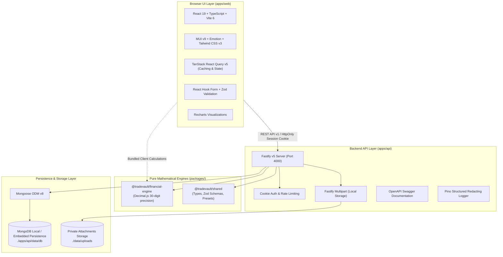
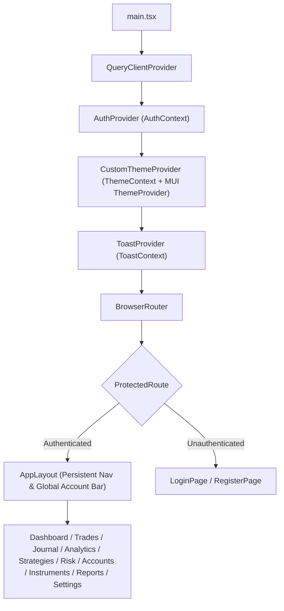
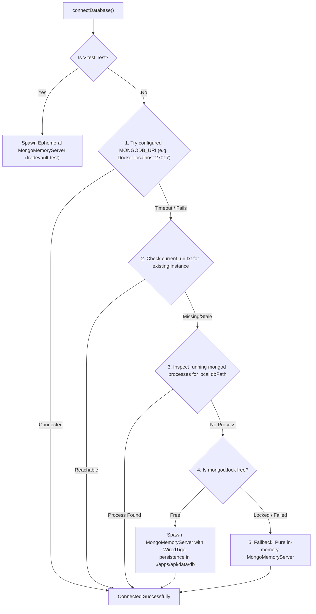

# SetupMint — Application Architecture Document

## 1. Executive Architecture Summary

SetupMint is architected as a **local-first, privacy-focused, TypeScript monorepo**. It is engineered to operate completely offline or in self-hosted environments with zero recurring third-party subscriptions, commercial UI kits, or external cloud databases.

---

## 2. Technology Stack Breakdown

| Layer | Technologies Selected | Rationale in Codebase |
| :--- | :--- | :--- |
| **Monorepo** | npm workspaces (`apps/*`, `packages/*`) | Zero overhead, native Node.js workspace protocol without heavy monorepo build tools. |
| **Frontend Framework** | React 19 (`@types/react` 19.0.10), Vite 6, TypeScript 5.7 | Modern concurrent React features, ultra-fast HMR, sub-second cold starts. |
| **UI Design System** | Material UI (MUI v9 / `@mui/material` 9.5.0), Emotion, Tailwind CSS v3 | Polished dark/light component library combined with flexible utility classes. |
| **Client State & Cache** | TanStack Query (`@tanstack/react-query` v5.66.7) | Declarative server-state caching, automatic background refetching, and query invalidation. |
| **Form Handling** | React Hook Form (`react-hook-form` 7.54.2), `@hookform/resolvers` | Performant uncontrolled inputs with zero unnecessary re-renders. |
| **Validation** | Zod (`zod` 3.24.2) | Shared runtime schema validation across frontend and backend. |
| **Charting** | Recharts (`recharts` 2.15.1) | Declarative SVG financial charts (equity curve, P&L distributions, weekday bars). |
| **Backend Server** | Fastify v5 (`fastify` 5.2.1), TypeScript, Node.js LTS (>=20.0.0) | High-performance asynchronous HTTP server with native schema compilation. |
| **Security & Headers** | `@fastify/helmet`, `@fastify/rate-limit`, `@fastify/cookie`, `bcryptjs` | Defense-in-depth, brute-force mitigation, HttpOnly SameSite cookie handling. |
| **File Uploads** | `@fastify/multipart` (10MB max limit) | Safe local streaming to disk with magic-bytes signature verification. |
| **Database & ODM** | MongoDB Community Server / `mongodb-memory-server` v10, Mongoose ODM v8 | Flexible document modeling, compound indexes, and Decimal128 exact monetary storage. |
| **Financial Engine** | `decimal.js` v10.5.0 | 30-digit precision arithmetic, eliminating IEEE-754 binary floating-point round-off errors. |
| **Testing** | Vitest (`vitest` 3.0.6) | Lightning-fast test runner sharing Vite configuration, 102 passing test cases. |

---

## 3. Frontend Architecture (`apps/web`)

### Architecture Pattern: Feature-Driven Layout with Context Providers
The frontend application bootstrap is located at [`src/main.tsx`](file:///Users/komal/projects/Trading%20Vault/apps/web/src/main.tsx) and [`src/App.tsx`](file:///Users/komal/projects/Trading%20Vault/apps/web/src/App.tsx).

### State Management Hierarchy
1. **Server State (TanStack Query):** Handles all asynchronous server data (`accounts`, `trades`, `dashboard-stats`, `journal-calendar`, `strategies`, `instruments`). All mutations trigger targeted query invalidation.
2. **Authentication State (`AuthContext`):** Verifies current session on mount via `api.auth.me()`. Exposes `user`, `loading`, `login()`, `register()`, and `logout()`.
3. **Theme State (`ThemeContext`):** Manages `dark`, `light`, or `system` modes. Synchronizes with MUI `createTheme` palette and persists to `localStorage`.
4. **Toast Notifications (`ToastContext`):** High-reliability custom toast notification system rendering animated notifications at the top-right of the viewport.
5. **Form State (`React Hook Form`):** Local state within forms (`TradeFormModal`, account modals, daily reviews), validated against shared Zod schemas.

---

## 4. Backend Architecture (`apps/api`)

### Fastify Architecture & Plugin System
The Fastify server is built using factory function `buildApp()` in [`src/server.ts`](file:///Users/komal/projects/Trading%20Vault/apps/api/src/server.ts):
- **CORS Configuration:** Binds to configured origins (`config.corsOrigin`, `http://localhost:5173`, `http://127.0.0.1:5173`) with `credentials: true`.
- **Cookie Support:** Secret-signed cookie session handling using `@fastify/cookie`.
- **Global Rate Limiting:** 1,200 requests per minute globally, with tighter limits (15 requests/minute) applied to sensitive authentication routes (`/register`, `/login`).
- **Multipart Uploads:** Max file size enforced at 10MB per attachment.
- **Empty JSON Body Parser:** Custom content type parser gracefully handling empty JSON bodies for POST/DELETE requests.
- **Centralized Error Handler:** Intercepts all errors, formats structured JSON responses, logs via Pino, and sanitizes 500 errors to prevent leaking stack traces.

### Routing Hierarchy
All routes are prefixed under `/api/v1/`:
- `/api/v1/auth` -> User registration, login, logout, profile
- `/api/v1/accounts` -> Account ledgers, transactions, reconciliation
- `/api/v1/instruments` -> Catalog presets and custom instruments
- `/api/v1/strategies` -> Strategy playbooks and performance aggregation
- `/api/v1/trades` -> Core trade CRUD, FIFO calculations, bulk operations
- `/api/v1/dashboard` -> Aggregated statistics and equity curve data
- `/api/v1/journal` -> Monthly calendar heatmaps and daily reviews
- `/api/v1/analytics` -> Psychology metrics, emotion/discipline correlation
- `/api/v1/risk` -> Position sizing calculator endpoint
- `/api/v1/attachments` -> Chart uploads and authenticated streaming
- `/api/v1/export` -> CSV/JSON exports and interactive CSV import
- `/api/v1/settings` -> Profile updates, password changes, system stats
- `/api/v1/integrations` -> Broker adapter configurations

---

## 5. Database Architecture & Resilient Connection Hierarchy

SetupMint uses **Mongoose ODM v8** with a multi-stage connection strategy in [`apps/api/src/db/connection.ts`](file:///Users/komal/projects/Trading%20Vault/apps/api/src/db/connection.ts) that allows the application to run out-of-the-box on a fresh machine without pre-installing MongoDB:

### Exact Monetary Persistence
All balances and cumulative ledger numbers in `TradingAccount` and `AccountTransaction` are stored using `mongoose.Schema.Types.Decimal128`. This guarantees that monetary amounts are persisted as exact 128-bit decimal floating points rather than IEEE-754 double floats.

---

## 6. Standalone Financial Engine (`@tradevault/financial-engine`)

The financial engine is an **independent, zero-dependency package** (apart from `decimal.js` and `@tradevault/shared`). It contains no DOM, React, or Fastify dependencies and runs identically in Node.js and the browser.

### Key Calculation Modules
1. **`pnl.ts`:** Deterministic linear gross and net P&L calculations.
2. **`fifo.ts`:** Strict FIFO queue matching for multi-fill executions (scale-ins and partial exits).
3. **`risk.ts`:** Risk budget sizing, stop-loss distance, loss per unit, lot size rounding, planned R:R, and realized R-multiples.
4. **`metrics.ts`:** Quantitative dashboard statistics: win rate, profit factor, expectancy, peak-to-trough drawdowns, consecutive streaks, and equity curves.
5. **`currency.ts`:** Strict currency conversion that refuses silent 1:1 conversions when exchange rates are unavailable.

---

## 7. Security Architecture & Threat Model

1. **HttpOnly SameSite Session Cookies:** Session tokens are stored in HttpOnly, SameSite `Lax` cookies, shielding authentication tokens from JavaScript XSS exfiltration.
2. **Strict Tenant Ownership Enforcement:** Every database query in every API route enforces `{ userId: req.user.id }`. A user can never read, modify, or delete another user's accounts, trades, or attachments.
3. **Magic-Bytes File Verification:** Attachment uploads are verified against their true binary file signatures (PNG `89 50 4E 47`, JPEG `FF D8 FF`, WebP `RIFF...WEBP`), preventing malicious disguised executables from being stored.
4. **Path Traversal Protection:** Uploaded files are renamed using server-generated UUIDs (`crypto.randomUUID() + ext`). The user-provided filename is never used on the filesystem.
5. **Structured Log Redaction:** Pino logger redacts `req.headers.cookie`, `req.headers.authorization`, `req.body.password`, and `req.body.token` in all environments.
