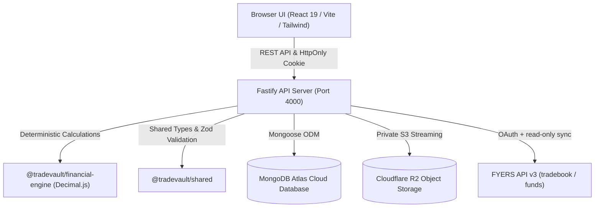

# SetupMint — System Architecture Document

## 1. Overview & Vision
SetupMint (monorepo name: `tradevault-monorepo`) is a local-first, privacy-respecting trading journal built for serious discretionary traders. It provides deterministic financial metrics, risk management, psychological discipline tracking, and multi-asset capabilities (Indian Stocks & Indices, F&O, MCX Commodities, Forex, and Crypto).

---

## 2. Monorepo Organization
The repository is managed as an npm workspace monorepo:

```
tradevault/
  apps/
    api/                     # Fastify v5 REST API with Mongoose ODM
    web/                     # React 19 + Vite + Tailwind CSS frontend
  packages/
    shared/                  # TypeScript types, constants, presets, and Zod validation schemas
    financial-engine/        # Standalone, 100% deterministic decimal calculation engine
  scripts/                   # Backup and restore utilities
  docs/                      # Architecture, calculations, licensing, and integration documentation
  data/                      # Private disk storage for local database and screenshot attachments
  docker-compose.yml         # Optional local MongoDB container setup
  .env.example               # Secure local environment defaults
  package.json               # Root monorepo configuration
  README.md                  # Comprehensive user and developer manual
```

---

## 3. High-Level System Architecture



---

## 4. Key Architectural Decisions

### A. Cloud-Only Architecture with Zero Fallbacks
- The application connects strictly to the user's dedicated MongoDB Atlas cluster and Cloudflare R2 private bucket.
- Fails fast on startup with clear errors if cloud credentials or network connectivity are missing.
- Private screenshot attachments are stored in private Cloudflare R2 buckets and served strictly through authenticated stream/download endpoints (`/api/v1/attachments/:id/stream`).

### B. Standalone Financial Engine
- Monetary numbers and R-multiples are calculated using `decimal.js` with 30-digit precision to avoid IEEE-754 floating-point inaccuracies.
- No React or DOM dependencies in the calculation engine; fully covered by independent Vitest test suites.

### C. Cloud MongoDB Persistence
- Connects exclusively to MongoDB Atlas (`mongodb+srv://...`).
- Single connection attempt with strict timeout and fail-fast termination. Local embedded and in-memory MongoDB fallbacks have been permanently removed from production code.

### D. Security & Ownership
- Session tokens are stored in HttpOnly, SameSite cookies.
- Passwords hashed using bcrypt.
- Every API endpoint enforces user ownership; users can never access or modify records belonging to another account.
