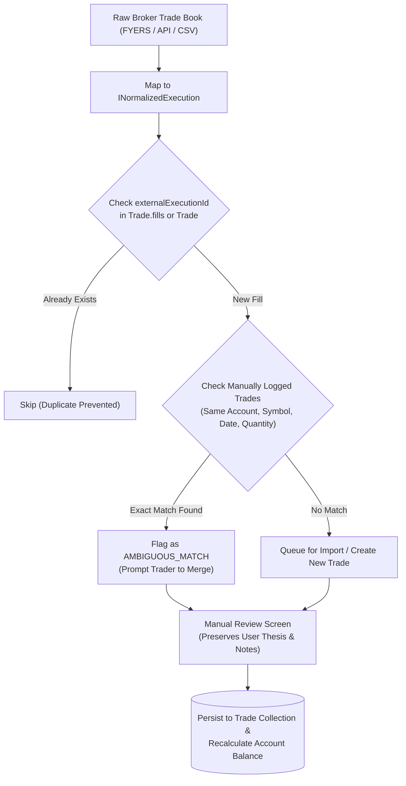

# SetupMint — Broker Integrations & FYERS Architecture

This document explains the broker integration architecture of **SetupMint**, focusing on the **FYERS API v3** integration model, data normalization schema, reconciliation engine, and the architectural decision to isolate live synchronization in the current release.

---

## 1. Architectural Strategy & Privacy Principle

SetupMint is engineered with a **local-first privacy architecture**:
1. Discretionary traders require complete privacy for their execution ledgers, position sizes, and trade setups.
2. Direct cloud broker connections often introduce third-party API instability, token expiry issues, and cloud vendor lock-in.
3. Therefore, in the initial production release of SetupMint, **automated live broker polling is intentionally isolated and disabled by default**.

The software is constructed with decoupled interfaces so that live FYERS API synchronization can be toggled on in future releases without modifying the core trading ledger, database schemas, or frontend pages.

---

## 2. Decoupled Abstraction Architecture

SetupMint isolates broker-specific logic through two shared interfaces in [`packages/shared/src/types.ts`](file:///Users/komal/projects/Trading%20Vault/packages/shared/src/types.ts#L496-L531):

### A. Broker Adapter Interface (`IBrokerAdapter`)
```typescript
export interface IBrokerAdapter {
  brokerName: 'FYERS';
  authenticate(authCode: string): Promise<{ accessToken: string; expiresAt: Date }>;
  fetchOrderHistory(startDate: Date, endDate: Date): Promise<INormalizedOrder[]>;
  fetchTradeExecutions(startDate: Date, endDate: Date): Promise<INormalizedExecution[]>;
  fetchPositions(): Promise<INormalizedPosition[]>;
}
```

### B. Normalized Execution Schema (`INormalizedExecution`)
An executed fill is fundamentally distinct from an order. An order can be cancelled, partially filled, or split across multiple exchange matching events. SetupMint normalizes all broker trade book records into `INormalizedExecution`:

```typescript
export interface INormalizedExecution {
  broker: 'FYERS';
  brokerTradeId: string;       // Unique trade identifier from exchange/broker
  brokerOrderId: string;       // Originating order ID
  symbol: string;              // Normalized symbol (e.g. "NIFTY")
  exchange: string;            // e.g. "NSE", "MCX"
  segment: string;             // "NSE_EQ", "NSE_FNO", "MCX"
  direction: 'LONG' | 'SHORT'; // Normalized direction
  price: number;               // Execution price
  quantity: number;            // Executed quantity
  timestamp: string;           // ISO execution timestamp
  orderType: string;           // "MARKET", "LIMIT", "SL-M"
  productType: string;         // "INTRADAY", "MARGIN", "CNC"
  rawPayload?: Record<string, any>; // Original broker payload for debugging
}
```

---

## 3. FYERS API v3 Integration Specification

### Required Configuration (Safe Placeholders)
To configure the future FYERS connection, the following environment and user settings are used:

```dotenv
# .env (Server-side broker integration configuration)
FYERS_APP_ID=<your-fyers-app-id>
FYERS_SECRET_KEY=<your-fyers-app-secret-key>
FYERS_REDIRECT_URI=http://127.0.0.1:4000/api/v1/integrations/fyers/callback
```

*Note: In compliance with security standards, actual client IDs, secrets, and auth tokens are never hardcoded or committed.*

### OAuth 2.0 Authentication Flow (Planned Implementation)
1. **App Registration:** The trader registers an application in the FYERS API Dashboard with redirect URL `http://127.0.0.1:4000/api/v1/integrations/fyers/callback`.
2. **Authorization Code:** User initiates login from SetupMint settings page; redirected to FYERS OAuth consent screen.
3. **Token Exchange:** FYERS redirects back with `auth_code`. The backend server exchanges `auth_code` with FYERS `/api/v3/validate-authcode` alongside SHA-256 hash of `appId + secretKey`.
4. **Credential Isolation:** The resulting `accessToken` is stored strictly in the database collection `BrokerIntegration` with an expiry timestamp (`authCodeExpiresAt`). Tokens are **never exposed to client browser bundles** or included in trade documents.

---

## 4. Reconciliation Engine & Idempotency Workflow

When broker synchronization is executed, incoming executions are processed through the **Reconciliation Engine**:



### Key Reconciliation Rules:
1. **Idempotency Key:** Checks `externalExecutionId` and `externalBrokerOrderRef` to ensure the same broker fill is never recorded twice.
2. **Ambiguity Resolution:** If a trader has already logged a trade manually with identical symbol, direction, and quantity on that date, the reconciler flags it as an ambiguous match rather than creating a duplicate entry.
3. **Preservation of Discretionary Context:** Merging a broker fill into an existing journal entry preserves the trader's pre-market bias, SMC confluences, emotion tags, and private chart screenshots.

---

## 5. Current Implementation Status vs. Future Work

| Feature | Current Implementation Status | Notes |
| :--- | :--- | :--- |
| **`BrokerAdapter` Abstraction** | **Implemented** | Defined in `@tradevault/shared` (`types.ts`). |
| **`NormalizedExecution` Schema** | **Implemented** | Strict schema in `@tradevault/shared`. |
| **`BrokerIntegration` Mongoose Model** | **Implemented** | Stores status (`DISABLED`, `IDLE`), `appId`, and sync history. |
| **Broker Config API** | **Implemented** | `GET /api/v1/integrations/fyers/status`, `POST /api/v1/integrations/fyers/config`. |
| **FYERS Settings UI** | **Implemented** | Located on [`SettingsPage.tsx`](file:///Users/komal/projects/Trading%20Vault/apps/web/src/pages/SettingsPage.tsx). |
| **Broker Charges Model** | **Implemented** | `IndianChargesCalculator` models FYERS flat ₹20/order fee schedule. |
| **Demo Broker Simulation** | **Implemented** | Seed Engine simulates realistic FYERS account numbers (`FY-89240`, `FY-OPT-771`) and sync logs. |
| **Live Webhook / OAuth Polling** | **Disabled by Design** | Isolated in v1.0 to ensure local offline operation without external network dependencies. |

---

## 6. Known API Volatility & Limitations of Broker APIs

1. **FYERS Daily Token Expiration:** Under current SEBI / Indian exchange regulations, broker API access tokens expire every 24 hours. Users must re-authenticate daily if live polling is enabled.
2. **Rate Limits:** FYERS API v3 imposes rate limits (typically 10 requests/second for historical orders and trade books).
3. **Execution Splitting:** A single market order of 500 shares may generate multiple fills at fractional microsecond differences; the FIFO reconciliation engine merges these into a single logical trade position.

---

## 7. Tradebook CSV Formats & Multi-Broker Import Mapping

SetupMint provides first-class support for importing historical tradebook CSV files from India's major discount and full-service brokers:

| Broker | Tradebook Identifier Headers | Direction Column | Execution Pricing | Supported Segments |
| :--- | :--- | :--- | :--- | :--- |
| **Zerodha** | `isin`, `trade_type`, `series`, `order_execution_time` | `trade_type` (`buy`/`sell`) | `price` | Equity, F&O, Currency, Commodity |
| **FYERS** | `trade no`, `order no`, `side`, `trade value` | `side` (`buy`/`sell` or `1`/`-1`) | `price` / `trade price` | Equity Cash, F&O, Commodities |
| **Angel One** | `scrip / contract`, `client code`, `net rate` | `buy/sell` | `rate` / `net rate` | NSE/BSE Equity, F&O, MCX |
| **Upstox** | `scrip`, `product`, `side` / `type`, `order no` | `side` (`BUY`/`SELL`) | `price` | Equity Intraday/Delivery, F&O |
| **Custom** | Heuristic matching (`Date`, `Symbol`, `Price`, `Qty`, `Exit`) | Direction or Side | Entry / Exit or Execution Rate | Any market or manual sheet |

### Smart Import Engine Workflow:
1. **Auto-Detection:** Inspects uploaded CSV headers and immediately identifies the originating broker.
2. **Saved User Mapping:** Loads the user's custom `BrokerImportMapping` configuration if previously saved, or provides broker-specific default mappings.
3. **FIFO Round-Trip Grouping:** Raw fills are chronologically ordered and matched into complete round-trip trades using `calculateFIFOExecution` in `@tradevault/financial-engine`.
4. **Auto-Charges:** Automatically calculates statutory exchange turnover fees, SEBI charges, stamp duty, STT/CTT, and GST via `IndianChargesCalculator`.
5. **Batch Undo:** Every import is tracked via `importBatchId` allowing 1-click batch reversal and balance re-reconciliation.
