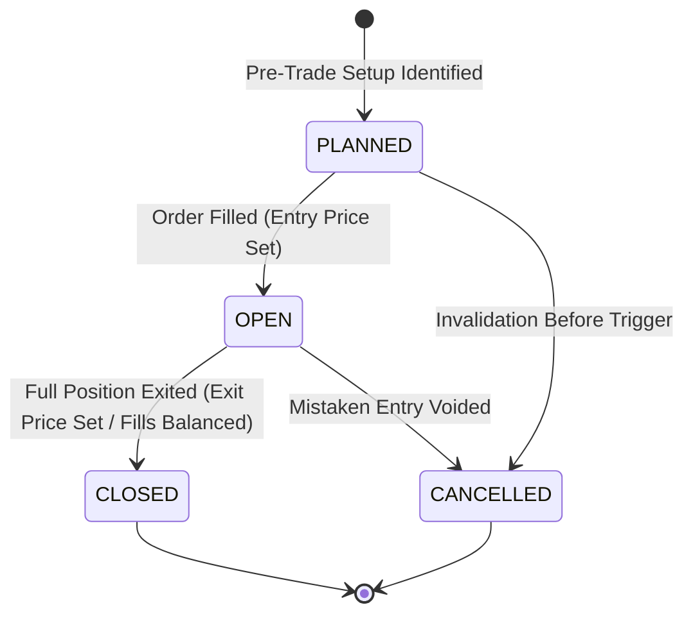

# SetupMint — Domain Business Logic Specification

This document details the core business logic, lifecycle states, domain rules, and domain invariants implemented in **SetupMint**.

---

## 1. Trade Lifecycle & Status Transitions

A trade in SetupMint progresses through a finite state machine:



### State Definitions
1. **`PLANNED`:** Setup identified with planned entry, initial stop-loss, and planned target. No actual monetary capital is committed. P&L is `0.00`. Outcome is marked as `OPEN`.
2. **`OPEN`:** Capital deployed. Entry price and quantity are established, but position remains unfilled on exit (or open lots remain in FIFO queue). Net P&L reflects unclosed holding; outcome is marked as `OPEN`.
3. **`CLOSED`:** Position completely exited. Net P&L is finalized, outcome is determined (`WIN`, `LOSS`, or `BREAKEVEN`), and account balance is authoritatively updated.
4. **`CANCELLED`:** Setup abandoned prior to entry or cancelled. Excluded from closed win rate and profit factor statistics.

---

## 2. Trade Outcome Classification Logic

Outcome classification is strictly deterministic and evaluated based on realized **Net P&L** (after deducting all brokerage, exchange fees, taxes, and statutory levies):

```typescript
// packages/financial-engine/src/pnl.ts
let outcome: TradeOutcome = 'BREAKEVEN';
if (netPnL.greaterThan(0)) {
  outcome = 'WIN';
} else if (netPnL.lessThan(0)) {
  outcome = 'LOSS';
}
```

- **WIN:** $\text{Net P&L} > 0.00$
- **LOSS:** $\text{Net P&L} < 0.00$
- **BREAKEVEN:** $\text{Net P&L} == 0.00$ (e.g. gross profit precisely offsets transaction fees).
- **OPEN:** Unfilled or partially closed without final exit fill.

---

## 3. Multi-Market Domain Logic & Instrument Specifications

SetupMint explicitly models the differing contract mechanisms across global asset classes:

### Multiplier & Lot Size Domain Rules
1. **Indian Equities (NSE/BSE Cash):**
   - Contract Multiplier = `1`
   - Lot Size = `1`
   - Tick Size = `0.05`
   - STT applied on sell-side turnover (0.025% intraday).
2. **Index Futures (NIFTY, BANKNIFTY, FINNIFTY):**
   - NIFTY: Lot Size `25`, Multiplier `1`, Tick Size `0.05`.
   - BANKNIFTY: Lot Size `15`, Multiplier `1`, Tick Size `0.05`.
   - FINNIFTY: Lot Size `25`, Multiplier `1`, Tick Size `0.05`.
   - Point value change = Points $\times$ Multiplier $\times$ Quantity.
3. **MCX Commodities (Physical multi-unit multiplier contracts):**
   - **CRUDEOIL:** Quoted per barrel; 1 lot = 100 barrels. Contract Multiplier = **`100`**. A ₹1 move in Crude equals ₹100 per lot.
   - **NATURALGAS:** Quoted per mmBtu; 1 lot = 1,250 mmBtu. Contract Multiplier = **`1250`**. A ₹1 move equals ₹1,250 per lot.
   - **GOLD (1KG):** Quoted per 10 grams. Contract Multiplier = **`1`** (relative to 100 base units per 1kg).
   - **COPPER:** Quoted per kg; 1 lot = 2,500 kg (2.5 MT). Contract Multiplier = **`2500`**. A ₹1 move equals ₹2,500 per lot.
4. **Forex & Crypto:**
   - EUR/USD: Pip precision 5 decimal places (`0.00001`), lot size `1,000`.
   - BTC/USDT: Lot size `0.001`, tick size `0.10`, quoted in USDT.

---

## 4. Position Sizing & Lot Rounding Domain Rules

When sizing a position in the risk calculator:
1. **Directional Invariant:**
   - For a `LONG` trade: Stop Loss **must** be strictly less than Entry Price ($P_{\text{stop}} < P_{\text{entry}}$). Target must be greater than Entry ($P_{\text{target}} > P_{\text{entry}}$).
   - For a `SHORT` trade: Stop Loss **must** be strictly greater than Entry Price ($P_{\text{stop}} > P_{\text{entry}}$). Target must be less than Entry ($P_{\text{target}} < P_{\text{entry}}$).
2. **Zero Stop Invariant:** If Stop Loss equals Entry Price, calculation halts with an explicit error warning.
3. **Lot Rounding Down Rule:** To prevent risking more than the user's maximum risk budget, raw suggested quantity is **floored** to the nearest integer multiple of `lotSize` or `quantityIncrement`:
   $$\text{Rounded Quantity} = \left\lfloor \frac{\text{Raw Suggested Quantity}}{\text{Lot Step}} \right\rfloor \times \text{Lot Step}$$
   *Rule:* SetupMint **never rounds up** because rounding up would cause the monetary loss at stop to exceed the trader's predefined risk budget.
4. **Minimum Lot Capital Alert:** If the rounded quantity equals `0` but the raw suggested quantity is greater than zero, the system raises a risk alert indicating that a single minimum lot would exceed the risk budget.

---

## 5. Psychology & Discipline Tracking Domain Logic

Discretionary trading performance is heavily determined by psychological discipline. SetupMint codifies behavioral metrics:

### Discrete Mistake Tags & Impact Quantification
SetupMint tracks five specific costly behavioral mistakes:
1. **`REVENGE_TRADING`:** Taking an unplanned emotional trade immediately after a loss to "win back" capital.
2. **`OVERTRADING`:** Executing trades outside playbook rules or beyond daily maximum limits.
3. **`PREMATURE_EXIT`:** Closing a winning trade out of fear before it reaches the planned target without technical invalidation.
4. **`STOP_MOVED`:** Widening or cancelling a stop-loss order during an adverse move.
5. **`SIZE_VIOLATION`:** Trading significantly larger lot sizes than allowed by account equity risk parameters.

The system calculates **Cumulative Mistake Loss**:
$$\text{Total Loss}_{\text{mistake}} = \sum_{t \in \text{Trades with Mistake Flag}} |\text{Net P&L}_t| \quad (\text{for } \text{Net P&L} < 0)$$

### Rule Adherence Percentage
$$\text{Rule Adherence \%} = \frac{\text{Closed Trades where } \text{rulesFollowed} == \text{true}}{\text{Total Closed Trades}} \times 100$$

---

## 6. Daily Session Reflection Rules

1. **One Journal per User per Date:** Daily journal reflections are uniquely indexed by `{ userId: 1, date: 1 }`. Saving a review for an existing date performs an upsert rather than creating duplicate entries.
2. **Date Format:** Stored strictly as a `YYYY-MM-DD` ISO date string (e.g. `"2026-10-18"`), eliminating UTC time zone day-shift errors.
3. **Trade Cross-Referencing:** A daily reflection entry can link directly to the user's `bestTradeId` and `worstTradeId` from that session.

---

## 7. Account Balance Consistency Invariants

The core ledger architecture enforces that **the database is the authoritative single source of truth**:
1. Account balance is never altered via unverified client-side increment or decrement operations.
2. Every trade addition, modification, deletion, or CSV import invokes:
   ```typescript
   await AccountService.recalculateAccountBalances(accountId, userId);
   ```
3. Balance reconciliation executes a clean aggregate query over all closed trade net P&Ls and cash transactions:
   $$\text{Current Balance} = \text{Initial Balance} + \sum \text{Closed Trade Net P&L} + \sum \text{Deposits} - \sum \text{Withdrawals} + \sum \text{Adjustments}$$
4. If an account has existing trades, deletion is prohibited and the account is automatically shifted to `status: 'ARCHIVED'`.

---

## 8. CSV Import, Broker Format Detection & FIFO Grouping Logic

1. **Broker Tradebook Auto-Detection:**
   The preview engine inspects uploaded CSV headers using signature heuristic patterns:
   - **Zerodha (Console / Kite):** Detects `isin`, `trade_type`, `series`, or `order_execution_time`. Default mapping maps `trade_type` -> direction, `quantity` -> quantity, `price` -> price, `trade_date` -> tradeDate.
   - **FYERS (Tradebook):** Detects `trade no` / `tradeno`, `order no`, `side`, and `trade value`. Maps `side` -> direction, `qty` -> quantity, `trade date` -> tradeDate.
   - **Angel One:** Detects `scrip / contract`, `client code`, `net rate`. Maps `buy/sell` -> direction, `rate` -> price, `trade date` -> tradeDate.
   - **Upstox:** Detects `scrip`, `product`, `side` / `type`. Maps `side` -> direction, `price` -> price, `date` -> tradeDate.
   - **Custom / Generic:** Flexible regex matching supporting both completed trade sheets (with `entryPrice` + `exitPrice`) and raw execution logs.

2. **Saved User Column Mappings:**
   - Saved in `BrokerImportMapping` (`userId`-scoped, unique per `userId+broker`).
   - When a broker tradebook is detected, any saved mapping for that broker is automatically retrieved and applied; users can customize and save mappings per broker.

3. **FIFO Round-Trip Execution Grouping (Advanced Mode):**
   - When importing raw broker execution fills (one row per BUY/SELL order):
     1. Raw fills are chronologically ordered per symbol.
     2. An initial BUY fill establishes a `LONG` trade; an initial SELL fill establishes a `SHORT` trade.
     3. Subsequent fills on the same side scale into the position (`type: 'ENTRY'`).
     4. Opposite-side fills exit open lots (`type: 'EXIT'`). When open lots reach zero, the round-trip trade is closed.
     5. If an exit fill exceeds the open quantity, the position is split: the open lots close the current trade, and the remainder opens a new trade in the reversed direction.
     6. Fills are matched and evaluated via `calculateFIFOExecution()` in `@tradevault/financial-engine`.

4. **Automated Regulatory Fee Calculation:**
   - Statutory Indian transaction charges are computed via `IndianChargesCalculator.calculate()` (Decimal.js 30-digit precision) based on asset class (`EQUITY`, `FUTURES`, `OPTIONS`, `MCX`), broker flat fee, and turnover.
   - Fees are populated into `brokerage`, `exchangeFees`, `regulatoryFees`, and `taxes`.

5. **Duplicate Prevention Invariant:**
   - Before inserting imported trades, the system queries:
     ```typescript
     await Trade.findOne({
       userId,
       accountId,
       symbol,
       tradeDate,
       'calculated.averageEntryPrice': avgEntry,
       'calculated.closedQuantity': closedQty,
     });
     ```
   - Matches are counted as duplicates and safely skipped without re-inflating account balances.

6. **Batch Undo Invariant:**
   - Every imported batch generates a unique `importBatchId` (e.g. `batch_<timestamp>_<rand>`) stamped on all created trades and recorded in their audit logs.
   - The user can undo any batch via `POST /api/v1/export/import/undo`. Undoing deletes all trades associated with that `importBatchId` and triggers `AccountService.recalculateAccountBalances(accountId, userId)` for all affected accounts.

---

## 9. Fast Entry & Quick Close Domain Rules

1. **Quick Close Lifecycle Transition:**
   - Any trade in `OPEN` or `PLANNED` status can be closed via the Quick Close action on `/trades` or `/trades/:id`.
   - The Quick Close action reuses `PUT /api/v1/trades/:id` accepting a partial `simpleExecution` payload containing `exitPrice` and optional fee adjustments.
   - The server merges the partial execution with the trade's existing `entryPrice`, `quantity`, and `contractMultiplier`.
2. **Authoritative Closure Calculations:**
   - Net realized P&L is re-evaluated by passing the merged execution details through `@tradevault/financial-engine`.
   - The trade status shifts to `CLOSED`, and the outcome is classified as `WIN`, `LOSS`, or `BREAKEVEN`.
3. **Audit Log & Balance Re-Aggregation:**
   - Every quick closure appends an immutable audit entry to `Trade.auditLog`:
     ```typescript
     {
       action: 'CLOSED',
       timestamp: new Date(),
       changedBy: req.user.email,
       details: { oldNetPnL, newNetPnL: newCalculated.netPnL, exitPrice }
     }
     ```
   - Immediately following trade persistence, `AccountService.recalculateAccountBalances(accountId, userId)` is executed to maintain strict balance consistency.

---

## 10. Strategy Playbook Adherence & Minimum R:R Validation

1. **Playbook Confluences Inheritance:**
   - Selecting a strategy in `TradeFormModal` automatically pre-fills the trade's `thesis.confluences` with the strategy's predefined `checklist` and `entryRules`.
   - Sets `psychology.checklistCompleted` to `true` by default.
2. **Minimum Reward-to-Risk Rule Enforcement:**
   - When planned entry price ($P_{\text{entry}}$), initial stop loss ($P_{\text{stop}}$), and target price ($P_{\text{target}}$) are supplied:
     $$\text{Planned R:R} = \frac{|P_{\text{target}} - P_{\text{entry}}|}{|P_{\text{entry}} - P_{\text{stop}}|}$$
   - If $\text{Planned R:R} < \text{Strategy.minRiskReward}$, the system generates an explicit warning banner:
     $$\text{Warning: Planned R:R is below the required minimum of } 1:\text{minRiskReward for strategy } \text{Name.}$$
   - This warning guides the trader prior to submitting the trade setup while preserving full discretionary execution flexibility.
