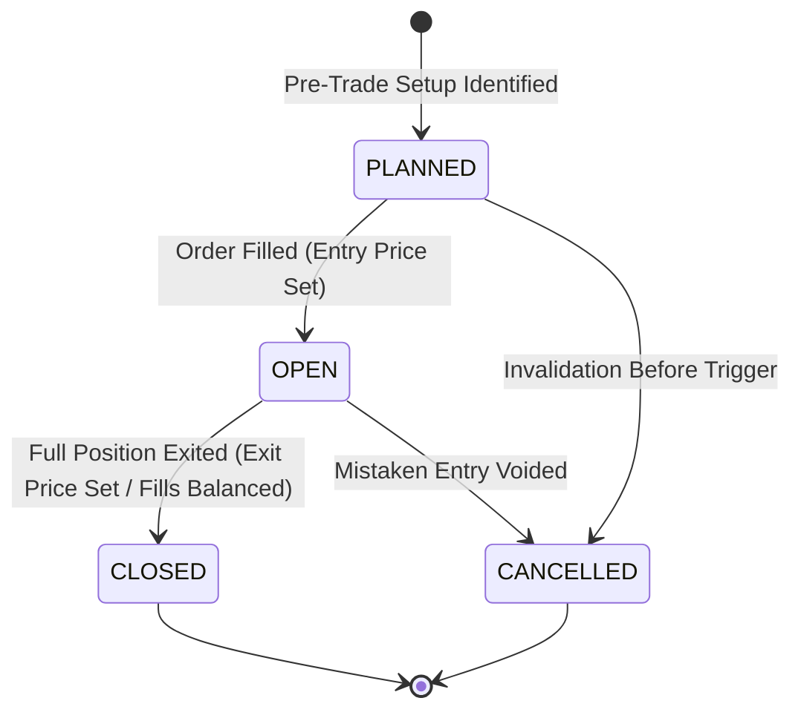

# SetupMint — Domain Business Logic Specification

This document details the core business logic, lifecycle states, domain rules, and domain invariants implemented in **SetupMint**.

---

## 1. Trade Lifecycle & Status Transitions

A trade in SetupMint progresses through a finite state machine:



### State Definitions
1. **`PLANNED`:** Setup identified with planned entry, initial stop-loss, and planned target. No actual monetary capital is committed. P&L is `0.00`. Outcome is marked as `OPEN`.
2. **`OPEN`:** Capital deployed. Entry price and quantity are established, but position remains unfilled on exit (or open lots remain in FIFO queue). Net P&L reflects unclosed holding; outcome is marked as `OPEN`.
3. **`CLOSED`:** Position completely exited. Net P&L is finalized, outcome is determined (`WIN`, `LOSS`, or `BREAKEVEN`), and account balance is authoritatively updated.
4. **`CANCELLED`:** Setup abandoned prior to entry or cancelled. Excluded from closed win rate and profit factor statistics.

---

## 2. Trade Outcome Classification Logic

Outcome classification is strictly deterministic and evaluated based on realized **Net P&L** (after deducting all brokerage, exchange fees, taxes, and statutory levies):

```typescript
// packages/financial-engine/src/pnl.ts
let outcome: TradeOutcome = 'BREAKEVEN';
if (netPnL.greaterThan(0)) {
  outcome = 'WIN';
} else if (netPnL.lessThan(0)) {
  outcome = 'LOSS';
}
```

- **WIN:** $\text{Net P&L} > 0.00$
- **LOSS:** $\text{Net P&L} < 0.00$
- **BREAKEVEN:** $\text{Net P&L} == 0.00$ (e.g. gross profit precisely offsets transaction fees).
- **OPEN:** Unfilled or partially closed without final exit fill.

---

## 3. Multi-Market Domain Logic & Instrument Specifications

SetupMint explicitly models the differing contract mechanisms across global asset classes, adhering to strict user ownership and underlying normalization:

### Underlying Normalization & One-Instrument-Per-Underlying Rule
1. **One Instrument Per Underlying:**
   - Instruments represent the root tradable asset (e.g., `NIFTY`, `BANKNIFTY`, `CRUDEOIL`, `RELIANCE`).
   - Derivative option contracts (strikes like `24500`, expiries like `2024-10-31`, and types `CE`/`PE`) belong to the **trade** entity (`trade.strikePrice`, `trade.expiryDate`, `trade.optionType`), **never** as separate instruments. Both `NIFTY 24500 CE` and `NIFTY 24000 PE` point to the single instrument `NIFTY`.
2. **Deterministic Symbol Normalization (`normalizeUnderlying`):**
   - Strips exchange prefixes (`NSE:`, `MCX:`, `BSE:`) and option suffixes (`24500CE`, `24500 PE`, `24OCT24500CE`, etc.).
   - Matches known market underlyings (`NIFTY`, `BANKNIFTY`, `FINNIFTY`, `MIDCPNIFTY`, `SENSEX`, `BANKEX`, `CRUDEOIL`, `NATURALGAS`, `GOLD`, `SILVER`, `COPPER`, `EURUSD`, `BTCUSDT`, etc.).
3. **Automatic Discovery on First Trade (`source: 'AUTO'`):**
   - The instruments collection contains **only** instruments the user has traded or custom created (`source: 'AUTO' | 'CUSTOM'`).
   - Logging or importing a trade with an unseen underlying automatically registers the instrument for the user.
   - If the symbol matches a known preset spec, default multiplier/lot/tick values are populated and `needsReview: false`. If unknown, fallback defaults are assigned (lot: 1, multiplier: 1, tick: 0.05) and `needsReview: true` is flagged for user confirmation.
4. **Specification Cascade Updates & Authoritative Balance Reconciliation:**
   - When an instrument's specifications (`contractMultiplier`, `lotSize`, `tickSize`) are updated:
     - The user can preview the financial impact (`POST /api/v1/instruments/:id/preview-update`), which calculates the number of affected closed trades and the exact net P&L delta using `decimal.js`.
     - When applied (`applyToTrades: true`), all trades referencing the instrument are recalculated via `@tradevault/financial-engine`, updating gross P&L, net P&L, R-multiple, and ROI.
     - Affected user accounts have their balances authoritatively recalculated (`AccountService.recalculateAccountBalances()`) within a single database transaction.
5. **Deletion Invariant:**
   - An instrument cannot be deleted if any trades reference its `instrumentId`. The API returns a `409 Conflict` error to prevent orphaned executions or corrupted trade calculations.

### Multiplier & Lot Size Domain Rules
1. **Indian Equities (NSE/BSE Cash):**
   - Contract Multiplier = `1`
   - Lot Size = `1`
   - Tick Size = `0.05`
   - STT applied on sell-side turnover (0.025% intraday).
2. **Index Futures & Options Underlyings (NIFTY, BANKNIFTY, FINNIFTY, MIDCPNIFTY, SENSEX, BANKEX):**
   - NIFTY: Lot Size `25` (or current exchange lot), Multiplier `1`, Tick Size `0.05`.
   - BANKNIFTY: Lot Size `15`, Multiplier `1`, Tick Size `0.05`.
   - FINNIFTY: Lot Size `25`, Multiplier `1`, Tick Size `0.05`.
   - MIDCPNIFTY: Lot Size `50`, Multiplier `1`, Tick Size `0.05`.
   - SENSEX: Lot Size `10`, Multiplier `1`, Tick Size `0.05`.
   - BANKEX: Lot Size `15`, Multiplier `1`, Tick Size `0.05`.
   - Point value change = Points $\times$ Multiplier $\times$ Quantity.
3. **MCX Commodities (Physical multi-unit multiplier contracts):**
   - **CRUDEOIL:** Quoted per barrel; 1 lot = 100 barrels. Contract Multiplier = **`100`**. A ₹1 move in Crude equals ₹100 per lot.
   - **NATURALGAS:** Quoted per mmBtu; 1 lot = 1,250 mmBtu. Contract Multiplier = **`1250`**. A ₹1 move equals ₹1,250 per lot.
   - **GOLD (1KG):** Quoted per 10 grams. Contract Multiplier = **`1`** (relative to 100 base units per 1kg).
   - **SILVER:** Quoted per kg; 1 lot = 30 kg. Contract Multiplier = **`30`**.
   - **COPPER:** Quoted per kg; 1 lot = 2,500 kg (2.5 MT). Contract Multiplier = **`2500`**. A ₹1 move equals ₹2,500 per lot.
4. **Forex & Crypto:**
   - EUR/USD: Pip precision 5 decimal places (`0.00001`), lot size `1,000`.
   - BTC/USDT: Lot size `0.001`, tick size `0.10`, quoted in USDT.


---

## 4. Position Sizing & Lot Rounding Domain Rules

When sizing a position in the risk calculator:
1. **Directional Invariant:**
   - For a `LONG` trade: Stop Loss **must** be strictly less than Entry Price ($P_{\text{stop}} < P_{\text{entry}}$). Target must be greater than Entry ($P_{\text{target}} > P_{\text{entry}}$).
   - For a `SHORT` trade: Stop Loss **must** be strictly greater than Entry Price ($P_{\text{stop}} > P_{\text{entry}}$). Target must be less than Entry ($P_{\text{target}} < P_{\text{entry}}$).
2. **Zero Stop Invariant:** If Stop Loss equals Entry Price, calculation halts with an explicit error warning.
3. **Lot Rounding Down Rule:** To prevent risking more than the user's maximum risk budget, raw suggested quantity is **floored** to the nearest integer multiple of `lotSize` or `quantityIncrement`:
   $$\text{Rounded Quantity} = \left\lfloor \frac{\text{Raw Suggested Quantity}}{\text{Lot Step}} \right\rfloor \times \text{Lot Step}$$
   *Rule:* SetupMint **never rounds up** because rounding up would cause the monetary loss at stop to exceed the trader's predefined risk budget.
4. **Minimum Lot Capital Alert:** If the rounded quantity equals `0` but the raw suggested quantity is greater than zero, the system raises a risk alert indicating that a single minimum lot would exceed the risk budget.

---

## 5. Psychology & Discipline Tracking Domain Logic

Discretionary trading performance is heavily determined by psychological discipline. SetupMint codifies behavioral metrics:

### Discrete Mistake Tags & Impact Quantification
SetupMint tracks 29 discrete behavioral and technical mistake tags grouped into four domain categories with human-readable labels:

1. **Liquidity / Level Mistakes (`LIQUIDITY_LEVEL`):**
   - `ENTERED_BEFORE_SWEEP`: Entered before liquidity sweep
   - `NO_LIQUIDITY_TAKEN`: No liquidity taken before entry
   - `NO_CONFIRMATION_AFTER_SWEEP`: No confirmation after sweep
   - `TRADED_INTO_HTF_LEVEL`: Traded directly into HTF level
   - `TRADED_MID_RANGE`: Traded mid-range / no edge
   - `STOP_INSIDE_LIQUIDITY_POOL`: Stop placed inside liquidity pool
   - `STOP_TOO_TIGHT`: Stop loss too tight
   - `TARGET_NOT_AT_LIQUIDITY`: Target not at liquidity pool
   - `NO_LIQUIDITY_TARGET`: Missing liquidity target
   - `IGNORED_HTF_BIAS`: Ignored higher timeframe bias
   - `COUNTER_TREND_NO_SWEEP`: Counter-trend without sweep
   - `FAKE_BREAKOUT_CHASE`: Chased fake breakout

2. **Execution / Timing Mistakes (`EXECUTION_TIMING`):**
   - `EARLY_ENTRY`: Early entry / jumped gun
   - `LATE_ENTRY`: Late entry / missed optimal price
   - `FOMO_ENTRY`: FOMO entry
   - `CHASED_MARKET`: Chased market after move started
   - `PREMATURE_EXIT`: Premature exit / cut winner early
   - `BREAKEVEN_TOO_EARLY`: Moved to breakeven too early

3. **Risk & Discipline Mistakes (`RISK_DISCIPLINE`):**
   - `STOP_MOVED`: Stop loss moved / widened. Automatically detected via Rule J when orderbook stop modifications expand downside capital risk (`widenedCount > 0` or `netRiskChangePoints > 0`). Automatically tags `STOP_MOVED` with `CRITICAL` severity and marks `psychology.stopLossMoved = true`. Favorable trailing stops are recognized as disciplined trade management (`TRAILED_FAVORABLY`) and never penalized.
   - `SIZE_VIOLATION`: Position size too large
   - `ADDED_TO_LOSER`: Added to losing position
   - `REVENGE_TRADING`: Revenge trading after loss
   - `OVERTRADING`: Overtrading / too many trades

4. **Session / Context Mistakes (`SESSION_CONTEXT`):**
   - `TRADED_OUTSIDE_SESSION`: Traded outside core session
   - `TRADED_NEWS_EVENT`: Traded into high-impact news

The system calculates **Cumulative Mistake Loss**:
$$\text{Total Loss}_{\text{mistake}} = \sum_{t \in \text{Trades with Mistake Flag}} |\text{Net P&L}_t| \quad (\text{for } \text{Net P&L} < 0)$$

### Reusable Liquidity Rule Checklist & Adherence Metric
SetupMint defines a standardized 10-point `LIQUIDITY_RULE_CHECKLIST` used across Strategy Playbooks and Trade Psychology:
1. HTF bias identified and trade aligned with it
2. Key liquidity pool marked (equal highs/lows, PDH/PDL, session high/low)
3. Liquidity was actually swept (wick beyond the level)
4. Price reclaimed / rejected the level (no acceptance beyond it)
5. LTF confirmation (CHOCH / MSS / displacement) after the sweep
6. Entry at a valid zone (OB / FVG / S-R flip / demand-supply)
7. Stop placed beyond the sweep wick, NOT inside a liquidity pool
8. Target set at the next opposing liquidity pool or key level
9. Planned R:R meets strategy minimum
10. Inside valid session / no high-impact news conflict

In the Trade Psychology tab, an interactive adherence tracker displays **"Rules Followed: X / 10"** with dynamic color badges (green $\ge 8$, amber $5-7$, red $< 5$).

### Rule Adherence Percentage
$$\text{Rule Adherence \%} = \frac{\text{Closed Trades where } \text{rulesFollowed} == \text{true}}{\text{Total Closed Trades}} \times 100$$

---

## 6. Daily Session Reflection Rules

1. **One Journal per User per Date:** Daily journal reflections are uniquely indexed by `{ userId: 1, date: 1 }`. Saving a review for an existing date performs an upsert rather than creating duplicate entries.
2. **Date Format:** Stored strictly as a `YYYY-MM-DD` ISO date string (e.g. `"2026-10-18"`), eliminating UTC time zone day-shift errors.
3. **Trade Cross-Referencing:** A daily reflection entry can link directly to the user's `bestTradeId` and `worstTradeId` from that session.

---

## 7. Account Balance Consistency Invariants

The core ledger architecture enforces that **the database is the authoritative single source of truth**:
1. Account balance is never altered via unverified client-side increment or decrement operations.
2. Every trade addition, modification, deletion, or CSV import invokes:
   ```typescript
   await AccountService.recalculateAccountBalances(accountId, userId);
   ```
3. Balance reconciliation executes a clean aggregate query over all closed trade net P&Ls and cash transactions:
   $$\text{Current Balance} = \text{Initial Balance} + \sum \text{Closed Trade Net P\&L} + \sum \text{Deposits} - \sum \text{Withdrawals} + \sum \text{Confirmed Adjustments}$$
4. If an account has existing trades, deletion is prohibited and the account is automatically shifted to `status: 'ARCHIVED'`.

---

## 8. CSV Import, Broker Format Detection & FIFO Grouping Logic

1. **Broker Tradebook Auto-Detection:**
   The preview engine inspects uploaded CSV headers using signature heuristic patterns:
   - **Zerodha (Console / Kite):** Detects `isin`, `trade_type`, `series`, or `order_execution_time`. Default mapping maps `trade_type` -> direction, `quantity` -> quantity, `price` -> price, `trade_date` -> tradeDate.
   - **FYERS (Tradebook):** Detects `trade no` / `tradeno`, `order no`, `side`, and `trade value`. Maps `side` -> direction, `qty` -> quantity, `trade date` -> tradeDate.
   - **Angel One:** Detects `scrip / contract`, `client code`, `net rate`. Maps `buy/sell` -> direction, `rate` -> price, `trade date` -> tradeDate.
   - **Upstox:** Detects `scrip`, `product`, `side` / `type`. Maps `side` -> direction, `price` -> price, `date` -> tradeDate.
   - **Custom / Generic:** Flexible regex matching supporting both completed trade sheets (with `entryPrice` + `exitPrice`) and raw execution logs.

2. **Saved User Column Mappings:**
   - Saved in `BrokerImportMapping` (`userId`-scoped, unique per `userId+broker+importKind`), so tradebook and cash-ledger mappings are independent.
   - When a broker tradebook is detected, any saved mapping for that broker is automatically retrieved and applied; users can customize and save mappings per broker.

3. **FIFO Round-Trip Execution Grouping (Advanced Mode):**
   - When importing raw broker execution fills (one row per BUY/SELL order):
     1. Raw fills are chronologically ordered per symbol.
     2. An initial BUY fill establishes a `LONG` trade; an initial SELL fill establishes a `SHORT` trade.
     3. Subsequent fills on the same side scale into the position (`type: 'ENTRY'`).
     4. Opposite-side fills exit open lots (`type: 'EXIT'`). When open lots reach zero, the round-trip trade is closed.
     5. If an exit fill exceeds the open quantity, the position is split: the open lots close the current trade, and the remainder opens a new trade in the reversed direction.
     6. Fills are matched and evaluated via `calculateFIFOExecution()` in `@tradevault/financial-engine`.

4. **Automated Regulatory Fee Calculation:**
   - Statutory Indian transaction charges are computed via `IndianChargesCalculator.calculate()` (Decimal.js 30-digit precision) based on asset class (`EQUITY`, `FUTURES`, `OPTIONS`, `MCX`), broker flat fee, and turnover.
   - Fees are populated into `brokerage`, `exchangeFees`, `regulatoryFees`, and `taxes`.

5. **Duplicate Prevention Invariant:**
   - Before inserting imported trades, the system queries:
     ```typescript
     await Trade.findOne({
       userId,
       accountId,
       symbol,
       tradeDate,
       'calculated.averageEntryPrice': avgEntry,
       'calculated.closedQuantity': closedQty,
     });
     ```
   - Matches are counted as duplicates and safely skipped without re-inflating account balances.

6. **Batch Undo Invariant:**
   - Every imported batch generates a unique `importBatchId` (e.g. `batch_<timestamp>_<rand>`) stamped on all created trades and recorded in their audit logs.
   - The user can undo any batch via `POST /api/v1/export/import/undo`. Undoing deletes all trades associated with that `importBatchId` and triggers `AccountService.recalculateAccountBalances(accountId, userId)` for all affected accounts.

---

## 9. Fast Entry & Quick Close Domain Rules

1. **Quick Close Lifecycle Transition:**
   - Any trade in `OPEN` or `PLANNED` status can be closed via the Quick Close action on `/trades` or `/trades/:id`.
   - The Quick Close action reuses `PUT /api/v1/trades/:id` accepting a partial `simpleExecution` payload containing `exitPrice` and optional fee adjustments.
   - The server merges the partial execution with the trade's existing `entryPrice`, `quantity`, and `contractMultiplier`.
2. **Authoritative Closure Calculations:**
   - Net realized P&L is re-evaluated by passing the merged execution details through `@tradevault/financial-engine`.
   - The trade status shifts to `CLOSED`, and the outcome is classified as `WIN`, `LOSS`, or `BREAKEVEN`.
3. **Audit Log & Balance Re-Aggregation:**
   - Every quick closure appends an immutable audit entry to `Trade.auditLog`:
     ```typescript
     {
       action: 'CLOSED',
       timestamp: new Date(),
       changedBy: req.user.email,
       details: { oldNetPnL, newNetPnL: newCalculated.netPnL, exitPrice }
     }
     ```
   - Immediately following trade persistence, `AccountService.recalculateAccountBalances(accountId, userId)` is executed to maintain strict balance consistency.

---

## 10. Strategy Playbook Adherence & Minimum R:R Validation

1. **Playbook Confluences Inheritance:**
   - Selecting a strategy in `TradeFormModal` automatically pre-fills the trade's `thesis.confluences` with the strategy's predefined `checklist` and `entryRules`.
   - Sets `psychology.checklistCompleted` to `true` by default.
2. **Minimum Reward-to-Risk Rule Enforcement:**
   - When planned entry price ($P_{\text{entry}}$), initial stop loss ($P_{\text{stop}}$), and target price ($P_{\text{target}}$) are supplied:
     $$\text{Planned R:R} = \frac{|P_{\text{target}} - P_{\text{entry}}|}{|P_{\text{entry}} - P_{\text{stop}}|}$$
   - If $\text{Planned R:R} < \text{Strategy.minRiskReward}$, the system generates an explicit warning banner:
     $$\text{Warning: Planned R:R is below the required minimum of } 1:\text{minRiskReward for strategy } \text{Name.}$$
   - This warning guides the trader prior to submitting the trade setup while preserving full discretionary execution flexibility.

---

## 11. Daily Review Queue, Rule-Based Mistake Detection & Discipline Scoring

### 1. Review Queue Qualification Criteria
A trade enters the user's **Daily Review Queue** (`GET /api/v1/review/queue`) if any of the following review criteria are unmet:
- **Missing Exit:** Status is `OPEN` or exit price/time is absent.
- **Missing Psychology / Reflection:** Closed trade lacking emotional state (`emotionBefore`, `emotionAfter`), notes, or mistake tags.
- **Missing Chart Screenshots:** Closed trade having zero linked attachments in Cloudflare R2 object storage.
- **Ambiguous Stop Loss (`SL_AMBIGUOUS`):** Trade where broker orderbook sync identified multiple conflicting stop-loss candidate orders without a unique match. To prevent inaccurate risk assumptions, the stop loss is NOT auto-applied; the trade is flagged with `"SL ambiguous - confirm"` for the trader to verify or adjust.
- **Unreviewed Trading Days:** Any date in the previous 30 calendar days that had executed trades but has no persisted `DailyJournal` reflection.

### 2. Rule-Based Mistake Suggestions (Never Auto-Applied)
Heuristic detections run inside `@tradevault/financial-engine` (`detectMistakeSuggestions`) and suggest tags to the trader without altering underlying records:

1. **Revenge Trading (`REVENGE_TRADING`):**
   - Triggered when a new trade is entered within $N$ minutes (`revengeTradingMinutes`, default 30 min) of a preceding closed trade that resulted in a net loss ($\text{netPnL} < 0$), where the new trade's position size or monetary exposure is equal to or larger than the losing trade:
     $$\Delta t = t_{\text{entry, new}} - t_{\text{exit, loss}} \le \text{revengeTradingMinutes} \quad \text{AND} \quad \text{Qty}_{\text{new}} \ge \text{Qty}_{\text{loss}}$$
   - Flagged with `CRITICAL` severity advising cooling off.

2. **Overtrading (`OVERTRADING`):**
   - **Daily Trade Cap:** Total trades executed on a calendar date exceeds the user-configured cap (`maxDailyTrades`, default 6):
     $$\text{DayTradesCount} > \text{maxDailyTrades}$$
   - **Concurrent Position Cap:** Concurrent open positions at entry time exceeds `maxOpenTrades` (default 3).

3. **Position Sizing Violation (`SIZE_VIOLATION`):**
   - Planned risk percentage or monetary risk as a percentage of account equity exceeds the maximum allowed limit (`maxRiskPerTradePercent`, default 2.0%):
     $$\text{ActualRiskPercent} > \text{maxRiskPerTradePercent}$$

4. **Max Daily Loss Breach:**
   - Evaluated across closed trades for the day. If accumulated net loss meets or exceeds `maxDailyLoss`:
     $$\left|\sum \text{NetPnL}_{\text{closed, today}}\right| \ge \text{maxDailyLoss} \quad (\text{NetPnL} < 0)$$
   - Triggers high-visibility critical warning banner on Dashboard and in the Journal dialog.

5. **No Liquidity Taken (`NO_LIQUIDITY_TAKEN`):**
   - Advisory check on closed trades whose `thesis.confluences` contains none of the `LIQUIDITY` or `SUPPORT_RESISTANCE` category confluences (e.g. sweeps, stop hunts, equal highs/lows, key levels, S/R flips, supply/demand).
   - Flagged with `INFO` severity.

6. **No Liquidity Target (`NO_LIQUIDITY_TARGET`):**
   - Advisory check on trades where setup confluences or targets are tracked, but `risk.plannedTarget` is missing ($<= 0$) or `thesis.targetRationale` is empty.
   - Flagged with `INFO` severity.

7. **Stop Loss Too Tight (`STOP_TOO_TIGHT`):**
   - Deterministic Decimal.js check evaluated when `entryPrice`, `initialStopLoss`, and instrument `tickSize` (> 0) are available:
     $$\Delta_{\text{stop}} = |P_{\text{entry}} - P_{\text{stop}}| < 3 \times \text{tickSize}$$
   - Flagged with `WARNING` severity. If `tickSize` is not available, the rule is safely skipped without heuristics.

### 3. Automated Daily Journal Prefill & Discipline Scoring
When initiating daily reflection review (`/journal/:date` or `/review/prefill/:date`):
- **Suggested Best Trade:** Closed trade with maximum positive net P&L ($\max(\text{NetPnL}) > 0$).
- **Suggested Worst Trade:** Closed trade with lowest negative net P&L ($\min(\text{NetPnL}) < 0$).
- **Aggregated Mistakes:** Union of trader-tagged mistakes and rule-detected suggestions.
- **Discipline Rating Scoring Matrix (1 to 5):**
  - **Rating 5 (Flawless Execution):** 0 rule breaks, positive or controlled P&L, full risk compliance.
  - **Rating 4 (Good Execution):** Negative P&L but zero risk rule violations; losses kept strictly within planned stops.
  - **Rating 3 (Hesitant / Rule Drift):** Minor mistakes logged (e.g. `CHASED_MARKET`, `PREMATURE_EXIT`).
  - **Rating 2 (Rule Violation):** Sizing limit exceeded (`SIZE_VIOLATION`) or daily frequency cap exceeded (`OVERTRADING`).
  - **Rating 1 (Severe Tilt / Breach):** Max daily loss breached or revenge trading pattern detected.

---

## 12. Market-Based, Rule-Driven Trade Setup Templates

SetupMint provides **25 built-in market-based templates** (expanded to include 5 specialized Liquidity and Support/Resistance price-action setups) designed to cut manual friction in trade logging while maintaining analytical precision:

### 1. Symbol-Independent, Market-Based Architecture
Templates describe a **setup pattern for a market mechanism**, not a static instrument:
- Grouped into market domains: `FNO` (10), `STOCKS` (3), `FOREX_GOLD` (2), `CRYPTO` (2), `MCX` (1), `PRICE_ACTION` (7 including liquidity sweep, equal highs/lows raid, PDH/PDL sweep, S/R flip retest, and supply/demand rejection), and `CUSTOM`.
- Never hardcode symbols like `NIFTY`, `BANKNIFTY`, or `RELIANCE`. The user picks or switches the instrument, and the template adapts dynamically to the asset class, precision, tick size, and contract multiplier.
- Titles use dynamic token patterns (e.g. `"{symbol} Liquidity Sweep Short"`, `"{symbol} S/R Flip Long"`) that interpolate the selected symbol and direction automatically.

### 2. Context-Aware Dynamic Ranking Engine (`rankTemplates`)
When logging a trade, SetupMint evaluates all available templates and surfaces the top 6 most relevant setups:
- **Asset Class Alignment (+100 pts):** Templates supporting the active trade's asset class (e.g. `OPTIONS`, `EQUITY`, `FOREX`).
- **Favorite Setup (+50 pts):** Trader-pinned setups (`isFavorite === true`).
- **Active Expiry Match (+40 pts):** Boosted when `expiryDayOnly === true` and the current date is an active expiry for the selected market.
- **Active Execution Window (+30 pts):** Active within the current time of day (e.g. 09:15–10:00 IST for Opening Range Breakout; 13:00–16:00 IST for London Open).
- **Session Alignment (+20 pts):** Matches the current market session (`NSE_REGULAR`, `LONDON`, `NEW_YORK`, `MCX_EVENING`).
- **Historical Frequency (+1 pt per use, max +20 pts):** Prioritizes frequently utilized user workflows.

### 3. NSE 2026 Expiry Calendar & Shift Rules
For Indian F&O derivatives, SetupMint accounts for exchange holiday schedules:
- **Weekly Expiry:** Standard Tuesday for Nifty (`isNiftyWeeklyExpiry`).
- **Monthly Expiry:** Last Thursday of the calendar month (`isNseMonthlyExpiry`).
- **Holiday Shift Invariant:** If the scheduled expiry date falls on an official NSE holiday according to `NSE_HOLIDAYS_2026` (e.g. Dussehra on Tuesday Oct 20, 2026; Guru Nanak Jayanti on Tuesday Nov 24, 2026), the expiry day shifts backwards to the preceding trading day (Monday). Verified through comprehensive unit tests.

### 4. Pure Decimal.js Stop-Loss & Target Mathematical Resolution (`resolveTemplate`)
Calculations are executed inside `@tradevault/financial-engine` using `decimal.js` (30 digits precision, `ROUND_HALF_UP`) with zero component floating-point inaccuracies:
- **`PERCENT` Rule:**
  - Long: $P_{\text{stop}} = P_{\text{entry}} \times \left(1 - \frac{\text{value}}{100}\right)$
  - Short: $P_{\text{stop}} = P_{\text{entry}} \times \left(1 + \frac{\text{value}}{100}\right)$
- **`POINTS` Rule:**
  - Long: $P_{\text{stop}} = P_{\text{entry}} - \text{value}$
  - Short: $P_{\text{stop}} = P_{\text{entry}} + \text{value}$
- **`PREMIUM_PERCENT` Rule:**
  - Tailored for options buying/selling; calculates stop-loss based on option premium percentage.
- **`MANUAL` Rule:**
  - Does not force an arbitrary price; populates actionable contextual entry guidance in `manualHint` (e.g. "Below trigger candle low").
- **Target Price Resolution:**
  - Risk Distance: $D_{\text{risk}} = |P_{\text{entry}} - P_{\text{stop}}|$
  - Long: $P_{\text{target}} = P_{\text{entry}} + (D_{\text{risk}} \times \text{minRR})$
  - Short: $P_{\text{target}} = P_{\text{entry}} - (D_{\text{risk}} \times \text{minRR})$
- **Tick Size Rounding:** Resulting stop-loss and target prices are rounded to the instrument's exact tick size via `roundToTick(price, tickSize)` (e.g. 0.05 for NSE, 0.00001 for Forex, 0.10 for Crypto).

### 5. Non-Destructive Form Prefilling Invariant
SetupMint enforces strict user-intent preservation:
- The trade entry modal tracks dirty fields (`dirtyFields.has(fieldName)`).
- Applying or switching templates will **never overwrite** any field that the trader has manually edited or typed.
- If the trader updates the entry price later, dependent stop-loss and target prices recompute dynamically according to template rules, *unless* the trader has manually modified the stop-loss or target fields.

---

## 13. Live Trade Management, Scaling Ladder & Stop Anchoring Invariants

### 1. Initial Stop Loss Entry Anchoring
When a trader modifies or trails a stop loss on an open position (via 1-click breakeven lock, scaling ladder step, or manual broker SL adjustment):
- `risk.initialStopLoss` is permanently preserved as the entry-time stop loss price.
- `risk.currentStopLoss` is updated to the active stop price.
- `risk.plannedRiskAmount` remains locked to the initial risk budget ($|P_{\text{entry}} - P_{\text{initialStopLoss}}| \times Q \times M$).
- **Why this invariant exists:** If trailing a stop loss to breakeven replaced `initialStopLoss`, the 1R denominator would become zero, causing realized and unrealized R-multiples to divide by zero or inflate to infinity.

### 2. Multi-Target Scaling Ladder & Atomic Execution
For open positions with a valid initial risk distance, SetupMint computes a 3-tier scaling ladder:
- **Step 1 (T1 at +1.0R):** Exits 50% of open quantity and locks stop loss to Breakeven ($P_{\text{entry}}$).
- **Step 2 (T2 at +2.0R):** Exits 33% of remaining quantity and trails stop loss to $+1.0R$ ($P_{T1}$).
- **Step 3 (Runner at +3.0R or Planned Target):** Exits 100% of remaining quantity and trails stop behind swing structure ($P_{T2}$).
- Executing a ladder step (`POST /api/v1/trades/:id/broker-ladder-step`) atomically transitions the trade to `ADVANCED` FIFO execution mode (if partial), records the exit fill, updates `currentStopLoss`, appends a `TRAILED_FAVORABLY` event to `stopLossMoveEvents`, logs `LADDER_STEP_<n>` in `auditLog`, and reconciles the trading account balance.

### 3. Live Profit Giveback Threat Radar
During live polling, SetupMint persists the high-water mark of floating profit in `calculated.liveMfeSummary` (`peakLtp`, `peakFloatingNetPnL`, `peakUnrealizedR`, `peakTimestamp`) and evaluates real-time giveback:
- **`CRITICAL_REVERSAL`:** Trade reached $\ge +1.0R$ peak MFE but current unrealized R dropped to $\le +0.2R$.
- **`LEAKING`:** Trade reached $\ge +1.0R$ peak MFE and surrendered $\ge 35\%$ of peak floating net P&L.
- **`WATCH`:** Trade reached $\ge +0.8R$ peak MFE and surrendered $\ge 20\%$ of peak floating net P&L.
- **`SAFE`:** Normal floating fluctuation.

### 4. Orphaned Broker Stop Order Prevention
When executing a full market exit (`POST /api/v1/trades/:id/broker-exit` with `isFullClose: true`), `FyersService.executeBrokerExit` automatically queries the live FYERS orderbook and cancels any resting pending Stop-Loss orders (`status: 6`) for that symbol before or immediately after the market exit, preventing orphaned stop orders from triggering unintended reverse positions.


