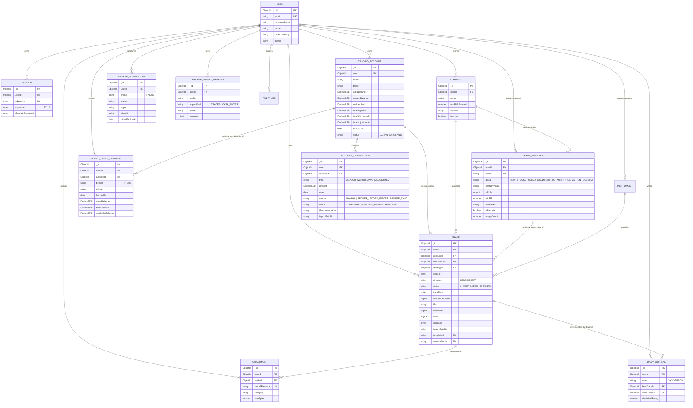
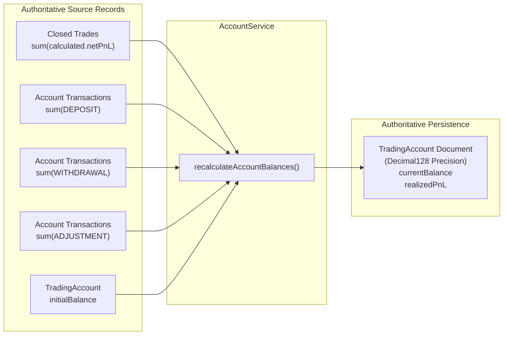
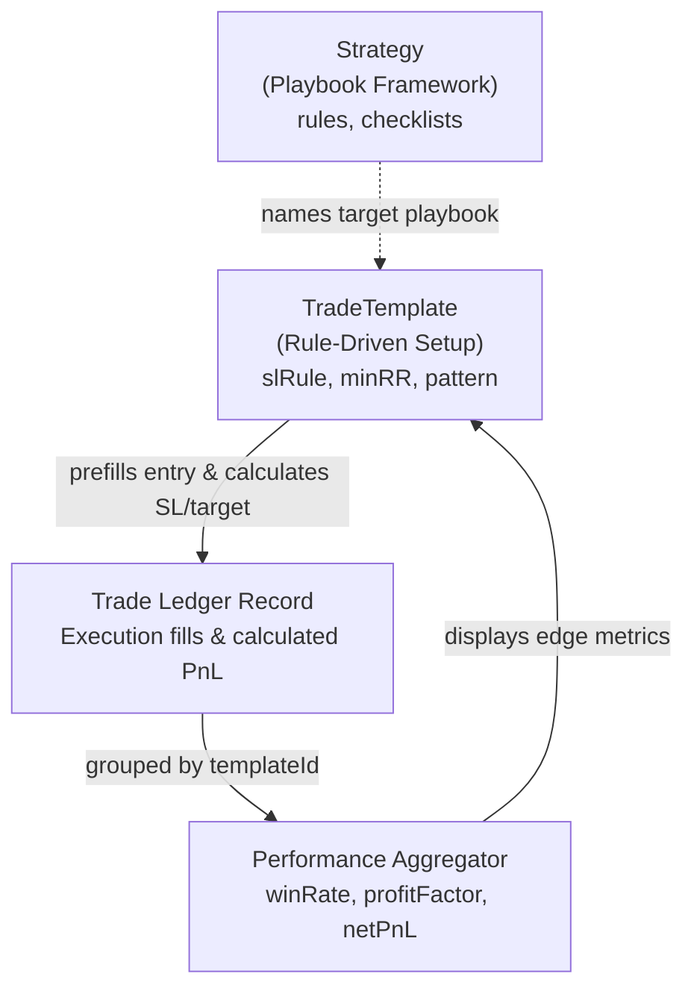

# SetupMint — Data Relationships & Entity-Relationship Architecture

This document describes the relational structure, referential integrity rules, tenant ownership boundaries, and cascading behaviors across MongoDB collections in **SetupMint**.

---

## 1. Entity-Relationship Diagram (ERD)



---

## 2. Ownership & Multi-Tenant Boundaries

SetupMint operates a **strict tenant boundary**:
1. **Primary Tenant Key:** Every document across all application collections (except global preset instruments) contains a mandatory `userId: mongoose.Types.ObjectId` referencing `User._id`.
2. **Zero Cross-Tenant Leakage:** Every API endpoint validates `req.user.id` and queries with `{ userId: req.user.id }`.
3. **No Global IDs Accessible Without Ownership:** Attempting to query `GET /trades/:id` or `GET /attachments/:id` for an ID that belongs to a different user returns `404 TRADE_NOT_FOUND` or `404 NOT_FOUND` rather than unauthorized details.

---

## 3. Referential Integrity & Cascading Behavior

MongoDB does not provide foreign key constraints at the database engine level. SetupMint enforces referential integrity through application services and route handlers:

### A. Trade Deletion Cascading
When a trade is deleted via `DELETE /api/v1/trades/:id` or `POST /api/v1/trades/bulk-delete`:
1. **Attachment Object Deletion:** All `Attachment` documents linked to `tradeId` are located. The actual files are physically deleted from the private Cloudflare R2 bucket via `storage.delete(attachment.storedFilename)` to prevent orphaned cloud storage waste.
2. **Database Attachment Purge:** The `Attachment` records are deleted from MongoDB.
3. **Trade Deletion:** The `Trade` document is removed.
4. **Authoritative Account Re-balancing:** `AccountService.recalculateAccountBalances(accountId, userId)` is immediately invoked, subtracting the deleted trade's net P&L from the trading account's cumulative realized P&L and current balance.

### B. Account Deletion & Archival Policy
When an account deletion is requested via `DELETE /api/v1/accounts/:id`:
- **If `tradeCount > 0`:** The account is **not deleted**. Instead, its status is changed to `'ARCHIVED'`. This preserves all historical trade ledger entries, P&L equity curves, and tax records.
- **If `tradeCount === 0`:** The account is safely removed from the database via `TradingAccount.deleteOne()`.

### C. Attachment Deletion
When an individual screenshot attachment is deleted via `DELETE /api/v1/attachments/:id`:
1. The physical object is deleted from the Cloudflare R2 bucket via `storage.delete(attachment.storedFilename)`.
2. The `Attachment` record is deleted from MongoDB.
3. The trade document is updated via `{ $pull: { screenshotIds: attachment._id } }`.

### D. Daily Journal Trade Linkage
The `DailyJournal` collection references `bestTradeId` and `worstTradeId`. If a trade is deleted, Mongoose `populate` on daily journals returns `null` for these fields without throwing an error.

---

## 4. Unique Constraints & Compound Indexes

SetupMint enforces business rules via MongoDB unique compound indexes:

| Model | Index Fields | Constraint | Business Purpose |
| :--- | :--- | :--- | :--- |
| `User` | `{ email: 1 }` | `unique: true` | Prevents duplicate user accounts. |
| `Session` | `{ token: 1 }` | `unique: true` | Ensures unique session tokens across all users. |
| `Session` | `{ expiresAt: 1 }` | `expires: '30d'` | Automatic MongoDB background purging of expired sessions. |
| `TradingAccount` | `{ userId: 1, name: 1 }` | `unique: true` | Prevents a user from naming two accounts identically. |
| `Strategy` | `{ userId: 1, name: 1 }` | `unique: true` | Prevents duplicate strategy names for the same user. |
| `DailyJournal` | `{ userId: 1, date: 1 }` | `unique: true` | Enforces strictly one reflection journal entry per user per date (`YYYY-MM-DD`). |
| `BrokerIntegration` | `{ userId: 1, broker: 1 }` | `unique: true` | Exactly one configuration record per broker per user. |
| `BrokerImportMapping` | `{ userId: 1, broker: 1 }` | `unique: true` | Exactly one saved CSV column mapping configuration per broker per user. |
| `Attachment` | `{ storedFilename: 1 }` | `unique: true` | Prevents disk filename collisions. |
| `TradeTemplate` | `{ userId: 1, name: 1 }` | `unique: true` | Prevents duplicate template names for the same user. |
| `TradeTemplate` | `{ userId: 1, isFavorite: 1 }` | — | Rapid filtering of user's pinned/favorite setup templates. |
| `TradeTemplate` | `{ userId: 1, group: 1 }` | — | High-performance grouping by market setup category. |
| `Trade` | `{ userId: 1, templateId: 1 }` | — | Efficient aggregation of trade edge, win rates, and net P&L by setup template. |

---

## 5. Account Balance Consistency Architecture

SetupMint guarantees that trading account balances never drift or desynchronize through the **Authoritative Reconciliation Pattern**:



**Consistency Invariants:**
1. $\text{Realized P&L} = \sum_{t \in \text{Closed Trades}} t.\text{calculated}.\text{netPnL}$
2. $\text{Current Balance} = \text{Initial Balance} + \text{Realized P&L} + \text{Total Deposits} - \text{Total Withdrawals} + \text{Total Adjustments}$
3. This calculation runs on every trade creation, modification, deletion, CSV import, and cash transaction.

---

## 6. Demo Records Isolation

Demo records generated by `SetupMintSeedEngine` are strictly segregated from real user data:
- **Dedicated Demo Identity:** All demo records are seeded exclusively under `userId` belonging to `trader@tradevault.local`.
- **Idempotent Reset:** The command `npm run seed:reset` executes:
  ```typescript
  const demoUser = await User.findOne({ email: 'trader@tradevault.local' });
  await Trade.deleteMany({ userId: demoUser._id });
  await TradingAccount.deleteMany({ userId: demoUser._id });
  // ... cleans only demoUser records
  ```
- Real users and their trading accounts are completely untouched during demo reseeding or reset.

---

## 7. Trade Setup Template & Strategy Relationships

The relationship between `Trade`, `TradeTemplate`, and `Strategy` forms SetupMint's analytical edge pipeline:



1. **Trade to TradeTemplate (`Trade.templateId`):**
   - A trade optionally records a `templateId` referencing either a built-in static identifier (e.g. `'fno-orb'`, `'forex-london-breakout'`) or a custom user-defined template `_id`.
   - Applying a template fills empty/clean form fields with intelligent title formatting, tags, confluences, and strategy names, and mathematically calculates stop-loss and profit target prices using `@tradevault/financial-engine`.
   - On trade execution, the template's `usageCount` and `lastUsedAt` are updated.
   - Deleting a custom template does not delete linked trades; the trade ledger retains historical fidelity and `templateId` for audit integrity.
2. **TradeTemplate to Strategy (`TradeTemplate.strategyName`):**
   - Templates refer to playbooks via `strategyName` rather than rigid database foreign keys.
   - This cleanly decouples tactical setup rules (e.g. 15-minute Opening Range Breakout) from broad trading styles (e.g. Trend Following or Breakout), permitting independent evolution of playbooks and execution setups.
3. **Template Performance Edge Aggregation:**
   - The `/api/v1/templates` API computes real-time performance analytics for every template across closed trades:
     $$\text{Win Rate} = \frac{\text{winTrades}}{\text{totalTrades}} \times 100$$
     $$\text{Profit Factor} = \frac{\sum \text{grossWins}}{|\sum \text{grossLosses}|}$$
   - This provides traders with immediate, empirical verification of which setup rules deliver a positive statistical expectancy.
