# SetupMint — Deployment & Operations Guide

This document describes the production build pipeline, hosting requirements, containerized execution, backup operations, and operational limits for **SetupMint**.

---

## 1. Production Build Pipeline

The complete application is compiled using the root build script:

```bash
npm run build
```

This sequentially compiles all workspaces in strict dependency order:
1. **`packages/shared`:** Runs `tsc` to generate TypeScript type declarations and JavaScript modules in `packages/shared/dist/`.
2. **`packages/financial-engine`:** Runs `tsc` to compile the decimal arithmetic library to `packages/financial-engine/dist/`.
3. **`apps/api`:** Runs `tsc` to compile Fastify controllers, models, and services to `apps/api/dist/server.js`.
4. **`apps/web`:** Runs `tsc -b && vite build` to generate an optimized, minified production single-page application (SPA) in `apps/web/dist/`.

---

## 2. Deployment Topology Options

SetupMint supports three primary deployment configurations:

```mermaid
graph TD
    subgraph OptionA["Option 1: Local MacBook / Workstation (Default)"]
        BrowserA["Local Browser"] --> ViteA["Vite Dev / Static Server (Port 5173)"]
        ViteA --> FastifyA["Fastify Server (Port 4000)"]
        FastifyA --> EmbedDB["Embedded WiredTiger MongoDB (./apps/api/data/db)"]
        FastifyA --> LocalDiskA["Local Storage (./data/uploads)"]
    end

    subgraph OptionB["Option 2: Docker Compose (Local Containerized)"]
        BrowserB["Local Browser"] --> NginxB["Reverse Proxy / Web"]
        NginxB --> FastifyB["Fastify API Container"]
        FastifyB --> MongoB[("Docker MongoDB 7.0 Container\n127.0.0.1:27017")]
        FastifyB --> VolumeB[("Persistent Volume ./data/uploads")]
    end

    subgraph OptionC["Option 3: Self-Hosted Cloud VPS (Ubuntu / Debian)"]
        ClientC["Remote Trader Browser"] -->|HTTPS| Caddy["Reverse Proxy (Caddy / Nginx)"]
        Caddy -->|Static Assets| WebDist["apps/web/dist/"]
        Caddy -->|Proxy /api| PM2["Fastify API (PM2 Process Manager)"]
        PM2 --> MongoC[("MongoDB Service / Atlas")]
        PM2 --> DiskC[("VPS Disk Storage /data/uploads")]
    end
```



---

## 3. Production Runtime Execution

To run the compiled production backend:

```bash
# In apps/api directory
cd apps/api
NODE_ENV=production node dist/server.js
```

Or using PM2 for process monitoring:
```bash
pm2 start apps/api/dist/server.js --name "setupmint-api"
```

The frontend production bundle in `apps/web/dist/` can be served via Nginx, Caddy, or any static file server:

**Sample Nginx Configuration:**
```nginx
server {
    listen 80;
    server_name trading.local;

    # Serve static frontend
    location / {
        root /var/www/setupmint/apps/web/dist;
        try_files $uri $uri/ /index.html;
    }

    # Proxy REST API requests
    location /api/ {
        proxy_pass http://127.0.0.1:4000;
        proxy_http_version 1.1;
        proxy_set_header Upgrade $http_upgrade;
        proxy_set_header Connection 'upgrade';
        proxy_set_header Host $host;
        proxy_set_header X-Real-IP $remote_addr;
        proxy_set_header X-Forwarded-For $proxy_add_x_forwarded_for;
        proxy_cache_bypass $http_upgrade;
    }
}
```

---

## 4. Backup & Disaster Recovery Runbook

SetupMint includes native disaster recovery scripts:

### A. Performing an Immediate Backup
```bash
npm run db:backup
```
- Creates `./backups/tradevault-backup-<timestamp>/`.
- Dumps JSON records for all database collections.
- Recursively copies all private screenshot attachments.
- Writes `manifest.json` validating collection record counts.

### B. Restoring from Backup
```bash
# Restore latest backup
npm run db:restore

# Or restore specific archive folder
npm run db:restore ./backups/tradevault-backup-2026-10-18T09-00-00-000Z
```

### C. Post-Restore Integrity Audit
After any restoration, run reconciliation to ensure all account balances are mathematically aligned:
```bash
npm run db:reconcile
```

---

## 5. Operational Limits & Resource Sizing

- **Memory:** Node.js process requires ~150MB RAM at baseline; ~500MB under heavy analytical chart rendering.
- **CPU:** Modest dual-core processor is sufficient. Calculation engine processes 5,000 trades in <100ms.
- **Disk Storage:**
  - Database: ~10MB per 10,000 trades.
  - Screenshots: Approximately 200KB – 800KB per chart image. 1,000 uploaded screenshots consume ~500MB disk space.
