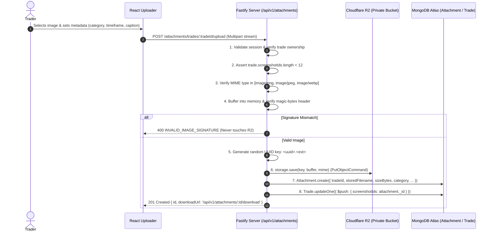

# SetupMint — File Storage & Chart Attachments Architecture

This document details the file upload pipeline, cloud object storage mechanisms, attachment categorization, image validation, and authenticated streaming protocols implemented in **SetupMint**.

---

## 1. Storage Architecture: Cloudflare R2 (Private Bucket)

### Cloud-Native Private Object Storage
SetupMint implements **100% cloud-only object storage** for chart screenshot attachments using **Cloudflare R2** (S3-compatible object storage). Local disk storage and in-memory fallbacks have been permanently removed.

| Architecture Characteristic | SetupMint Cloud-Only Implementation (Cloudflare R2) | Legacy Local Disk Storage |
| :--- | :--- | :--- |
| **Storage Location** | Dedicated private Cloudflare R2 bucket (`setupmint`) | Local filesystem directory |
| **Bucket Privacy** | **100% Private**. Public development URL and public access are disabled. | Local filesystem permissions |
| **Client Access** | **Zero direct R2 URLs**. Browser never receives direct bucket URLs or S3 signed links. | Authenticated Fastify streams |
| **Streaming Mechanism** | Authenticated Fastify proxy endpoints stream object streams directly from R2 to the browser. | Direct disk streams |
| **Image Validation** | Raw in-memory magic-bytes inspection BEFORE any cloud upload occurs. | Post-upload disk inspection |
| **Fail-Fast Policy** | App startup fails fast with non-zero exit if R2 credentials or bucket are unreachable. | Silent fallback |

---

## 2. Supported Formats & Upload Specifications

- **Accepted MIME Types:** `image/png`, `image/jpeg`, `image/webp` (and synthetic demo charts in `image/svg+xml`).
- **Maximum File Size:** Configured via `MAX_FILE_SIZE_MB` in `.env` (default: **10 MB**).
- **Maximum Screenshots per Trade:** **12 images**.
- **Key Pattern:** Enforced by `assertValidKey()` allowing only `<uuid>.(png|jpe?g|webp|svg)` and synthetic demo charts. Path traversal (`..`, `/`, `\`) is strictly rejected.
- **Client Capture Modes:**
  - Multi-file drag-and-drop onto [`TradeAttachmentUploader`](file:///Users/komal/projects/Trading%20Vault/apps/web/src/components/trades/attachments/TradeAttachmentUploader.tsx).
  - Direct clipboard paste (`Ctrl+V` / `Cmd+V`) from system screenshot tools (e.g. macOS `Cmd+Ctrl+Shift+4`).
  - Automatic stage categorization on addition (`SETUP` -> `ENTRY` -> `EXIT` -> `REVIEW`).

---

## 3. Upload & Storage Processing Pipeline



---

## 4. Binary Magic-Bytes Signature Verification

To guarantee that uploaded files are genuine images rather than disguised binary payloads or executable scripts, `verifyImageMagicBytes` inspects the raw in-memory buffer before any network call to Cloudflare R2:

```typescript
// PNG Header: 89 50 4E 47 0D 0A 1A 0A
buffer[0] === 0x89 && buffer[1] === 0x50 && buffer[2] === 0x4e && buffer[3] === 0x47

// JPEG Header: FF D8 FF
buffer[0] === 0xff && buffer[1] === 0xd8 && buffer[2] === 0xff

// WebP Header: RIFF .... WEBP
buffer.toString('ascii', 0, 4) === 'RIFF' && buffer.toString('ascii', 8, 12) === 'WEBP'
```

If the signature fails verification, the request immediately terminates with HTTP 400 `INVALID_IMAGE_SIGNATURE`.

---

## 5. Attachment Categories & Trading Phases

SetupMint allows traders to organize charts by trade progression:

| Category Value | Display Label | Badge Color | Description |
| :--- | :--- | :--- | :--- |
| `SETUP` | Trade Setup | Blue (`#3b82f6`) | Higher timeframe market structure, pre-entry context. |
| `ENTRY` | Entry Trigger | Emerald (`#10b981`) | Lower timeframe execution candle, order fill confirmation. |
| `EXIT` | Exit / Target | Amber (`#f59e0b`) | Take profit target, stop loss hit, trailing stop exit. |
| `REVIEW` | Post-Trade Review | Purple (`#8b5cf6`) | Annotated chart review, post-session debrief. |
| `BEFORE_ENTRY` | Pre-Entry Setup | Blue | Setup before order placement. |
| `ANNOTATED` | Markup Chart | Indigo | Technical drawings and marked price levels. |
| `OTHER` | Reference / Macro | Slate (`#64748b`) | Orderbook depth, correlated market, or news catalyst. |

---

## 6. Authenticated Image Streaming

Attachments are **not** served as public static assets. Instead, streaming is guarded by session authentication:

- **Endpoints:**
  - `GET /api/v1/attachments/:id/download`
  - `GET /api/v1/attachments/:id/stream`
- **Ownership Check:** Queries `Attachment.findOne({ _id: req.params.id, userId: req.user.id })`. An unauthenticated request yields 401, while another user's attachment yields 404.
- **Response Headers:**
  ```http
  Content-Type: image/png
  Content-Disposition: inline; filename="Nifty_5m_Entry.png"
  Cache-Control: private, max-age=86400
  ```
- **Stream:** Node.js readable stream piped directly from Cloudflare R2 (`storage.read(key)`).

---

## 7. Deletion & Cleanup Behavior

When an attachment is removed:
1. **Via `DELETE /api/v1/attachments/:id`:**
   - Object removed from Cloudflare R2 bucket via `storage.delete(storedFilename)`.
   - Record removed from `Attachment` collection in MongoDB Atlas.
   - Reference removed from `Trade.screenshotIds`.
2. **Via Trade Deletion (`DELETE /api/v1/trades/:id`):**
   - Queries all attachments linked to the trade.
   - Deletes each object from Cloudflare R2.
   - Deletes all attachment records from MongoDB Atlas.
   *Eliminates orphaned cloud storage objects.*
