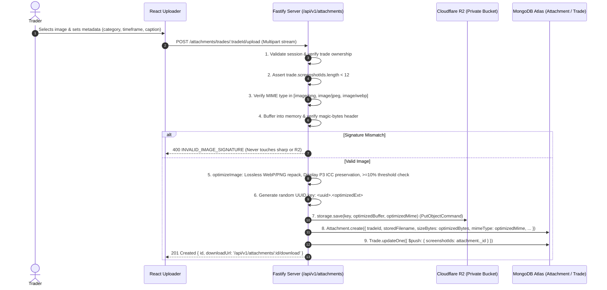

# SetupMint — File Storage & Chart Attachments Architecture

This document details the file upload pipeline, cloud object storage mechanisms, attachment categorization, image validation, and authenticated streaming protocols implemented in **SetupMint**.

---

## 1. Storage Architecture: Cloudflare R2 (Private Bucket)

### Cloud-Native Private Object Storage
SetupMint implements **100% cloud-only object storage** for chart screenshot attachments using **Cloudflare R2** (S3-compatible object storage). Local disk storage and in-memory fallbacks have been permanently removed.

| Architecture Characteristic | SetupMint Cloud-Only Implementation (Cloudflare R2) | Legacy Local Disk Storage |
| :--- | :--- | :--- |
| **Storage Location** | Dedicated private Cloudflare R2 bucket (`setupmint`) | Local filesystem directory |
| **Bucket Privacy** | **100% Private**. Public development URL and public access are disabled. | Local filesystem permissions |
| **Client Access** | **Zero direct R2 URLs**. Browser never receives direct bucket URLs or S3 signed links. | Authenticated Fastify streams |
| **Streaming Mechanism** | Authenticated Fastify proxy endpoints stream object streams directly from R2 to the browser. | Direct disk streams |
| **Image Validation** | Raw in-memory magic-bytes inspection BEFORE any cloud upload occurs. | Post-upload disk inspection |
| **Fail-Fast Policy** | App startup fails fast with non-zero exit if R2 credentials or bucket are unreachable. | Silent fallback |

---

## 2. Supported Formats & Upload Specifications

- **Accepted MIME Types:** `image/png`, `image/jpeg`, `image/webp` (and synthetic demo charts in `image/svg+xml`).
- **Maximum File Size:** Configured via `MAX_FILE_SIZE_MB` in `.env` (default: **10 MB**).
- **Maximum Screenshots per Trade:** **12 images**.
- **Key Pattern:** Enforced by `assertValidKey()` allowing only `<uuid>.(png|jpe?g|webp|svg)` and synthetic demo charts. Path traversal (`..`, `/`, `\`) is strictly rejected.
- **Client Capture Modes:**
  - Multi-file drag-and-drop onto [`TradeAttachmentUploader`](file:///Users/komal/projects/Trading%20Vault/apps/web/src/components/trades/attachments/TradeAttachmentUploader.tsx).
  - Direct clipboard paste (`Ctrl+V` / `Cmd+V`) from system screenshot tools (e.g. macOS `Cmd+Ctrl+Shift+4`).
  - Automatic stage categorization on addition (`SETUP` -> `ENTRY` -> `EXIT` -> `REVIEW`).

---

## 3. Upload & Storage Processing Pipeline



---

## 4. Binary Magic-Bytes Signature Verification

To guarantee that uploaded files are genuine images rather than disguised binary payloads or executable scripts, `verifyImageMagicBytes` inspects the raw in-memory buffer before any network call to Cloudflare R2 or sharp processing:

```typescript
// PNG Header: 89 50 4E 47 0D 0A 1A 0A
buffer[0] === 0x89 && buffer[1] === 0x50 && buffer[2] === 0x4e && buffer[3] === 0x47

// JPEG Header: FF D8 FF
buffer[0] === 0xff && buffer[1] === 0xd8 && buffer[2] === 0xff

// WebP Header: RIFF .... WEBP
buffer.toString('ascii', 0, 4) === 'RIFF' && buffer.toString('ascii', 8, 12) === 'WEBP'
```

If the signature fails verification, the request immediately terminates with HTTP 400 `INVALID_IMAGE_SIGNATURE`.

---

## 5. Server-Side Image Optimization Pipeline

To minimize storage footprint in Cloudflare R2 and expedite chart downloads without sacrificing technical chart legibility, SetupMint applies an automated server-side image optimization pipeline via `sharp`:

### 1. Lossless-First Strategy
The vast majority of trader uploads are macOS screenshot clips (`Cmd+Ctrl+Shift+4`), which produce high-resolution PNGs at Retina 2x scale with embedded Display P3 color profiles.
- **PNG Optimization:** Builds lossless candidates concurrently and selects the smallest:
  - **Lossless WebP Candidate:** `sharp(input).webp({ lossless: true, effort: 6 })`
  - **Repacked PNG Candidate:** `sharp(input).png({ compressionLevel: 9, effort: 10, palette: false })`
  - *Palette mode is explicitly disabled (`palette: false`)* to avoid 8-bit color quantization and keep 100% pixel-identical RGBA clarity.
- **JPEG Optimization:** `sharp(input).webp({ quality: 90, effort: 6, smartSubsample: true })`.
- **WebP Optimization:** Lossless re-pack (`effort: 6`), retaining original if not smaller.
- **SVG Pass-Through:** Vector charts (`image/svg+xml`) pass through untouched without any sharp decoding.

### 2. Display P3 & sRGB ICC Profile Preservation
Every raster pipeline begins with:
```typescript
sharp(input, { failOn: 'error' }).rotate().keepIccProfile()
```
This guarantees:
- EXIF rotation is applied correctly.
- Embedded color profiles (especially macOS **Display P3** and standard **sRGB**) are preserved across transcoding so red and green candlestick shades remain vibrant and true to the trading platform.

### 3. Absolute Pixel Fidelity (Zero Downscaling)
The pipeline strictly preserves full pixel dimensions (e.g. 2880x1800 Retina). Resizing, downscaling, or blur filters are never applied.

### 4. 10% Minimum Savings Threshold (`MIN_SAVING_RATIO = 0.10`)
To prevent unnecessary format conversions or negligible size deltas:
- The candidate is only adopted if `optimizedBytes <= originalBytes * (1 - MIN_SAVING_RATIO)`.
- If savings are below 10%, the original buffer is saved with `wasOptimized = false`.

### 5. Fail-Safe Fallback
All optimization logic is wrapped in a fail-safe `try/catch`. If sharp encounters an unexpected decoding issue or corrupted segment, the pipeline safely catches the error, logs a warning, and returns the original buffer. An upload will **never fail** because optimization failed.

### 6. Storage Keys & Content-Disposition
- When lossless optimization chooses WebP, the stored key is `<uuid>.webp` and MongoDB stores `mimeType: "image/webp"`.
- When streaming or downloading via `/api/v1/attachments/:id/stream`, the `Content-Type` header reflects `attachment.mimeType`. If `Content-Disposition` is generated from the client's original filename, its extension is rewritten to match the stored format (e.g. `chart.png` -> `chart.webp`) ensuring seamless OS handling.

---

## 6. Attachment Categories & Trading Phases

SetupMint allows traders to organize charts by trade progression:

| Category Value | Display Label | Badge Color | Description |
| :--- | :--- | :--- | :--- |
| `SETUP` | Trade Setup | Blue (`#3b82f6`) | Higher timeframe market structure, pre-entry context. |
| `ENTRY` | Entry Trigger | Emerald (`#10b981`) | Lower timeframe execution candle, order fill confirmation. |
| `EXIT` | Exit / Target | Amber (`#f59e0b`) | Take profit target, stop loss hit, trailing stop exit. |
| `REVIEW` | Post-Trade Review | Purple (`#8b5cf6`) | Annotated chart review, post-session debrief. |
| `AUTO_CHART` | Auto Execution Chart | Cyan (`#06b6d4`) | Automated candlestick chart generated from FYERS historical 1m/5m market data with execution overlays. |
| `BEFORE_ENTRY` | Pre-Entry Setup | Blue | Setup before order placement. |
| `ANNOTATED` | Markup Chart | Indigo | Technical drawings and marked price levels. |
| `OTHER` | Reference / Macro | Slate (`#64748b`) | Orderbook depth, correlated market, or news catalyst. |

---

## 7. Server-Side Automated Candlestick Execution Charts (Multi-Timeframe & Padding)

SetupMint includes an automated server-side SVG chart generator (`ChartGeneratorService`) that converts market data historical candlestick snapshots into production TradingView-grade dark-mode SVG charts:

- **Data Sources & Fallback Chain:**
  1. Cached `TradeCandleSnapshot` (if coverage covers required range).
  2. FYERS API v3 historical candlestick endpoint (`GET /data/history`).
  3. Angel One SmartAPI historical candle endpoint (fallback).
  4. Underlying cash index proxy fallback for option derivatives.
- **Base Resolution Grouping & In-Memory Aggregation:**
  - Base provider fetches are grouped: `'1'` -> 1m; `'5'` -> 5m; `'D'` -> Daily.
  - Intermediate timeframes (`15m`, `30m`, `1h`) are synthesized in-memory via `aggregateCandles` anchored to IST session opens (`09:15` for NSE, `09:00` for MCX), never the Unix epoch.
- **Window Selection & Candle Padding:**
  - Evaluated via pure `selectChartWindow` in `@tradevault/financial-engine`.
  - Padding is counted in **candles of the selected timeframe** (e.g. 45 candles on 15m is ~11h 15m; 45 candles on 1D is 45 trading days).
  - Handles gaps, weekends, and holidays naturally as no candles exist for non-trading intervals.
  - If total window exceeds `MAX_RENDERED_CANDLES` (1,500), the trade execution window is preserved and pre/post padding are scaled down proportionally. If the execution span alone exceeds 1,500 candles, the window centers around entry/exit with zero padding and `truncated: true`.
- **Candlestick Engine & Aesthetics:**
  - Bullish (emerald `#10b981`) and bearish (rose `#f43f5e`) candle bodies and wicks with dynamic spacing.
  - Subtle shaded band (`#0ea5e9` with 0.06 opacity) highlighting the active trade entry-to-exit execution window.
  - Header displays symbol, timeframe, and padding (e.g. `NIFTY  5m  -45/+45`).
- **Execution Overlays:**
  - **Entry Level:** Cyan dashed line with right-hand pill badge `ENT: ₹X`, plus candle pinpoint marker with directional arrow (`▲ BUY` / `▼ SELL`). Snaps to containing candle.
  - **Exit Level:** Purple dashed line with right-hand pill badge `EXIT: ₹X`, plus candle pinpoint marker `✕ EXIT @ ₹X`. Snaps to containing candle.
  - **Stop Loss Level:** Red dotted line with right-hand pill badge `SL: ₹X` (if initial stop loss defined).
  - **Target Level:** Green dotted line with right-hand pill badge `TP: ₹X` (if planned target defined).
  - **Excursion HUD Box:** Real-time HUD inset displaying MFE (+pts, +R), MAE (-pts, -R), and Exit Efficiency (%) reading from stored excursion calculations.
- **Persistence & Cloudflare R2 Upload:** Chart SVGs are stored directly to R2 under `<uuid>.svg`, registered as `Attachment` records with `category: 'AUTO_CHART'`, `timeframe`, and `chartMeta`:
  ```ts
  chartMeta: {
    resolution: string;
    paddingBefore: number;
    paddingAfter: number;
    appliedBefore: number;
    appliedAfter: number;
    truncated: boolean;
    generatedAt: Date;
    settingsSource?: string;
    isStale?: boolean;
  }
  ```
- **Automatic Lifecycle Triggers & Permanent Snapshots:**
  - Whenever a trade transitions to `CLOSED` (via manual creation, Quick Close, FYERS sync, or CSV import), `ChartGeneratorService.ensureTradeSnapshot` is automatically triggered.
  - Snapshot resolutions are determined purely by `resolveSnapshotTimeframes()` using user `PatternDetectionSettings` and instrument-specific overrides (defaulting to user settings, or adaptive fallback if unspecified).
  - Preserves visual auditability permanently in Cloudflare R2 even after broker historical candle lookback periods expire.
- **Staleness Tracking & Regeneration:**
  - If an already-closed trade's parameters (e.g. stop loss, exit price, notes, thesis) are modified via `PUT /api/v1/trades/:id`, `ChartGeneratorService.markSnapshotsStale` flags existing snapshots with `isStale: true`.
  - The UI presents a warning chip and a one-click "Regenerate" button to refresh snapshots against current trade parameters.
- **Dedup & Cap Limits:**
  - Dedup key: `{ tradeId, category: 'AUTO_CHART', timeframe }`.
  - Net new attachments enforce the 12-screenshot cap up front (replacing an existing chart of the same timeframe counts as net zero).
  - When slots are limited, LTF (execution view) is given first priority over HTF (context view).
- **On-Demand Endpoint:** `POST /api/v1/trades/:id/chart/generate` supports multi-timeframe requests and legacy backwards-compatible single-chart calls with optional `force: true`.
- **Backfill Utility:** CLI script `npm run chart:backfill` (`apps/api/src/scripts/chart-backfill.ts`) scans closed trades without snapshots (dry-run by default, `--yes` to generate live).


---

## 8. Authenticated Image Streaming

Attachments are **not** served as public static assets. Instead, streaming is guarded by session authentication:

- **Endpoints:**
  - `GET /api/v1/attachments/:id/download`
  - `GET /api/v1/attachments/:id/stream`
- **Ownership Check:** Queries `Attachment.findOne({ _id: req.params.id, userId: req.user.id })`. An unauthenticated request yields 401, while another user's attachment yields 404.
- **Response Headers:**
  ```http
  Content-Type: image/webp
  Content-Disposition: inline; filename="Nifty_5m_Entry.webp"
  Cache-Control: private, max-age=86400
  ```
  *(Note: `Content-Type` reflects the stored MIME type, and `Content-Disposition` dynamically matches the stored extension).*
- **Stream:** Node.js readable stream piped directly from Cloudflare R2 (`storage.read(key)`).

---

## 9. Deletion & Cleanup Behavior

When an attachment is removed:
1. **Via `DELETE /api/v1/attachments/:id`:**
   - Object removed from Cloudflare R2 bucket via `storage.delete(storedFilename)`.
   - Record removed from `Attachment` collection in MongoDB Atlas.
   - Reference removed from `Trade.screenshotIds`.
2. **Via Trade Deletion (`DELETE /api/v1/trades/:id`):**
   - Queries all attachments linked to the trade.
   - Deletes each object from Cloudflare R2.
   - Deletes all attachment records from MongoDB Atlas.
   *Eliminates orphaned cloud storage objects.*
