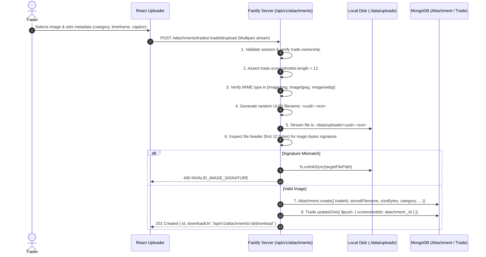

# SetupMint — File Storage & Chart Attachments Architecture

This document details the file upload pipeline, storage mechanisms, attachment categorization, image validation, and streaming protocols implemented in **SetupMint**.

---

## 1. Storage Architecture: Local Disk vs. Cloudinary

### Local-First Privacy Design
SetupMint implements **100% private local disk storage** for chart screenshot attachments.

| Architecture Characteristic | SetupMint Implementation (Local Disk) | Cloud-Hosted Storage (e.g. Cloudinary / S3) |
| :--- | :--- | :--- |
| **Storage Location** | `./data/uploads/` on the trader's local filesystem | Remote cloud vendor servers |
| **Financial Privacy** | Complete offline privacy. Trade setups and sizes never leave the computer. | Proprietary charts and entries are uploaded to third-party cloud infrastructure. |
| **Recurring Costs** | **Zero cost**. No paid subscription or API bandwidth billing. | Bandwidth overage fees, paid monthly storage tiers. |
| **Network Independence** | Operates with zero internet connectivity. | Requires persistent internet access to upload and render charts. |
| **Backup Integration** | Single command (`npm run db:backup`) archives database and charts together. | Requires separate cloud snapshot tooling. |

*Note: While cloud providers like Cloudinary can be integrated in future web-hosted SaaS deployments, local disk storage is the intentional, verified default of the SetupMint local-first product.*

---

## 2. Supported Formats & Upload Specifications

- **Accepted MIME Types:** `image/png`, `image/jpeg`, `image/webp`.
- **Maximum File Size:** Configured via `MAX_FILE_SIZE_MB` in `.env` (default: **10 MB**).
- **Maximum Screenshots per Trade:** **12 images**.
- **Attachment Storage Directory:** Configured via `UPLOAD_DIR` in `.env` (default: `./data/uploads`). Automatically created on server boot if absent.

---

## 3. Upload & Storage Processing Pipeline



---

## 4. Binary Magic-Bytes Signature Verification

To guarantee that uploaded files are genuine images rather than disguised binary payloads or executable scripts, [`verifyImageMagicBytes`](file:///Users/komal/projects/Trading%20Vault/apps/api/src/routes/attachment.routes.ts#L14-L45) inspects the raw file buffer:

```typescript
// PNG Header: 89 50 4E 47 0D 0A 1A 0A
buffer[0] === 0x89 && buffer[1] === 0x50 && buffer[2] === 0x4e && buffer[3] === 0x47

// JPEG Header: FF D8 FF
buffer[0] === 0xff && buffer[1] === 0xd8 && buffer[2] === 0xff

// WebP Header: RIFF .... WEBP
buffer.toString('ascii', 0, 4) === 'RIFF' && buffer.toString('ascii', 8, 12) === 'WEBP'
```

If the signature fails verification, the file is deleted from disk immediately.

---

## 5. Attachment Categories & Trading Phases

SetupMint allows traders to organize charts by trade progression:

| Category Value | Display Label | Badge Color | Description |
| :--- | :--- | :--- | :--- |
| `SETUP` | Trade Setup | Blue (`#3b82f6`) | Higher timeframe market structure, pre-entry context. |
| `ENTRY` | Entry Trigger | Emerald (`#10b981`) | Lower timeframe execution candle, order fill confirmation. |
| `EXIT` | Exit / Target | Amber (`#f59e0b`) | Take profit target, stop loss hit, trailing stop exit. |
| `REVIEW` | Post-Trade Review | Purple (`#8b5cf6`) | Annotated chart review, post-session debrief. |
| `BEFORE_ENTRY` | Pre-Entry Setup | Blue | Setup before order placement. |
| `ANNOTATED` | Markup Chart | Indigo | Technical drawings and marked price levels. |
| `OTHER` | Reference / Macro | Slate (`#64748b`) | Orderbook depth, correlated market, or news catalyst. |

---

## 6. Authenticated Image Streaming

Attachments are **not** served as public static assets. Instead, streaming is guarded by session authentication:

- **Endpoints:**
  - `GET /api/v1/attachments/:id/download`
  - `GET /api/v1/attachments/:id/stream`
- **Ownership Check:** Queries `Attachment.findOne({ _id: req.params.id, userId: req.user.id })`.
- **Response Headers:**
  ```http
  Content-Type: image/png
  Content-Disposition: inline; filename="Nifty_5m_Entry.png"
  Cache-Control: private, max-age=86400
  ```
- **Stream:** Node.js readable stream piped directly from disk (`fs.createReadStream(filePath)`).

---

## 7. Deletion & Cleanup Behavior

When an attachment is removed:
1. **Via `DELETE /api/v1/attachments/:id`:**
   - Physical file unlinked from `./data/uploads/<storedFilename>` via `fs.unlinkSync()`.
   - Removed from `Attachment` collection.
   - Reference removed from `Trade.screenshotIds`.
2. **Via Trade Deletion (`DELETE /api/v1/trades/:id`):**
   - Queries all attachments linked to the trade.
   - Unlinks each file from disk.
   - Deletes all attachment records from MongoDB.
   *Eliminates orphaned files and disk space leaks.*
