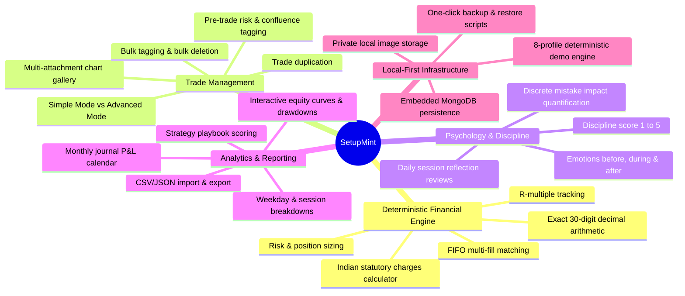

# SetupMint — Product Overview

## 1. What is SetupMint?

**SetupMint — Trade. Track. Improve.** is a privacy-first, professional trading journal and quantitative performance analytics platform engineered specifically for serious discretionary traders, with primary focus on Indian retail traders across Equities, Futures & Options (F&O), and MCX Commodities, as well as global Forex and Crypto traders.

The software is engineered with a **local-first philosophy**: all trades, psychological evaluations, notes, and chart screenshot attachments remain strictly on the user's local machine or self-hosted persistent database. No subscription fees, commercial cloud vendor lock-ins, or third-party behavioral analytics services are imposed on the trader.

In codebase configurations and package naming, the project is structured under the monorepo package namespace `@tradevault` (`tradevault-monorepo`). The user-facing application brand is **SetupMint Pro**.

---

## 2. Target Audience & Primary Use Cases

### Target Audience
1. **Indian F&O Intraday & Positional Traders:** Traders actively navigating NIFTY, BANKNIFTY, FINNIFTY, and stock derivatives who require granular Indian statutory cost breakdowns (STT, GST, SEBI turnover fees, stamp duty, exchange turnover charges) alongside gross and net P&L.
2. **MCX Commodity Traders:** Traders dealing in Crude Oil, Natural Gas, Gold, and Copper who need exact lot sizes, quantity increments, tick sizes, and contract multipliers (e.g., Crude Oil 100 BBL, Natural Gas 1250 mmBtu, Copper 2500 kg).
3. **Price Action & Discretionary Rule-Based Traders:** Practitioners of Smart Money Concepts (SMC), ICT, support/resistance, and volume profiling who track technical confluences (BOS, CHOCH, FVG, Order Blocks, Liquidity Sweeps) alongside strict risk parameters.
4. **Prop Firm & Multi-Account Traders:** Traders managing capital across multiple accounts and brokers (FYERS, Zerodha, Angel One, Upstox, ICICI Direct, Prop accounts) who need segregated ledgers with unified performance analytics.
5. **Psychology-Conscious Traders:** Traders seeking to eliminate costly emotional biases (revenge trading, overtrading, moving stop losses, position sizing violations, FOMO).

### Primary Use Cases
- **Rapid Manual Trade Journaling:** Logging trades immediately after market execution with live preview of fees, net P&L, and R-multiples using either Express Quick mode or Comprehensive mode.
- **Multi-Fill Execution Tracking (Scale-Ins & Partial Exits):** Recording individual entry and exit executions in Advanced Mode, matched deterministically via strict FIFO order.
- **Pre-Trade Risk Management & Sizing:** Computing optimal position sizes, lot rounding, and stop-loss distances before entering orders, with one-click transfer into the trade logging form.
- **Daily Reflection & Calendar Reviews:** Reviewing daily net P&L heatmaps, market biases, and discipline ratings to foster consistent trading habits.
- **Quantitative Strategy Playbook Evaluation:** Measuring the historical win rate, profit factor, total net P&L, and expectancy of specific strategy rules to identify true market edge.
- **Tax & Fee Audit Reporting:** Analyzing total transaction friction (brokerage vs. statutory charges) to prevent "trading for the broker."
- **Data Portability & Backups:** Performing full JSON/CSV data exports, interactive CSV imports with column mapping, and single-command local disk backups.

---

## 3. The Problems SetupMint Solves

| Problem Experienced by Traders | How SetupMint Solves It |
| :--- | :--- |
| **Silent IEEE-754 Floating-Point Errors:** Standard spreadsheet tools and basic web journals suffer from binary floating-point round-off errors in financial balances. | Uses `decimal.js` with **30-digit precision** for all P&L, fee, R-multiple, and balance calculations in `@tradevault/financial-engine`. |
| **Hidden Friction & Fee Surprise:** Indian traders frequently miscalculate net profitability due to complex statutory taxes (STT/CTT, Stamp Duty, GST, Exchange Fees). | Incorporates a dedicated `IndianChargesCalculator` modeling exact exchange turnover, STT/CTT rates, SEBI fees, and 18% GST across asset classes. |
| **Emotional Blind Spots:** Costly habits like revenge trading and moving stops are often hidden from conventional broker P&L reports. | Features explicit psychological tracking (emotions before/during/after, 1–5 discipline ratings, checklist confirmations, and 5 discrete mistake flags). |
| **Cloud Privacy Concerns:** Uploading proprietary trading strategies, trade sizes, and annotated chart screenshots to third-party cloud servers exposes sensitive financial intellectual property. | Fully local-first architecture. Attachments are saved to `./data/uploads` on local disk and served strictly through authenticated endpoints. |
| **Account Balance Drift:** Frequent deposits, withdrawals, and trade edits cause account balances to desynchronize over time. | Features authoritative account balance reconciliation (`AccountService.recalculateAccountBalances`), deriving balances directly from raw trade P&Ls and cash transactions. |
| **Complex Lot & Multiplier Arithmetic:** MCX commodities and Index F&O contracts have varying lot sizes and multipliers that break generic trade trackers. | Built-in instrument catalog with explicit `contractMultiplier`, `lotSize`, `tickSize`, and `quantityIncrement` parameters. |

---

## 4. Key Product Capabilities

---

## 5. Supported Markets & Broker Ecosystem

### Market Segments
SetupMint supports the full spectrum of trading instruments:
1. **NSE_EQ:** National Stock Exchange Cash Equities (Intraday and Delivery).
2. **NSE_FNO:** NSE Index Futures (NIFTY, BANKNIFTY, FINNIFTY) and Stock F&O.
3. **BSE_EQ:** Bombay Stock Exchange Equities.
4. **MCX:** Multi Commodity Exchange of India (Crude Oil, Natural Gas, Gold, Silver, Copper).
5. **FOREX:** Spot and Futures Foreign Exchange (EUR/USD, GBP/USD, USD/INR).
6. **CRYPTO:** Spot and Perpetual Futures (BTC/USDT, ETH/USDT).
7. **US_EQUITY:** NASDAQ / NYSE equities.
8. **CME:** Chicago Mercantile Exchange global futures.

### Broker Ecosystem
- **FYERS:** Primary integrated broker partner architecture. SetupMint includes a dedicated FYERS API configuration interface, normalized execution schema, and realistic charge calculator modeling FYERS flat ₹20/order fee schedules.
- **Zerodha, Angel One, Upstox, ICICI Direct:** Supported via multi-account ledgers, manual trade logging, and intelligent CSV import with auto-column mapping.

---

## 6. Major Workflows

1. **Authentication & Session Management:** User registration, password hashing (bcrypt), and stateful session management backed by MongoDB and HttpOnly cookies.
2. **Account Provisioning & Cash Flows:** Managing trading accounts, recording capital deposits, withdrawals, transfers, and balance reconciliation.
3. **Trade Entry & Execution:**
   - *Simple Mode:* Single entry price, exit price, quantity, multiplier, and comprehensive fee breakdown.
   - *Advanced Mode:* Granular FIFO matching of chronological entry fills and partial exits.
4. **Chart Screenshot Attachment:** Uploading pre-entry setups, execution triggers, and post-trade reviews with magic-bytes verification and secure streaming.
5. **Daily Calendar Journaling:** Evening session reflection, capturing market conditions, emotional discipline, best/worst trade links, and action plans for next session.
6. **Risk Calculation & Transfer:** Pre-trade position size calculation based on account equity, risk budget percentage, and stop distance, transferred directly into the trade form.
7. **Performance Analytics & Strategy Playbooks:** Real-time equity curve rendering, peak-to-trough drawdown analysis, and strategy win rate/profit factor evaluations.
8. **Data Portability & Backup:** Full CSV/JSON data export, interactive CSV imports with fuzzy column mapping, and local archive restoration.

---

## 7. Data Provenance: Live, Imported, Manual, and Demo Data

To maintain absolute data integrity, SetupMint categorizes records based on how they entered the system:

| Data Type | Description | System Behavior |
| :--- | :--- | :--- |
| **Manually Entered Data** | Trades, fills, and notes entered directly by the trader via `TradeFormModal`. | Treated as primary discretionary records with full audit log trails. |
| **Imported Data** | Records brought in via the CSV Import engine (`/api/v1/export/import/commit`). | Automatically tagged with `['IMPORTED']`. Reconciles account balances upon import. Duplicate check prevents duplicate fills. |
| **Synthetic Demo Data** | Records generated by `SetupMintSeedEngine` (`npm run db:seed`). | Seeded under the isolated demo user `trader@tradevault.local`. Includes synthetic SVG candlestick charts and deterministic PRNG distributions. Never mixes with real user data. |
| **Live Broker Data (Future)** | Executions synchronized via `BrokerAdapter` interface. | Architecturally modeled via `INormalizedExecution` with idempotency key checks. Kept disabled in current release to preserve offline privacy. |
