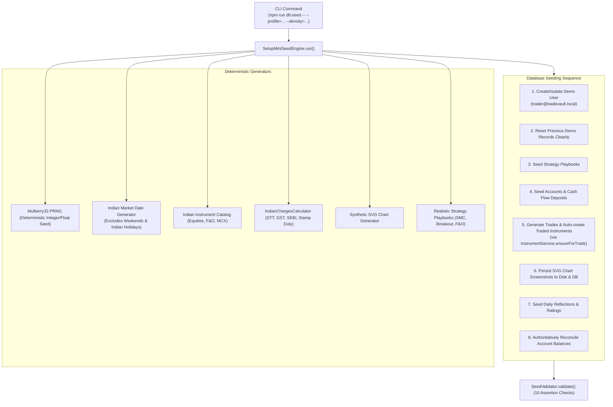

# SetupMint — Seed Data Engine & Demo Mode Specification

This document details the **SetupMint Heavy Seed Data Engine** (`apps/api/src/seed/`), its 8 specialized trader profiles, deterministic Pseudo-Random Number Generator (PRNG), synthetic chart generator, data integrity validator, and safe reset workflows.

> [!NOTE]
> All records produced by the Seed Engine are **synthetic simulations** designed for product evaluation, test automation, and UI demonstration. They are **not** live market executions or actual broker trade records.

---

## 1. Engine Capabilities & Architecture

The SetupMint Seed Engine is implemented in [`apps/api/src/seed/seed-engine.ts`](file:///Users/komal/projects/Trading%20Vault/apps/api/src/seed/seed-engine.ts). It generates complete, statistically coherent, and mathematically consistent trading histories:



---

## 2. Available Seed Profiles

The engine includes **8 distinct trader profiles** in [`apps/api/src/seed/profiles.ts`](file:///Users/komal/projects/Trading%20Vault/apps/api/src/seed/profiles.ts):

| Profile Name | Profile Display Name | Target Win Rate | Default Density | Asset Classes | Target Trades Range | Description |
| :--- | :--- | :--- | :--- | :--- | :--- | :--- |
| `beginner` | **Profile A — Beginner Trader** | 52% | `minimal` | Equity, Futures | 30 – 50 | Small account (₹1,00,000), cash equities, simple executions, basic trading. |
| `active-trader` | **Profile B — Active Indian Intraday Trader** | 58% | `rich` | Equity, F&O, Options | 500 – 1,000 | Primary default profile. High-frequency NSE intraday, stop-losses, and realistic fee friction. |
| `options-specialist` | **Profile C — Options Specialist** | 55% | `rich` | Options | 500 – 1,000 | CE/PE options buying, weekly/monthly expiries, directional index setups. |
| `commodity-trader` | **Profile D — MCX Commodity Trader** | 56% | `standard` | Commodities | 300 – 600 | CRUDEOIL, NATURALGAS, GOLD, COPPER; evening session trades with exact lot multipliers. |
| `multi-broker` | **Profile E — Multi-Broker Professional** | 60% | `rich` | Equity, F&O, Commodity | 1,500 – 3,000 | Capital distributed across FYERS, Zerodha, Angel One, Upstox, and ICICI Direct. |
| `psychology` | **Profile F — Psychology & Discipline** | 50% | `standard` | Equity, F&O, Options | 200 – 500 | Explores behavioral errors: revenge trading, overtrading, moving stops, discipline rating variance. |
| `analytics` | **Profile G — Analytics Showcase** | 62% | `analytics` | Multi-asset | 2,000 – 5,000 | Dense dataset spanning multiple years, strategies, and instruments for stress-testing charts. |
| `edge-cases` | **Profile H — Edge Cases & Boundaries** | 50% | `minimal` | Multi-asset | 45 – 80 | Boundary testing: breakeven streaks, zero-loss runs, open positions, planned trades, multi-fills. |

---

## 3. Dataset Density Levels

Each profile scales dynamically across 5 density levels:

| Density Level | Relative Scale | Typical Trades Count | Use Case |
| :--- | :--- | :--- | :--- |
| **`minimal`** | Baseline | 30 – 100 trades | Fast local testing, unit tests, clean demonstration |
| **`standard`** | Medium | 300 – 600 trades | Routine development, realistic monthly calendar |
| **`rich`** | High | 500 – 1,800 trades | Production-like volume, multi-month analytics |
| **`analytics`** | Very High | 1,200 – 3,200 trades | Comprehensive reporting, strategy comparisons |
| **`stress`** | Maximum | 2,000 – 6,000 trades | Performance benchmarking, database query profiling |

---

## 4. Determinism & Idempotency Architecture

### A. Mulberry32 Deterministic PRNG
[`apps/api/src/seed/prng.ts`](file:///Users/komal/projects/Trading%20Vault/apps/api/src/seed/prng.ts)
Instead of non-deterministic `Math.random()`, the engine employs a seedable **Mulberry32 32-bit PRNG**. Supplying the same `--seed=<number>` produces **identical trade dates, prices, quantities, and P&L outcomes every run**.

### B. Strict Reseed Idempotency
Reseeding the database is completely idempotent:
1. It queries the dedicated demo identity `trader@tradevault.local`.
2. Cleanly deletes all existing records belonging to that user ID.
3. Generates the new dataset from scratch.
4. Leaves all real registered users and their data untouched.

---

## 5. Seeded Entities & Relational Linkage

The engine seeds and interlinks 7 distinct entity types:
1. **Trading Accounts:** Created with realistic initial balances (e.g. ₹5,00,000), cash deposits, and withdrawals.
2. **Instruments:** Auto-created strictly on-demand for traded underlyings (`source: 'AUTO'`) via `InstrumentService.ensureForTrade`. Zero unused instruments exist in the database.
3. **Strategy Playbooks:** 15 strategy playbooks with asset classes, timeframes, entry rules, stop-loss rules, target rules, invalidation criteria, and checklists (including 6 specialized Liquidity & S/R playbooks: *Liquidity Sweep & Reversal*, *Equal Highs/Lows Raid*, *PDH/PDL Sweep Reversal*, *Support/Resistance Flip Retest*, *Asian Range Sweep*, and *Supply/Demand Zone Rejection*). The last two are **starter parent strategies with child setup variants** (*Bullish* and *Bearish HTF Retracement – LTF Liquidity Sweep & Confirmation*, 3 variants each). These are plain seed data defined in [`apps/api/src/seed/playbooks.ts`](file:///Users/komal/projects/Trading%20Vault/apps/api/src/seed/playbooks.ts) — not application constants — and are inserted into MongoDB like any user-created strategy. Demo trades on these parents are classified to a direction-compatible variant and receive a `CLASSIFIED` audit log entry.
4. **Trades:** Simple and Advanced multi-fill trades with realistic prices, stops, targets, confluences, and psychological tags.
5. **Chart Screenshots:** Real SVG TradingView-style candlestick charts persisted to Cloudflare R2 private bucket storage (via `storage.save()`) and linked via `Attachment` records.
6. **Daily Journals:** Reflection entries across all active trading days with market biases and ratings.
7. **Broker Connection Status:** Realistic FYERS connection metadata and synchronization logs.

---

## 6. Seed CLI Commands & Usage

All commands are defined in root [`package.json`](file:///Users/komal/projects/Trading%20Vault/package.json):

```bash
# 1. Seed default profile (active-trader, rich density)
npm run db:seed

# 2. Seed a specific profile and density
npm run db:seed -- --profile=psychology --density=standard --seed=101

# 3. Seed minimal beginner profile for fast testing
npm run db:seed -- --profile=beginner --density=minimal

# 4. Validate integrity of existing demo data
npm run seed:validate

# 5. Safely reset/wipe all demo data (zero data loss for real users)
npm run seed:reset

# 6. Seed 4 core institutional strategies (Intraday Trend, ORB, Mean Reversion, Expiry Scalping)
npx tsx apps/api/src/scripts/seed-komal-strategies.ts
```

### Demo & Default User Credentials:
- **Demo Account:** `trader@tradevault.local` (Password: `TradeVault@123`)
- **Default Login Pre-fill (`LoginPage.tsx`):** `komal@gmail.com` (Password: `komal@1998`)

### Core Institutional Strategy Seeder (`seed-komal-strategies.ts`):
In addition to the demo seed engine, [`apps/api/src/scripts/seed-komal-strategies.ts`](file:///Users/komal/projects/Trading%20Vault/apps/api/src/scripts/seed-komal-strategies.ts) idempotently seeds **4 core institutional strategies** with child setup variants, rules, and checklists:
1. **Intraday Index Trend Following** (EMA alignment, BOS pullback, VWAP confluence)
2. **Opening Range Breakout (ORB)** (First 15m range breakout with volume spike confirmation)
3. **Mean Reversion Fade** (Liquidity sweep & exhaustion at key HTF levels)
4. **High-Probability Expiry Scalping** (0DTE gamma scalps at Open Interest walls)

---

## 7. Data Integrity Assertion Validator

The validator in [`apps/api/src/seed/validator.ts`](file:///Users/komal/projects/Trading%20Vault/apps/api/src/seed/validator.ts) executes **10 automated integrity checks** after every seed:

1. **User Identity Check:** Verifies demo user exists and has a valid password hash.
2. **Account Balances Check:** Asserts that every account's `currentBalance` matches the sum of initial balance, trade net P&Ls, and cash transactions with zero drift.
3. **Trades & Instruments Referential Integrity:** Verifies all trades reference existing accounts and valid instruments, and asserts that exactly zero unused instruments exist for the demo user.
4. **Calculations Check:** Asserts that `netPnL == grossPnL - totalCosts` across all simple execution trades.
5. **FIFO Integrity Check:** Asserts that advanced trades have valid fill matches and no orphaned exit quantities.
6. **Chart Attachments Check:** Asserts that all attachment records point to existing physical files on disk.
7. **Daily Journal Check:** Asserts that daily reflection ratings are between 1 and 5 and dates follow `YYYY-MM-DD`.
8. **Strategy Linkage Check:** Asserts that linked strategies exist and are active.
9. **Broker Status Check:** Verifies valid broker integration status.
10. **Win Rate Target Tolerance Check:** Asserts that actual realized win rate is within $\pm 10\%$ of the profile's target win rate.
11. **Parent Strategy & Setup Variants Integrity Check:** Asserts at least 2 strategies define child variants, at least one trade is classified, and every trade with `setup.variantKey` references a parent strategy that defines that variant key.
