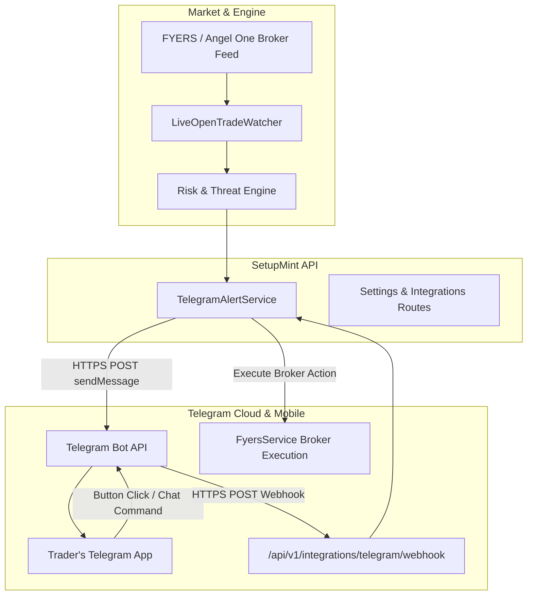
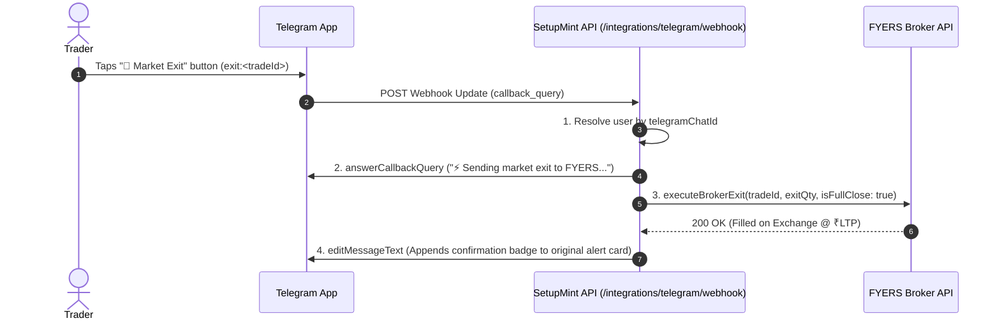

# SetupMint — Telegram Bot & Real-Time Push Alerts Architecture

This document details the architecture, two-way interactive command engine, inline button callbacks, webhook configuration, and real-time risk alert pipeline implemented in **SetupMint** via the **Telegram Bot API**.

---

## 1. Overview & Purpose

SetupMint provides a **two-way Telegram Bot integration** engineered to give traders off-screen trade surveillance and emergency mobile execution without requiring an open browser tab:

- **Audible Off-Screen Risk Alerts:** Instant audio/haptic push alerts to the trader's mobile phone via Telegram (`disable_notification: false`) when high-risk events occur (critical stop loss threats, profit givebacks, daily loss breaches, or naked unhedged positions).
- **Interactive Inline Keyboards:** One-tap action buttons embedded directly underneath alert messages allowing the trader to execute actions on the broker from their phone:
  - `🚨 Market Exit` — Immediately closes the position at market via broker API.
  - `🛡️ Lock True BE` — Automatically calculates statutory fees and trails the resting stop loss order to true breakeven.
  - `🎯 Book 50%` — Closes 50% of the position and moves the remaining stop loss to breakeven.
- **Two-Way Chat Commands:** Direct chat commands (`/pnl`, `/trades`, `/summary`, `/panic`) returning monospace cards and portfolio status reports.
- **Automated Lifecycle Triggers:** Instant notifications when trades are opened, closed, or when daily market close summaries are ready.



---

## 2. Configuration & Authentication Setup

### 2.1 Generating Bot Credentials
1. **Create Bot:** Message `@BotFather` on Telegram, send `/newbot`, name your bot (e.g., `MySetupMintBot`), and copy the issued **Telegram Bot Token** (e.g. `123456789:ABCdefGHIjklMNOpqrSTUvwxyz`).
2. **Find Chat ID:** Start a chat with `@userinfobot` or send a direct message to your newly created bot, then copy your numeric **Chat ID** (e.g. `987654321`).
3. **Save in SetupMint:**
   - Navigate to **Settings > Live Open Trade Watcher > Telegram Off-Screen Push Alerts**.
   - Enable **Telegram Off-Screen Push Alerts**.
   - Input **Telegram Bot Token** and **Telegram Chat ID**.
   - Click **Test Link** to dispatch an instant rich verification card.
   - Click **Save Watcher Settings**.

### 2.2 Registering the Two-Way Webhook
To enable interactive buttons and commands (`/pnl`, `/trades`, `/panic`), the bot needs a public webhook endpoint pointing back to SetupMint:
- **Webhook URL:** `https://<api-domain>/api/v1/integrations/telegram/webhook`
- **One-Click Registration:** In **Settings > Live Watcher**, click **Register Webhook**. SetupMint calls `https://api.telegram.org/bot<TOKEN>/setWebhook` with `allowed_updates: ['message', 'callback_query']`.
- **Public Accessibility:** Telegram webhooks require a publicly accessible HTTPS URL. On local development environments, tools like `ngrok` or Cloudflare Tunnels can expose the webhook.

---

## 3. Two-Way Interactive Commands

Traders can send standard slash commands directly in their Telegram chat:

| Command | Action & Response Card | Available Interactive Buttons |
| :--- | :--- | :--- |
| **`/start`** or **`/help`** | Displays available bot commands and the authenticated account profile name. | None |
| **`/pnl`** | Monospace card displaying live floating net/gross P&L, unrealized R-multiple, estimated fees, realized P&L today, and overall day net P&L. | `📋 View Open Trades`, `🚨 Panic Exit All` |
| **`/trades`** | Iterates across all currently open trades, showing Entry Price, LTP, Floating P&L, Stop Loss level, Distance to Stop, and True Breakeven price. | `🚨 Market Exit`, `🛡️ Lock True BE`, `🎯 Book 50%` |
| **`/summary`** | End-of-day or mid-session performance digest: total closed trades, win/loss count, win rate %, net P&L, and net harvested R-multiples. | None |
| **`/panic`** or **`/killswitch`** | Prompts for confirmation to market-exit all active open positions across the broker exchange immediately. | `🛑 YES, CLOSE ALL POSITIONS NOW` |

---

## 4. Inline Action Callbacks & Broker Execution

When a trader taps an inline keyboard button on an alert or command card:



### Supported Callback Actions:
1. **`exit:<tradeId>` (Market Exit):**
   - Dispatches a market exit order to FYERS for the trade's active quantity.
   - Updates the original Telegram message with a green `[✅ EXECUTED MARKET EXIT ON FYERS]` confirmation banner showing traded price and fill timestamp.
2. **`lock_be:<tradeId>` (Lock True Breakeven):**
   - Retrieves the trade's `trueBreakevenPrice` from `LiveWatcherService` (which covers entry price + all estimated statutory brokerage, STT, exchange, and GST charges).
   - Modifies the active resting stop loss order on the broker.
   - Appends `[🛡️ STOP LOCKED AT TRUE BREAKEVEN]` to the message.
3. **`book_50:<tradeId>` (Book 50% & Trail BE):**
   - Submits a market exit for 50% of the open position quantity.
   - Modifies the resting stop loss order for the remainder to true breakeven.
   - Appends `[🎯 50% BOOKED & STOP TO BREAKEVEN]` to the message.
4. **`panic_prompt` & `confirm_panic` (Emergency Killswitch):**
   - Two-step fail-safe confirmation.
   - Iterates through all open trades under the user's account and submits immediate market exits to FYERS.
   - Edits the alert to display `[🚨 EMERGENCY KILLSWITCH COMPLETE - Flattened N positions]`.

---

## 5. Real-Time Alert Event Categories

Traders can selectively toggle any of the **9 alert event categories** from **Settings > Live Watcher Settings**:

| Event Key | Label in Settings | Description & Trigger Threshold |
| :--- | :--- | :--- |
| **`stopThreatCritical`** | Stop Threat: Critical / Breached | Fires when distance between LTP and stop loss narrows to **CRITICAL** (top 15% of risk corridor) or **BREACHED**. Includes market exit and lock BE buttons. |
| **`givebackLeaking`** | Profit Giveback: Leaking Radar | Fires when an open winner gives back significant peak MFE (e.g. retreating from +2.5R to +1.2R, crossing the `givebackThresholdPercent` setting). |
| **`ladderMilestoneReached`** | Scaling Ladder: Milestones | Fires when price hits multi-target scaling ladder steps (Target 1 +1.0R, Target 2 +2.0R, or Runner +3.0R). |
| **`dailyLossBreached`** | Daily Loss Limit Breached | Fires at 75% warning and 100% hard breach of configured `maxDailyLoss` limit, rendering a visual ASCII progress bar of risk exhausted. |
| **`nakedPositionWarning`** | Naked Position Warning (Missing SL) | Fires when a position has been active for > 3 minutes with zero resting stop loss order on the broker orderbook. |
| **`tokenExpiryWarning`** | Broker Daily Token Expiry Warning | Dispatched in the morning (30 minutes prior) if the FYERS daily 24-hour OAuth token has expired or is nearing expiration. |
| **`tradeOpened`** | Trade Opened (Execution Notification) | Dispatched immediately whenever a new trade is created manually or imported from a live FYERS execution fill. |
| **`tradeClosed`** | Trade Closed (P&L & Excursion Summary) | Dispatched immediately upon trade exit, reporting Net P&L (₹), Realized R-multiple, Exit Price, and Exit Reason. |
| **`eodSummaryDigest`** | End of Day Performance Digest | Dispatched automatically at market close (15:35 IST) summarizing day's closed trades, win rate %, and net P&L. |

---

## 6. Message Formatting & Institutional Aesthetics

All Telegram messages generated by `TelegramAlertService` adhere to clean, terminal-inspired institutional formatting:

- **Audible Alerts (`disable_notification: false`):** Strictly audible and vibrating so mobile notifications break through phone sleep mode during active market hours.
- **Monospace Preformatted Data Cards (`<pre>`):** Metrics (Entry, LTP, P&L, StopLoss, Exposure) are aligned using monospace tables for instant mobile readability without horizontal overflow.
- **ASCII Progress Bars:** Renders text-based graphical bars for risk depletion and target progress:
  ```text
  Daily Risk Exhausted: [████████░░] 80%
  ```
- **Timezone Standardization:** All timestamps are formatted explicitly in Indian Standard Time (`Asia/Kolkata` / IST).
- **Intelligent Deduplication:** Identical alerts are debounced by a 60-second cooldown window (`DEBOUNCE_MS = 60,000 ms`) to prevent notification spam during violent market price oscillations.

---

## 7. Security & Tenant Privacy

1. **Strict Chat ID Tenant Isolation:** Incoming webhook updates match `liveWatcherSettings.telegramChatId`. An unrecognized Chat ID cannot query trades or execute broker orders and receives an unlinked setup guide.
2. **Encrypted Storage:** User Telegram Bot Tokens and Chat IDs are stored in MongoDB Atlas within the authenticated `User` document.
3. **Redacted Logs:** In [`apps/api/src/server.ts`](file:///Users/komal/projects/Trading%20Vault/apps/api/src/server.ts), Telegram bot tokens and webhook payloads are automatically redacted from Pino logs with `[Redacted]`.
4. **Zero Third-Party Relays:** All communication occurs strictly between SetupMint's dedicated Fastify API server and the official Telegram Bot API (`https://api.telegram.org`). No intermediary webhook proxies or commercial alert services are used.
