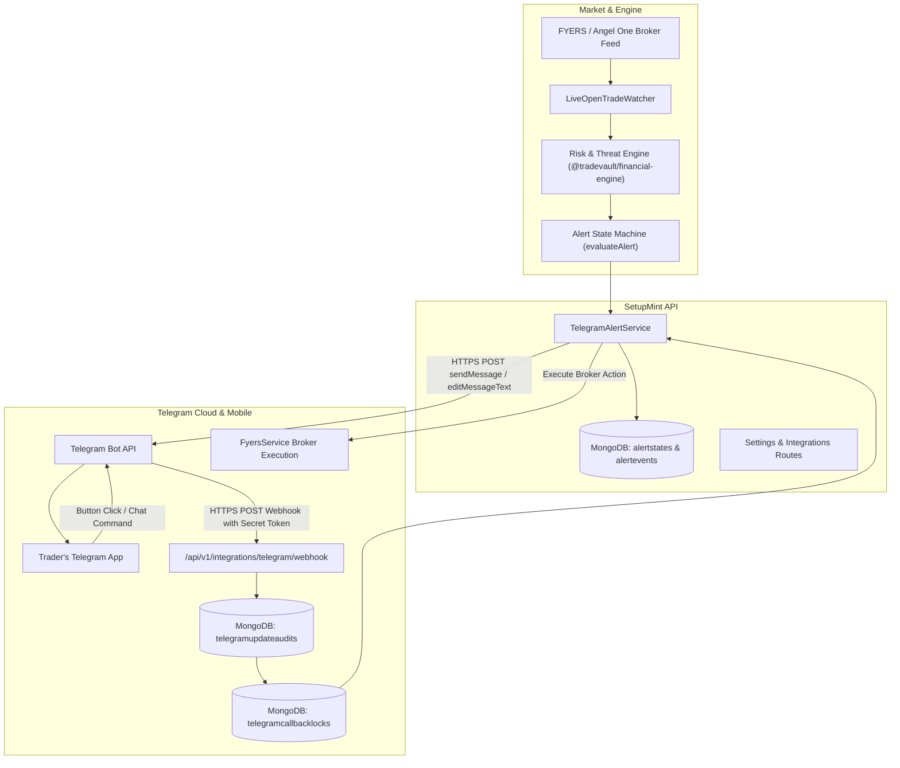
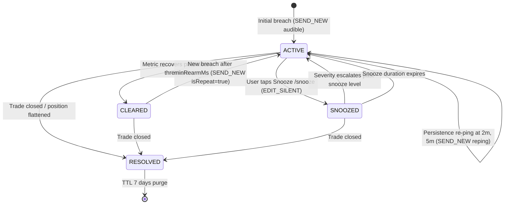
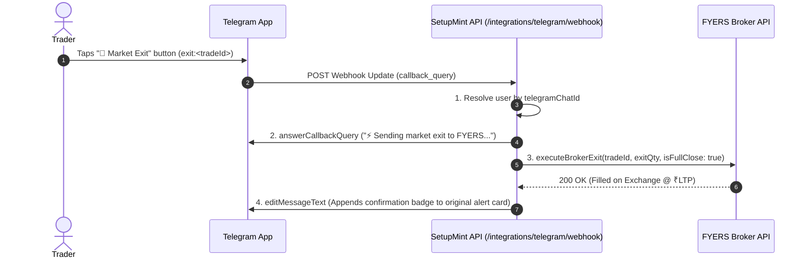

# SetupMint — Telegram Bot & Real-Time Push Alerts Architecture

This document details the architecture, alert state machine, hysteresis rules, two-way interactive command engine, inline button callbacks, webhook security, and real-time risk alert pipeline implemented in **SetupMint** via the **Telegram Bot API**.

---

## 1. Overview & Purpose

SetupMint provides a **two-way Telegram Bot integration** engineered to give traders off-screen trade surveillance and emergency mobile execution without requiring an open browser tab:

- **Audible Off-Screen Risk Alerts:** Instant audio/haptic push alerts to the trader's mobile phone via Telegram (`disable_notification: false`) when high-risk events occur (critical stop loss threats, profit givebacks, daily loss breaches, or naked unhedged positions).
- **In-Place Live Card Telemetry:** Single persistent live message card per open trade edited in-place (throttled to 10s intervals) displaying exact floating net PnL, "If SL" loss including Indian statutory charges, price velocity, tick distance, day-loss usage, and deterministic rule hints.
- **Alert State Machine & Hysteresis:** Prevents notification spam, duplicate alerts, and rapid oscillatory flapping via distinct entry/clear hysteresis thresholds, severity escalation, persistence re-pings, snooze with escalation breaks, and re-entry gap enforcement.
- **Contextual & Guarded Inline Keyboards:** Dynamic action buttons embedded directly underneath alert messages (`🚨 Exit`, `🛡️ Lock BE`, `🎯 Book 50%`, `💤 Snooze 10m`) featuring cardVersion validation, 15-second double-tap idempotency locks, slippage protection, and true breakeven profitability checks.
- **Two-Way Chat Commands:** Direct chat commands (`/pnl`, `/trades`, `/summary`, `/panic`, `/alerts`, `/snooze`, `/mute`) returning monospace telemetry and portfolio status reports.
- **Automated Lifecycle Triggers:** Instant notifications when trades are opened, closed (marking alert states RESOLVED), or when daily market close summaries are ready.



---

## 2. Alert State Machine & Hysteresis Architecture

All alerts pass through the pure mathematical decision engine in `@tradevault/financial-engine` (`alert-state.ts`). The API service layer persists snapshots to the `alertstates` collection and only executes broker orders or sends Telegram messages when instructed by the state machine.

### 2.1 State Lifecycle



### 2.2 Hysteresis Thresholds & Rules

To eliminate alerting noise and notification flapping around volatile boundary prices:

1. **STOP_THREAT:**
   - **Enter CRITICAL:** Stop buffer $\le 25\%$ of initial risk corridor (or $LTP$ crosses trigger threshold). Audible `SEND_NEW`.
   - **Clear Threshold:** Stop buffer recovers $> 40\%$. State transitions to `CLEARED`.
   - **Breached:** Stop buffer $\le 0\%$. Audible `SEND_NEW`.
   - Price movement between $25\%$ and $40\%$ produces silent live-card edits (`EDIT_SILENT`) or `SKIP`, never repeat audio alerts.
2. **GIVEBACK:**
   - **Enter LEAKING:** Floating profit gives back $\ge 35\%$ from peak MFE.
   - **Clear Threshold:** Giveback falls below $25\%$.
   - **CRITICAL_REVERSAL:** Position reverses below $+0.5R$ after achieving $\ge +2.0R$ peak. Clears when current $R > 0.5$.
3. **Severity Escalation:** Only upward severity escalation ($0 \to 1 \to 2 \to 3$) emits audible notifications (`SEND_NEW`). Equal or downward severity updates the existing message silently (`EDIT_SILENT`).
4. **Re-entry Enforcement (`minRearmMs`):** After a threat is `CLEARED`, a recurring breach before $180,000\text{ ms}$ (3 minutes) is suppressed (`SKIP`). Once the cooldown window passes, re-entry triggers `SEND_NEW` with `isRepeat = true` and `enterCount + 1`.
5. **Persistence Re-pings:** For unacknowledged `CRITICAL` or `BREACHED` alerts, re-pings are dispatched at 2 minutes and 5 minutes, then every 5 minutes up to a maximum of 3 re-pings (`maxRepings = 3`), then ceases.
6. **Snooze Support:** Suppresses notifications until `snoozedUntil` expires, unless severity escalates above the severity level present when snoozed.
7. **Terminal Resolution:** When a trade closes, all alert states referencing that trade transition to `RESOLVED` with a 7-day TTL index on `resolvedAt`.

---

## 3. Configuration & Webhook Security

### 3.1 Bot Credentials & Encryption at Rest
- Bot tokens are stored encrypted at rest using AES-256-GCM (`enc:v1:` envelope) via `crypto.service.ts`.
- The `User.toJSON()` serializer permanently strips `liveWatcherSettings.telegramBotToken` to prevent leakage in REST responses.
- In [`apps/api/src/server.ts`](file:///Users/komal/projects/Trading%20Vault/apps/api/src/server.ts), bot tokens, chat IDs, and webhook secret tokens are redacted in Pino logs with `[Redacted]`.

### 3.2 Webhook Registration & Secret Verification
1. SetupMint registers the webhook with Telegram using `setWebhook`:
   - URL: `https://<api-domain>/api/v1/integrations/telegram/webhook`
   - Secret Token: SetupMint computes a deterministic secret token from `APP_SECRET` and passes `secret_token` to Telegram.
2. Every incoming webhook request is validated against the `x-telegram-bot-api-secret-token` HTTP header. Missing or invalid tokens immediately reject with `401 Unauthorized`.
3. Fastify returns `200 OK` within $<50\text{ ms}$ and asynchronously dispatches updates to prevent Telegram retry timeouts.
4. Duplicate webhook updates are discarded via a unique index on `update_id` in `TelegramUpdateAudit` with a 24-hour TTL.

---

## 4. Contextual Inline Keyboards & Execution Guards

Alert buttons are contextual and state-aware:

- **STOP_THREAT:** `🚨 Exit @~₹LTP`, `🛡️ Lock BE` (only rendered if LTP is on the profitable side of True Breakeven), `💤 Snooze 10m`, `🔄 Refresh`.
- **GIVEBACK:** `🎯 Book 50%`, `🚨 Exit @~₹LTP`, `🛡️ Trail to BE`, `💤 Snooze 10m`.
- **NAKED_POSITION:** `🚨 Exit Position`, `🔄 Refresh`.
- **CLEARED / RECOVERED:** Action buttons are stripped, leaving only `🔄 Refresh`.

### Callback Protocol & Safety Pipeline

```
Callback Data Wire Format (<= 64 bytes):
x:<tradeId>:<actionCode>:<cardVersion>:<renderLtp>
```

When a button is tapped, the following validation pipeline executes in strict sequence:

```mermaid
flowchart TD
    Tap[Trader taps button] --> ResolveUser[1. Resolve User from telegramChatId]
    ResolveUser --> CheckOpen[2. Validate Trade belongs to user and is OPEN]
    CheckOpen --> CheckVersion[3. Compare cardVersion against AlertState]
    CheckVersion -- Stale Version --> StaleMsg[answerCallbackQuery: Card outdated, refreshed]
    CheckVersion -- Valid Version --> CallbackLock[4. Acquire Idempotency Lock tradeId:action]
    CallbackLock -- Double Tap Blocked --> LockMsg[answerCallbackQuery: Action already in progress]
    CallbackLock -- Lock Acquired --> Ack[5. answerCallbackQuery: Processing on FYERS...]
    Ack --> SlippageCheck[6. Slippage Guard: |LTP - renderLtp| / renderLtp > slippageGuardPercent]
    SlippageCheck -- Exceeds Guard --> ConfirmPrompt[Edit Card with Slippage Warning & Confirm Button]
    SlippageCheck -- Within Guard --> ExecuteOrder[7. Execute Broker Action via FyersService]
    ExecuteOrder --> EditCard[8. Edit Message Text with Fill Badge & Strip Buttons]
    EditCard --> AuditLog[9. Append TELEGRAM_* to trade.auditLog and record AlertEvent]
```

1. **Card Version Verification:** If the user clicks an outdated button, SetupMint cancels execution, informs the user via `answerCallbackQuery`, and refreshes the card to the current terminal state.
2. **Double-Tap Idempotency Lock:** Double taps within 15 seconds are caught by a unique index on `TelegramCallbackLock (lockKey: ${tradeId}:${actionCode})`, ensuring exactly **one** broker order is sent.
3. **Slippage Protection:** If current market price deviates from the card's `renderLtp` by more than `slippageGuardPercent` (configurable, default `0.5%`), execution halts and prompts with a one-tap confirmation card showing the updated price.
4. **Auditability:** Every executed action updates the trade's `auditLog` with `changedBy: 'telegram'` and records execution latency in `alertevents`.

---

## 5. Institutional Monospace Alert Cards

All telemetry cards use preformatted HTML (`<pre>`) to deliver compact, aligned metrics:

```text
🔴 CRITICAL · NIFTY 24500 CE · LONG       ↩️ 2nd test in 14m
Price approaching stop loss boundary

LTP      ₹121.40   (−0.90 / 60s)
SL       ₹118.00   3.4 pts · 68 ticks
R now    −0.62R    (peak +0.40R, 11m ago)
Float    −₹2,340   net of est. fees
If SL    −₹3,610   incl. charges
Time     23m in trade · velocity −₹95/min
Day      ₹6,200 / ₹15,000 loss limit (41%)
Open risk (all trades) ₹7,100

💡 Exit now saves ₹1,270 vs stop. Downward velocity high.
```

- **Net Financial Calculations:** Floating PnL and "If SL" losses are computed using `IndianChargesCalculator` and `Decimal.js` (30 digits precision, `ROUND_HALF_UP`), reflecting true take-home amounts net of brokerage, STT, exchange turnover fees, SEBI charges, stamp duty, and GST.
- **Velocity Telemetry:** Tracks 60-second price and monetary velocity ($\Delta\text{Price}$ and $\Delta\text{₹}/\text{min}$).
- **Deterministic Rule Hints:** Derived strictly from quantitative engine indicators (ladder milestones, giveback thresholds, stagnation, tilt warnings). Zero LLM hallucinations.
- **Sound Notification Tiers:**
  - **Audible (`disable_notification: false`):** CRITICAL, BREACHED, CRITICAL_REVERSAL, DAILY_LOSS breach, NAKED_POSITION.
  - **Silent (`disable_notification: true`):** Information updates, ladder milestone notices, in-place live card telemetry edits.

---

## 6. Two-Way Commands Reference

| Command | Description |
| :--- | :--- |
| **`/start`** or **`/help`** | Displays bot capabilities and account profile. |
| **`/pnl`** | Monospace card displaying live floating net/gross P&L, unrealized R-multiple, fees, and day P&L. |
| **`/trades`** | Lists all currently open positions with LTP, stop loss distance, and action buttons. |
| **`/summary`** | Mid-session or end-of-day digest: closed trades count, win rate %, net P&L, harvested R. |
| **`/panic`** or **`/killswitch`** | Two-step fail-safe emergency market exit for all open positions. |
| **`/alerts`** | Lists all active, snoozed, or recently cleared alert states. |
| **`/snooze [mins]`** | Snoozes alert notifications for active positions (default 10 mins). Breaks on severity escalation. |
| **`/mute [mins]`** | Mutes all non-critical notifications for the specified duration. |

---

## 2. Configuration & Authentication Setup

### 2.1 Generating Bot Credentials
1. **Create Bot:** Message `@BotFather` on Telegram, send `/newbot`, name your bot (e.g., `MySetupMintBot`), and copy the issued **Telegram Bot Token** (e.g. `123456789:ABCdefGHIjklMNOpqrSTUvwxyz`).
2. **Find Chat ID:** Start a chat with `@userinfobot` or send a direct message to your newly created bot, then copy your numeric **Chat ID** (e.g. `987654321`).
3. **Save in SetupMint:**
   - Navigate to **Settings > Live Open Trade Watcher > Telegram Off-Screen Push Alerts**.
   - Enable **Telegram Off-Screen Push Alerts**.
   - Input **Telegram Bot Token** and **Telegram Chat ID**.
   - Click **Test Link** to dispatch an instant rich verification card.
   - Click **Save Watcher Settings**.

### 2.2 Registering the Two-Way Webhook
To enable interactive buttons and commands (`/pnl`, `/trades`, `/panic`), the bot needs a public webhook endpoint pointing back to SetupMint:
- **Webhook URL:** `https://<api-domain>/api/v1/integrations/telegram/webhook`
- **One-Click Registration:** In **Settings > Live Watcher**, click **Register Webhook**. SetupMint calls `https://api.telegram.org/bot<TOKEN>/setWebhook` with `allowed_updates: ['message', 'callback_query']`.
- **Public Accessibility:** Telegram webhooks require a publicly accessible HTTPS URL. On local development environments, tools like `ngrok` or Cloudflare Tunnels can expose the webhook.

---

## 3. Two-Way Interactive Commands

Traders can send standard slash commands directly in their Telegram chat:

| Command | Action & Response Card | Available Interactive Buttons |
| :--- | :--- | :--- |
| **`/start`** or **`/help`** | Displays available bot commands and the authenticated account profile name. | None |
| **`/pnl`** | Monospace card displaying live floating net/gross P&L, unrealized R-multiple, estimated fees, realized P&L today, and overall day net P&L. | `📋 View Open Trades`, `🚨 Panic Exit All` |
| **`/trades`** | Iterates across all currently open trades, showing Entry Price, LTP, Floating P&L, Stop Loss level, Distance to Stop, and True Breakeven price. | `🚨 Market Exit`, `🛡️ Lock True BE`, `🎯 Book 50%` |
| **`/summary`** | End-of-day or mid-session performance digest: total closed trades, win/loss count, win rate %, net P&L, and net harvested R-multiples. | None |
| **`/panic`** or **`/killswitch`** | Prompts for confirmation to market-exit all active open positions across the broker exchange immediately. | `🛑 YES, CLOSE ALL POSITIONS NOW` |

---

## 4. Inline Action Callbacks & Broker Execution

When a trader taps an inline keyboard button on an alert or command card:



### Supported Callback Actions:
1. **`exit:<tradeId>` (Market Exit):**
   - Dispatches a market exit order to FYERS for the trade's active quantity.
   - Updates the original Telegram message with a green `[✅ EXECUTED MARKET EXIT ON FYERS]` confirmation banner showing traded price and fill timestamp.
2. **`lock_be:<tradeId>` (Lock True Breakeven):**
   - Retrieves the trade's `trueBreakevenPrice` from `LiveWatcherService` (which covers entry price + all estimated statutory brokerage, STT, exchange, and GST charges).
   - Modifies the active resting stop loss order on the broker.
   - Appends `[🛡️ STOP LOCKED AT TRUE BREAKEVEN]` to the message.
3. **`book_50:<tradeId>` (Book 50% & Trail BE):**
   - Submits a market exit for 50% of the open position quantity.
   - Modifies the resting stop loss order for the remainder to true breakeven.
   - Appends `[🎯 50% BOOKED & STOP TO BREAKEVEN]` to the message.
4. **`panic_prompt` & `confirm_panic` (Emergency Killswitch):**
   - Two-step fail-safe confirmation.
   - Iterates through all open trades under the user's account and submits immediate market exits to FYERS.
   - Edits the alert to display `[🚨 EMERGENCY KILLSWITCH COMPLETE - Flattened N positions]`.

---

## 5. Real-Time Alert Event Categories

Traders can selectively toggle any of the **9 alert event categories** from **Settings > Live Watcher Settings**:

| Event Key | Label in Settings | Description & Trigger Threshold |
| :--- | :--- | :--- |
| **`stopThreatCritical`** | Stop Threat: Critical / Breached | Fires when distance between LTP and stop loss narrows to **CRITICAL** (top 15% of risk corridor) or **BREACHED**. Includes market exit and lock BE buttons. |
| **`givebackLeaking`** | Profit Giveback: Leaking Radar | Fires when an open winner gives back significant peak MFE (e.g. retreating from +2.5R to +1.2R, crossing the `givebackThresholdPercent` setting). |
| **`ladderMilestoneReached`** | Scaling Ladder: Milestones | Fires when price hits multi-target scaling ladder steps (Target 1 +1.0R, Target 2 +2.0R, or Runner +3.0R). |
| **`dailyLossBreached`** | Daily Loss Limit Breached | Fires at 75% warning and 100% hard breach of configured `maxDailyLoss` limit, rendering a visual ASCII progress bar of risk exhausted. |
| **`nakedPositionWarning`** | Naked Position Warning (Missing SL) | Fires when a position has been active for > 3 minutes with zero resting stop loss order on the broker orderbook. |
| **`tokenExpiryWarning`** | Broker Daily Token Expiry Warning | Dispatched in the morning (30 minutes prior) if the FYERS daily 24-hour OAuth token has expired or is nearing expiration. |
| **`tradeOpened`** | Trade Opened (Execution Notification) | Dispatched immediately whenever a new trade is created manually or imported from a live FYERS execution fill. |
| **`tradeClosed`** | Trade Closed (P&L & Excursion Summary) | Dispatched immediately upon trade exit, reporting Net P&L (₹), Realized R-multiple, Exit Price, and Exit Reason. |
| **`eodSummaryDigest`** | End of Day Performance Digest | Dispatched automatically at market close (15:35 IST) summarizing day's closed trades, win rate %, and net P&L. |

---

## 6. Message Formatting & Institutional Aesthetics

All Telegram messages generated by `TelegramAlertService` adhere to clean, terminal-inspired institutional formatting:

- **Audible Alerts (`disable_notification: false`):** Strictly audible and vibrating so mobile notifications break through phone sleep mode during active market hours.
- **Monospace Preformatted Data Cards (`<pre>`):** Metrics (Entry, LTP, P&L, StopLoss, Exposure) are aligned using monospace tables for instant mobile readability without horizontal overflow.
- **ASCII Progress Bars:** Renders text-based graphical bars for risk depletion and target progress:
  ```text
  Daily Risk Exhausted: [████████░░] 80%
  ```
- **Timezone Standardization:** All timestamps are formatted explicitly in Indian Standard Time (`Asia/Kolkata` / IST).
- **Intelligent Deduplication:** Identical alerts are debounced by a 60-second cooldown window (`DEBOUNCE_MS = 60,000 ms`) to prevent notification spam during violent market price oscillations.

---

## 7. Security & Tenant Privacy

1. **Strict Chat ID Tenant Isolation:** Incoming webhook updates match `liveWatcherSettings.telegramChatId`. An unrecognized Chat ID cannot query trades or execute broker orders and receives an unlinked setup guide.
2. **Encrypted Storage:** User Telegram Bot Tokens and Chat IDs are stored in MongoDB Atlas within the authenticated `User` document.
3. **Redacted Logs:** In [`apps/api/src/server.ts`](file:///Users/komal/projects/Trading%20Vault/apps/api/src/server.ts), Telegram bot tokens and webhook payloads are automatically redacted from Pino logs with `[Redacted]`.
4. **Zero Third-Party Relays:** All communication occurs strictly between SetupMint's dedicated Fastify API server and the official Telegram Bot API (`https://api.telegram.org`). No intermediary webhook proxies or commercial alert services are used.

