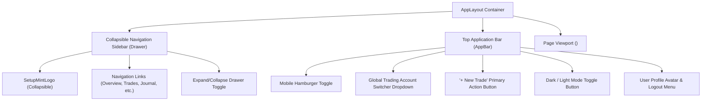

# SetupMint — UI Components & Design System Specification

This document details the design system, component hierarchy, theme tokens, layout structures, and accessibility conventions implemented in the **SetupMint** frontend application ([`apps/web/src/`](file:///Users/komal/projects/Trading%20Vault/apps/web/src/)).

---

## 1. Design System Principles & Theme Architecture

SetupMint implements a modern, precision-engineered trading terminal aesthetic built with **Material UI (MUI v9)**, **Emotion**, and **Tailwind CSS v3**:

- **Dark Mode First:** Default mode is a sleek dark terminal palette tailored for prolonged market monitoring.
- **Brand Palette:** Precision Mint/Emerald green accents symbolizing discipline, profitability, and clarity:
  - Mint Primary: `#10B981` (Emerald 500)
  - Mint Bright: `#34D399` (Emerald 400)
  - Mint Dark: `#059669` (Emerald 600)
- **Neutral Surfaces:** Deep slate/navy foundations (`#0F172A`, `#020617`, `#1E293B`) ensuring high-contrast readability without harsh glare.
- **Semantic Colors:**
  - Profit / Win: `#10B981` (Green)
  - Loss: `#F43F5E` / `#EF4444` (Rose / Red)
  - Breakeven / Neutral: `#64748B` (Slate)
  - Warning: `#F59E0B` (Amber)
  - Info: `#3B82F6` (Blue)
- **Typography:** Modern sans-serif stack (`Inter`, system-ui) paired with monospace typography (`JetBrains Mono`, monospace) for financial figures, lot sizes, and currency numbers.

---

## 2. Layout & Navigation Hierarchy

The application layout is encapsulated in [`apps/web/src/components/layout/AppLayout.tsx`](file:///Users/komal/projects/Trading%20Vault/apps/web/src/components/layout/AppLayout.tsx):

### Navigation Items:
1. `/` — Overview (Dashboard)
2. `/trades` — Trades Ledger
3. `/journal` — Journal Calendar
4. `/analytics` — Analytics & Psychology
5. `/strategies` — Strategy Playbook
6. `/risk-calculator` — Risk Calculator
7. `/accounts` — Accounts Ledger
8. `/instruments` — Instruments Catalog
9. `/reports` — Reports & Data Portability
10. `/settings` — Settings & Configuration

---

## 3. Reusable UI Primitives

### 1. `SetupMintLogo.tsx` ([`apps/web/src/components/brand/SetupMintLogo.tsx`](file:///Users/komal/projects/Trading%20Vault/apps/web/src/components/brand/SetupMintLogo.tsx))
- Renders vector geometric brand icon (ascending trend chevron, central candlestick wick, and diamond foundation).
- Supports three sizes: `sm`, `md`, `lg`.
- Configurable `collapsed` mode for compact sidebar drawer state.
- Includes `"PRO"` badge and tagline `"Trade. Track. Improve."`.

### 2. `ConfirmDialog.tsx` ([`apps/web/src/components/ui/ConfirmDialog.tsx`](file:///Users/komal/projects/Trading%20Vault/apps/web/src/components/ui/ConfirmDialog.tsx))
- Accessible modal dialog for destructive actions (deleting trades, wiping accounts, resetting demo data).
- Renders custom warning icon, explanatory text, cancel button, and danger-themed confirmation button with loading spinner.

### 3. `QuickCloseTradeDialog.tsx` ([`apps/web/src/components/trades/QuickCloseTradeDialog.tsx`](file:///Users/komal/projects/Trading%20Vault/apps/web/src/components/trades/QuickCloseTradeDialog.tsx))
- Compact modal dialog for rapid closure of `OPEN` and `PLANNED` trades directly from `/trades` or `/trades/:id`.
- Prompts for exit price, exit date/time (defaults to current local time), and optional exit fees.
- Real-time statutory fee calculation via `@tradevault/financial-engine` with manual override and reset.
- Live Net Realized P&L preview banner before closing the position.

### 4. `CommandPalette.tsx` ([`apps/web/src/components/layout/CommandPalette.tsx`](file:///Users/komal/projects/Trading%20Vault/apps/web/src/components/layout/CommandPalette.tsx))
- Global `Cmd+K` / `Ctrl+K` command search modal with full keyboard navigation (`↑`/`↓`/`↵`/`Esc`).
- Provides quick actions: Log New Trade (`N`), Repeat Last Trade (`R`), Jump to Today's Journal (`J`), Open Risk Calculator (`C`), and instant fuzzy page navigation.

### 5. `Modal.tsx` ([`apps/web/src/components/ui/Modal.tsx`](file:///Users/komal/projects/Trading%20Vault/apps/web/src/components/ui/Modal.tsx))
- Base modal wrapper with smooth backdrop transition, keyboard `Esc` listener, and focus trapping.

---

## 4. Trade Entry & Form Architecture

The central trade logging experience is managed by [`TradeFormModal.tsx`](file:///Users/komal/projects/Trading%20Vault/apps/web/src/components/trades/TradeFormModal.tsx), composed of specialized sub-components:

| Component | Responsibility |
| :--- | :--- |
| `TradeCalculationBanner` | Displays live real-time gross P&L, statutory fee breakdown, AUTO/MANUAL fee chip with reset action, net P&L, realized R-multiple, and strategy minimum R:R violation warning before form submission. |
| `TradeTemplateSelector` | One-click prefill chips for common market setups (e.g., Nifty Breakout, BankNifty Mean Reversion). |
| `TradeQuickSection` | Express trade entry with instrument autofill (currency, multiplier, lot size), bidirectional **Lots** / Quantity conversion, auto-session derivation, strategy playbook selection with auto-confluences prefill, and auto statutory fee breakdown with manual override and reset. |
| `TradeAdvancedFills` | Interactive chronological list of entry and exit fills with FIFO lot matching. |
| `TradeJournalDetails` | Accordion containing deep-dive tabs: Identity, Execution, Risk, Technical Thesis, and Psychology. |
| `TradeAttachmentUploader` | Multi-file drag-and-drop and direct clipboard paste (`Ctrl+V` / `Cmd+V`) dropzone with staging preview, progress indicators, and category selection. |

---

## 5. Notification System (`ToastContext.tsx`)

Implemented in [`apps/web/src/context/ToastContext.tsx`](file:///Users/komal/projects/Trading%20Vault/apps/web/src/context/ToastContext.tsx):
- Provides programmatic notification dispatch: `toast.success()`, `toast.error()`, `toast.info()`, `toast.warning()`.
- Floating notification stack fixed at the top-right of the viewport (`z-index: 9999`).
- Features progress bar countdown, manual dismiss button, and automatic timeout (default: 4,000ms).
- Smooth spring animations for enter and exit transitions.

---

## 6. Skeletons, Empty States & Loading Indicators

1. **Dashboard Skeleton:** Renders placeholder KPI card boxes and chart containers during initial data load.
2. **Table Empty States:** Master tables display descriptive empty states with illustrated icons and clear Call-to-Action (CTA) buttons (e.g., `"No trades recorded yet. Click 'Log New Trade' to begin."`).
3. **Button Loading States:** All submission buttons disable during network transit and render spinning `CircularProgress` indicators.

---

## 7. Responsive Behavior & Breakpoints

- **Desktop ($\ge 1200\text{px}$):** Full 250px persistent sidebar drawer; dual-column dashboard layout.
- **Tablet ($900\text{px} - 1199\text{px}$):** Collapsed 72px icon-only sidebar drawer.
- **Mobile ($< 900\text{px}$):** Drawer converts to temporary off-canvas sliding drawer toggled via header hamburger button. Grid layouts collapse to single-column vertical stacks.
