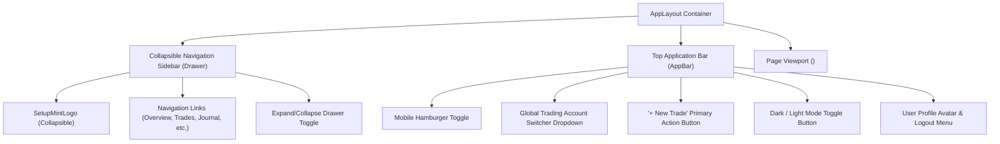

# SetupMint — UI Components & Design System Specification

This document details the design system, component hierarchy, theme tokens, layout structures, and accessibility conventions implemented in the **SetupMint** frontend application ([`apps/web/src/`](file:///Users/komal/projects/Trading%20Vault/apps/web/src/)).

---

## 1. Design System Principles & Theme Architecture

SetupMint implements a modern, precision-engineered trading terminal aesthetic built with **Material UI (MUI v9)**, **Emotion**, and **Tailwind CSS v3**:

- **Dark Mode First:** Default mode is a sleek dark terminal palette tailored for prolonged market monitoring.
- **Brand Palette:** Precision Mint/Emerald green accents symbolizing discipline, profitability, and clarity:
  - Mint Primary: `#10B981` (Emerald 500)
  - Mint Bright: `#34D399` (Emerald 400)
  - Mint Dark: `#059669` (Emerald 600)
- **Neutral Surfaces:** Deep slate/navy foundations (`#0F172A`, `#020617`, `#1E293B`) ensuring high-contrast readability without harsh glare.
- **Semantic Colors:**
  - Profit / Win: `#10B981` (Green)
  - Loss: `#F43F5E` / `#EF4444` (Rose / Red)
  - Breakeven / Neutral: `#64748B` (Slate)
  - Warning: `#F59E0B` (Amber)
  - Info: `#3B82F6` (Blue)
- **Typography:** Modern sans-serif stack (`Inter`, system-ui) paired with monospace typography (`JetBrains Mono`, monospace) for financial figures, lot sizes, and currency numbers.

---

## 2. Layout & Navigation Hierarchy

The application layout is encapsulated in [`apps/web/src/components/layout/AppLayout.tsx`](file:///Users/komal/projects/Trading%20Vault/apps/web/src/components/layout/AppLayout.tsx):



### Navigation Items:
1. `/` — Overview (Dashboard)
2. `/trades` — Trades Ledger
3. `/journal` — Journal Calendar
4. `/analytics` — Analytics & Psychology
5. `/strategies` — Strategy Playbook
6. `/risk-calculator` — Risk Calculator
7. `/accounts` — Accounts Ledger
8. `/instruments` — Instruments Catalog
9. `/reports` — Reports & Data Portability
10. `/settings` — Settings & Configuration

---

## 3. Reusable UI Primitives

### 1. `SetupMintLogo.tsx` ([`apps/web/src/components/brand/SetupMintLogo.tsx`](file:///Users/komal/projects/Trading%20Vault/apps/web/src/components/brand/SetupMintLogo.tsx))
- Renders vector geometric brand icon (ascending trend chevron, central candlestick wick, and diamond foundation).
- Supports three sizes: `sm`, `md`, `lg`.
- Configurable `collapsed` mode for compact sidebar drawer state.
- Includes `"PRO"` badge and tagline `"Trade. Track. Improve."`.

### 2. `ConfirmDialog.tsx` ([`apps/web/src/components/ui/ConfirmDialog.tsx`](file:///Users/komal/projects/Trading%20Vault/apps/web/src/components/ui/ConfirmDialog.tsx))
- Accessible modal dialog for destructive actions (deleting trades, wiping accounts, resetting demo data).
- Renders custom warning icon, explanatory text, cancel button, and danger-themed confirmation button with loading spinner.

### 3. `QuickCloseTradeDialog.tsx` ([`apps/web/src/components/trades/QuickCloseTradeDialog.tsx`](file:///Users/komal/projects/Trading%20Vault/apps/web/src/components/trades/QuickCloseTradeDialog.tsx))
- Compact modal dialog for rapid closure of `OPEN` and `PLANNED` trades directly from `/trades` or `/trades/:id`.
- Prompts for exit price, exit date/time (defaults to current local time), and optional exit fees.
- Real-time statutory fee calculation via `@tradevault/financial-engine` with manual override and reset.
- Live Net Realized P&L preview banner before closing the position.

### 4. `CommandPalette.tsx` ([`apps/web/src/components/layout/CommandPalette.tsx`](file:///Users/komal/projects/Trading%20Vault/apps/web/src/components/layout/CommandPalette.tsx))
- Global `Cmd+K` / `Ctrl+K` command search modal with full keyboard navigation (`↑`/`↓`/`↵`/`Esc`).
- Provides quick actions: Log New Trade (`N`), Repeat Last Trade (`R`), Jump to Today's Journal (`J`), Open Risk Calculator (`C`), and instant fuzzy page navigation.

### 5. `Modal.tsx` ([`apps/web/src/components/ui/Modal.tsx`](file:///Users/komal/projects/Trading%20Vault/apps/web/src/components/ui/Modal.tsx))
- Base modal wrapper with smooth backdrop transition, keyboard `Esc` listener, and focus trapping.

### 6. `DateRangeFilter.tsx` ([`apps/web/src/components/ui/DateRangeFilter.tsx`](file:///Users/komal/projects/Trading%20Vault/apps/web/src/components/ui/DateRangeFilter.tsx))
- Universal date range selector button and popover supporting 14 financial presets plus custom start/end dates.
- See **Section 9** for full architectural and visual specification.

---

## 4. Trade Entry & Form Architecture

The central trade logging experience is managed by [`TradeFormModal.tsx`](file:///Users/komal/projects/Trading%20Vault/apps/web/src/components/trades/TradeFormModal.tsx), composed of specialized sub-components:

| Component | Responsibility |
| :--- | :--- |
| `TradeCalculationBanner` | Displays live real-time gross P&L, statutory fee breakdown, AUTO/MANUAL fee chip with reset action, net P&L, realized R-multiple, and strategy minimum R:R violation warning before form submission. |
| `TradeTemplateSelector` | One-click prefill chips for common market setups (e.g., Nifty Breakout, BankNifty Mean Reversion). |
| `TradeQuickSection` | Express trade entry with instrument autofill (currency, multiplier, lot size), bidirectional **Lots** / Quantity conversion, auto-session derivation, strategy playbook selection with auto-confluences prefill, and auto statutory fee breakdown with manual override and reset. |
| `TradeAdvancedFills` | Interactive chronological list of entry and exit fills with FIFO lot matching. |
| `TradeJournalDetails` | Accordion containing deep-dive tabs: Identity, Execution, Risk, Technical Thesis, and Psychology. |
| `TradeAttachmentUploader` | Multi-file drag-and-drop and direct clipboard paste (`Ctrl+V` / `Cmd+V`) dropzone with staging preview, progress indicators, and category selection. |

---

## 5. Notification System (`ToastContext.tsx`)

Implemented in [`apps/web/src/context/ToastContext.tsx`](file:///Users/komal/projects/Trading%20Vault/apps/web/src/context/ToastContext.tsx):
- Provides programmatic notification dispatch: `toast.success()`, `toast.error()`, `toast.info()`, `toast.warning()`.
- Floating notification stack fixed at the top-right of the viewport (`z-index: 9999`).
- Features progress bar countdown, manual dismiss button, and automatic timeout (default: 4,000ms).
- Smooth spring animations for enter and exit transitions.

---

## 6. Skeletons, Empty States & Loading Indicators

1. **Dashboard Skeleton:** Renders placeholder KPI card boxes and chart containers during initial data load.
2. **Table Empty States:** Master tables display descriptive empty states with illustrated icons and clear Call-to-Action (CTA) buttons (e.g., `"No trades recorded yet. Click 'Log New Trade' to begin."`).
3. **Button Loading States:** All submission buttons disable during network transit and render spinning `CircularProgress` indicators.

---

## 7. Responsive Behavior & Breakpoints

- **Desktop ($\ge 1200\text{px}$):** Full 250px persistent sidebar drawer; dual-column dashboard layout.
- **Tablet ($900\text{px} - 1199\text{px}$):** Collapsed 72px icon-only sidebar drawer.
- **Mobile ($< 900\text{px}$):** Drawer converts to temporary off-canvas sliding drawer toggled via header hamburger button. Grid layouts collapse to single-column vertical stacks.

---

## 8. Multi-Panel Performance & Universal Drilldown Components

### 1. `MultiPanelEquityCurve.tsx` ([`apps/web/src/components/dashboard/MultiPanelEquityCurve.tsx`](file:///Users/komal/projects/Trading%20Vault/apps/web/src/components/dashboard/MultiPanelEquityCurve.tsx))
- **Role:** High-density, multi-panel performance visualization with synchronized Recharts time axes.
- **Features:**
  - Synchronized dual-panel charts via `syncId="setupmint-equity-sync"`.
  - **Upper Panel:** Money equity curve, cumulative-R curve, or synchronized dual-axis Both view. Includes up to 6 per-strategy overlays with `< 30 trades` sample-size warning badges. Overlays forward Monte Carlo expectancy cones (P5, P25, P50, P75, P95). Emits clickable event markers for Daily Loss Breaches (crimson) and High-Tilt Days (amber).
  - **Lower Panel:** Synchronized Underwater / Drawdown area graph with continuous drawdown depth, peak-to-trough max drawdown, and recovery duration indicators in calendar days and trade count.
  - **Interactive Drilldown:** Every curve point and event marker is clickable, invoking `openDrill()` with relevant trade IDs or filters.

### 2. `TradeDrillDrawer.tsx` ([`apps/web/src/components/drilldown/TradeDrillDrawer.tsx`](file:///Users/komal/projects/Trading%20Vault/apps/web/src/components/drilldown/TradeDrillDrawer.tsx))
- **Role:** Universal right-hand drawer / bottom sheet for immediate trade inspection anywhere across the application.
- **Layout & Responsiveness:**
  - 620px width on desktop ($\ge 900\text{px}$); full-width bottom sheet on mobile ($< 900\text{px}$).
  - Mounted once in [`AppLayout.tsx`](file:///Users/komal/projects/Trading%20Vault/apps/web/src/components/layout/AppLayout.tsx) to guarantee zero layout shifts and instant availability.
- **Modes:**
  - **Single Trade View:** Comprehensive trade header, P&L badge, R-multiple badge, execution fills, key confluences, discipline rating, mistake chips, screenshot previews, and direct navigation buttons (`"Open in Full Detail"`, `"Edit Trade"`).
  - **Multi-Trade List View:** Summary aggregate ribbon (`Total Trades`, `Net P&L`, `Win Rate %`, `Sum R`), sortable columns, outcome chips, and row click selection with smooth drill into single trade mode.
- **Keyboard Shortcuts:**
  - `j`: Move to next trade in list.
  - `k`: Move to previous trade in list.
  - `Esc`: Close drawer.

### 3. `TradeDrillContext.tsx` ([`apps/web/src/context/TradeDrillContext.tsx`](file:///Users/komal/projects/Trading%20Vault/apps/web/src/context/TradeDrillContext.tsx))
- **Role:** React context provider wrapping the application tree in [`App.tsx`](file:///Users/komal/projects/Trading%20Vault/apps/web/src/App.tsx).
- **Capabilities:**
  - Exposes `openDrill(descriptor)` and `closeDrill()`.
  - Automatically synchronizes active drill descriptor with the browser URL (`?drill=<base64-json>`), enabling browser history back/forward navigation and shareable deep links.
  - 150ms debounced prefetching cache to ensure instant drawer opening upon click.

---

## 9. Global Date Range Filter Architecture (`DateRangeFilter.tsx` & `DateRangeContext.tsx`)

### 1. `DateRangeFilter.tsx` ([`apps/web/src/components/ui/DateRangeFilter.tsx`](file:///Users/komal/projects/Trading%20Vault/apps/web/src/components/ui/DateRangeFilter.tsx))
- **Role:** Reusable, theme-aware date range picker component built with MUI v9 `Popover` and Tailwind CSS.
- **Visual Design & Aesthetics:**
  - **Trigger Button:** Polished terminal pill button showing a calendar icon (`CalendarTodayRounded`), the currently active preset badge (e.g. `THIS_FY`), and a formatted human-readable date span (e.g. `01 Apr 2026 – 26 Oct 2026`). Features subtle border glow (`focus:ring-1 focus:ring-emerald-500/50`) and chevron dropdown indicator.
  - **Popover Overlay:** 360px structured overlay with backdrop blur, deep slate background (`#0F172A` / `#020617`), and emerald border accent.
  - **Categorized Presets:** Presets are categorized into semantic groups:
    - *Quick:* `TODAY`, `YESTERDAY`, `7D`, `30D`, `90D`
    - *Calendar Periods:* `THIS_WEEK`, `LAST_WEEK`, `THIS_MONTH`, `LAST_MONTH`, `THIS_QUARTER`, `YTD`, `ALL_TIME`
    - *Fiscal Year:* `THIS_FY`, `LAST_FY` (Indian FY: April 1 to March 31, clipped to today for active FY)
  - **Custom Range Controls:**
    - Dual HTML5 date inputs (`Start Date`, `End Date`) with calendar picker icon and automatic max date clamping (`max={todayStr}`).
    - Dynamic inline validation alerts with warning icons for:
      - Start date after end date (`"Start date cannot be after end date"`).
      - Invalid calendar dates (`"Invalid start/end date format (YYYY-MM-DD)"`).
    - Disabled `"Apply Range"` button when invalid inputs exist, preventing bad network requests.
    - Quick `"Reset to All Time"` button to restore baseline view with single click.
- **Responsiveness & Mobile Ergonomics:**
  - Supports `fullWidth` prop for stacked layouts and mobile viewports (`< 900px`).
  - Native date picker interfaces trigger seamless mobile OS date wheels on touch devices.

### 2. `DateRangeContext.tsx` ([`apps/web/src/context/DateRangeContext.tsx`](file:///Users/komal/projects/Trading%20Vault/apps/web/src/context/DateRangeContext.tsx))
- **Role:** Monorepo-wide temporal state orchestrator wrapping the root component tree.
- **State Interface:**
  ```typescript
  interface DateRangeContextValue {
    preset: DateRangePreset;
    startDate?: string; // YYYY-MM-DD
    endDate?: string;   // YYYY-MM-DD
    formattedRange: string;
    setPreset: (preset: DateRangePreset) => void;
    setCustomRange: (startDate?: string, endDate?: string) => void;
    resetToDefault: () => void;
  }
  ```
- **URL Parameter Synchronization:**
  - Synchronizes filter state with URL search parameters (`?from=YYYY-MM-DD&to=YYYY-MM-DD&range=PRESET`), matching the deep-linking model of `TradeDrillContext`.
  - Enables browser back/forward history navigation and shareable link reproduction.
  - No `localStorage` pollution for active ranges; preserves clean URL truth.
- **Query Key Integration:**
  - Changing the date range updates `startDate` and `endDate`, which are incorporated into TanStack Query keys across all consumption views (Dashboard, Trades, Analytics, Strategies, Reports, Instruments), triggering clean surgical refetches without invalidating unrelated caches.

---

## 10. Execution Safety & Live Watcher Components

### 1. `HoldToConfirmButton.tsx` ([`apps/web/src/components/trades/live/HoldToConfirmButton.tsx`](file:///Users/komal/projects/Trading%20Vault/apps/web/src/components/trades/live/HoldToConfirmButton.tsx))
- **Role:** High-urgency execution button requiring continuous pressing and holding (~600ms default) before firing live broker market exits or panic square-offs.
- **Visual Design & Tactile Feedback:**
  - **Animated Circular Progress Ring:** Radial SVG spinner (`CircularProgress`) fills proportionally with elapsed hold duration.
  - **Linear Track Inset:** Subtle gradient overlay tracking left-to-right fill progress across the button surface.
  - **Press Spring Scale:** Subtly scales down (`scale(0.97)`) on pointer down, providing physical haptic sensation.
  - **Safety Cancellation:** Instant progress reset if pointer leaves the button, pointer cancels, or release occurs before 100%.
  - **Keyboard Accessibility:** Supports Space and Enter keydown hold-to-confirm with keyup cancellation.
  - **Disabled Reason Tooltips:** Surfaces descriptive tooltip explanations whenever execution is guarded or invalid.

### 2. Execution Dialogs with Pre-Flight Preview & Order Stepper
- **`QuickCloseTradeDialog.tsx` & `ExecuteLadderStepDialog.tsx`:**
  - **Pre-Flight Preview Panel:** Real-time computation of net realized P&L, lot-aware exit quantities, runner remaining lots, and resulting R-multiple before order transmission using `@tradevault/financial-engine`.
  - **Slippage Guard Banner:** Alerts traders if the execution price drifts beyond `slippageGuardPercent` from the rendered price.
  - **3-Stage Order Execution Stepper:** Stepper tracking `Sending` -> `Exchange Ack (Working)` -> `Filled` / `Rejected`, displaying FYERS order ID and fill price.
  - **Double-Submission Prevention:** In-flight submission lock preventing duplicate API requests or rapid double-taps.

### 3. `LiveUnifiedPriceLadder.tsx` ([`apps/web/src/components/trades/live/LiveUnifiedPriceLadder.tsx`](file:///Users/komal/projects/Trading%20Vault/apps/web/src/components/trades/live/LiveUnifiedPriceLadder.tsx))
- **Role:** Depth of Market (DOM) style vertical price ladder combining price gauge spatial intuition with multi-target scaling execution.
- **Visual Structure & Price Tiers:**
  - Strict descending vertical order from highest price at top to lowest price at bottom.
  - Targets (T3, T2, T1) with planned exit percentages, progress status chips, and 1-click execution buttons for met steps.
  - Peak MFE high-watermark amber marker with giveback distance.
  - Pulsing Live LTP marker with monospace price readout and point/R distance from entry.
  - True Breakeven tier with explicit statutory fee cushion points indicated and 1-click "Lock True BE" button.
  - Fill Entry price and active Stop Loss tier with threat badges.
  - Reduced-motion support disabling pulse and transition animations when `@media (prefers-reduced-motion: reduce)` is active.

### 4. `LivePortfolioRiskBanner.tsx` (Pinned Portfolio Risk & Discipline Strip)
- **Role:** High-visibility banner pinned above the open positions grid showing real-time portfolio-level risk and discipline limits.
- **Metrics Tracked:**
  - **Day Floating Loss Progress:** Visual progress bar tracking current floating loss against `maxDailyLoss`, featuring dedicated 75% amber warning marker and 100% crimson red circuit breaker marker.
  - **Total Open Risk Capital:** Aggregate initial risk capital committed across all open trades relative to user account risk profile.
  - **Open Positions Cap:** Current open trades count compared against `maxOpenTrades`, showing "CAP REACHED" badge upon saturation.
  - **Trades Today Limit:** Daily closed + open trades count compared against `maxDailyTrades`.
  - Preserves portfolio directional delta sensitivity, options theta decay bleed, and conflicting position alerts.

### 5. Three-Tier Density Hierarchy & Urgency Sort in `LiveOpenTradeWatcher.tsx`
- **Glance Mode:** High-density, compact card layout showing only instrument, direction, LTP, net floating P&L, unrealized R, next-action hint strip, SL runway, and hold-to-confirm quick market actions.
- **Standard Mode:** Adds tactical price section (`Classic Gauge` or `Vertical Ladder` toggle) and tactical strategy inspector tabs (`🪜 Scaling Ladder` vs `🛡️ Giveback Radar`).
- **Deep Mode:** Full analytics layout incorporating Black-Scholes Options Greeks, holding efficiency & stagnation radar, high-res sparkline trajectory, and psychological pulse timeline.
- **Deterministic Urgency Sort:** Prioritizes positions by threat level (`BREACHED` > `CRITICAL` > `CRITICAL_REVERSAL` / `LEAKING` > `ATTENTION` / `WATCH` > `SAFE`) with proximity to stop loss as tie-breaker.
- **Auto-Expansion with 60-Second Manual Collapse Immunity:** Critical trades automatically expand and float to top, while user manual collapse is respected for 60 seconds.

### 6. Attention Management & Multi-Channel Alert Sync
- **Tab Title & Favicon Badges:** Real-time throttled (2.5–3s) browser tab title reflection (`🚨 2 CRITICAL | -₹3,200 | SetupMint`). Dynamically renders alert status dots in SVG `<link rel="icon">` (🔴 Red for critical stop breach threats, 🟢 Green for positive MTM, 🟡 Amber for active trades) and cleanly restores original title and icon on unmount.
- **`LiveAlertCenterDialog.tsx` (In-App Threat Alert Center):** Interactive telemetry drawer synchronized bidirectionally with MongoDB `AlertState` and the background Telegram alert daemon. Shows active, snoozed, and resolved alerts with severity indicators. Snoozing from web suppresses Telegram pushes; clearing resolves alerts across all connected clients.
- **Watcher Layout Presets (`IWatcherLayoutPreset`):** Rapid workspace layout switcher for "⚡ Scalping" (1s refresh, Glance density, Vertical Ladder, Hotkeys armed), "📐 Positional" (30s refresh, Standard density, Classic Gauge, Hotkeys disabled), and "🔬 Deep Analytics" (5s refresh, Deep density, Vertical Ladder). Traders can save and persist custom view profiles directly to their user settings in MongoDB.
- **`HotkeyCheatSheetDialog.tsx` (Rapid Execution Overlay):** Comprehensive cheat sheet triggered by `?` or header action explaining `B` (Lock BE), `Space` (Book 50%), `K` (Kill Switch), `1-3` (Densities), `V` (Ladder toggle), `U` (Urgency sort), and `P` (Cycle preset). All action buttons display visible hotkey badges (`[B]`, `[Space]`, `[K]`).

### 7. Cognitive Ergonomics, Pop-Out Mini Watcher & Accessibility
- **Document Picture-in-Picture Mini Watcher:** Spawns an always-on-top floating PiP window running the Glance mode live monitor via React `createPortal`. Keeps critical risk metrics, floating P&L, and next-action triggers visible even when viewing charting software or external brokers. Gracefully falls back to standalone popup for unsupported browsers.
- **Accessibility & Monospace Readouts:** Monospace tabular numerals (`font-variant-numeric: tabular-nums`, `font-family: monospace`) applied across all live prices and P&L readouts to prevent horizontal jitter during tick updates.
- **Aria-Live Threat Announcements:** Hidden screen-reader live regions (`aria-live="assertive"` for critical stop breaches, `aria-live="polite"` for target step fills) provide non-visual situational awareness for visually impaired traders.
- **Colorblind-Safe Design:** All threat alerts and status pills couple colors with distinct geometric shapes and symbols (🔴 `[!]`, 🟡 `[▲]`, 🟢 `[✓]`, 🛡️ `BE`). Reduced-motion styles (`@media (prefers-reduced-motion: reduce)`) tone down flash transitions.

### 8. Post-Trade Feedback Loop & Psychological Trajectory (`TradeFlightRecorderDialog.tsx` & `LiveSparkline.tsx`)
- **`TradeFlightRecorderDialog.tsx` (Flight Recorder & Trade Receipt):**
  - **Automated Execution Grading:** Computed purely in `@tradevault/financial-engine` via `generatePostTradeReviewSummary`. Assigns grades $A+$ through $F$ based on MFE capture efficiency, profit retention, and stop discipline.
  - **Surrendered Giveback Telemetry:** Displays exact surrendered monetary giveback (₹) and percentage of peak unrealized profit lost before exit.
  - **Algorithmic Mistake Tags:** Detects execution flaws (`SURRENDERED_PROFIT`, `STOP_LOSS_WIDENED`, `FOMO_CHASE`, `HELD_INTO_REVERSAL`) with interactive 1-click toggling to enrich the trade's permanent journal record.
  - **Psychology Capture:** Automatically pre-fills emotional state from the last recorded in-trade pulse check-in, rule adherence switch, reflection note, and clipboard receipt copy.
  - **Journal Integration:** Persists debrief directly into trade psychology in MongoDB and routes directly to the detailed trade review.
- **MTM Trajectory Sparkline with Emotional Pulse Checkpoints (`LiveSparkline.tsx` & `TradeDetailPage.tsx`):**
  - Interactive SVG curve rendering the chronological MTM excursion with peak MFE, lowest MAE, entry, and exit points.
  - Renders emotion-coded pulse nodes (Calm `#10B981`, Confident `#3B82F6`, Anxious `#EF4444`, FOMO `#F59E0B`, Greedy `#EC4899`) plotted along the trajectory curve with rich tooltips.
  - Displays the in-trade emotional pulse history timeline and identified tactical mistake chips directly in the Psychology & Discipline Audit section of [`TradeDetailPage.tsx`](file:///Users/komal/projects/Trading%20Vault/apps/web/src/pages/TradeDetailPage.tsx).

---

## 9. Account-Driven Capability System & UI Gating

The SetupMint user interface enforces strict **account-driven capability gating**. No feature, tab, action button, or form field is rendered speculatively or "just in case".

### 1. The Single Source of Truth: `resolveAccountUiCapabilities`
Defined in `@tradevault/financial-engine` and typed in `@tradevault/shared`:
```ts
resolveAccountUiCapabilities(scope: Partial<AccountScope> | string | null, accounts: ITradingAccount[]): IAccountUiCapabilities
```
Capabilities are derived purely from:
- `TradingAccount.profile` (`marketRegion`, `baseCurrency`, `timezone`, `feeModelKey`, `executionAdapterKey`, `positionModel`, `sessionCalendarKey`, `capabilities`)
- `accountType` (`EQUITY`, `FUTURES_OPTIONS`, `COMMODITY`, `FOREX`, `CRYPTO`, `PROP_FIRM`, `DEMO`)
- `brokerLink` (`FYERS` credentials and connection state)
- `propFirm` metadata (evaluation vs funded, starting balances, challenge rules)

### 2. React Context & Hooks
- `useAccountCapabilities()`: Returns the live `IAccountUiCapabilities` object for the current scope, automatically re-evaluating when switching accounts.
- `useCan(capPath: string)`: Dot-path helper evaluating boolean capability flags (e.g. `useCan('broker.canExecuteLive')`, `useCan('prop.showChallengePanel')`).
- `<CapabilityGate cap="path">`: Higher-order JSX container rendering `null` (not disabled or greyed out) when the capability is unsupported.

```tsx
<CapabilityGate cap="broker.canSyncTrades">
  <Button onClick={syncFyersTrades}>Sync FYERS Trades</Button>
</CapabilityGate>
```

### 3. Capability Domain Matrix
| Domain | Properties Gated | UI Manifestations |
| :--- | :--- | :--- |
| **Broker** | `adapter`, `isFyers`, `isConnected`, `canSyncTrades`, `canSyncFunds`, `canExecuteLive`, `canLinkAccount`, `needsDailyLogin` | Header FYERS trade sync button, live funds card, quick-close broker exit toggle, hotkey execution badges (`[B]`, `[Space]`, `[K]`), Settings FYERS integration card. |
| **Prop** | `isProp`, `showChallengePanel`, `showRuleAdvisories` | Prop Challenge status panel on Dashboard, daily drawdown advisories, risk rules strips. Hides personal risk guardrails when prop rules take precedence. |
| **Fees** | `model`, `showStatutoryBreakdown`, `showCommissionSwap` | Statutory charges breakdown (brokerage, STT, turnover, GST, stamp duty) for Indian markets vs Commission & Swap readouts for Forex/Crypto/Prop. |
| **Instruments** | `showLots`, `showMultiplier`, `showOptionsFields` | Lot stepper & multiplier inputs in trade forms & risk calculator; CE/PE strike and expiry selectors in trade forms. |
| **Position Model** | `isNetting`, `isHedging` | Netting FIFO fill matching vs Hedging ticket-based position review. |
| **Market Data** | `fyersHistory`, `angelOneFallback` | Live market chart widgets, automated execution chart generators, MFE/MAE excursion analytics, What-If simulator tabs. |
| **Sessions** | `calendarKey`, `allowedSessions` | Session tag selector filtered strictly to sessions valid for the account's market (NSE vs Forex 24/5 vs Crypto 24/7). |
| **Status Guards** | `isDemo`, `isArchived` | Demo accounts hide live execution calls. Archived accounts render strictly read-only (hiding trade creation, editing, closing, and cash flow operations). |


