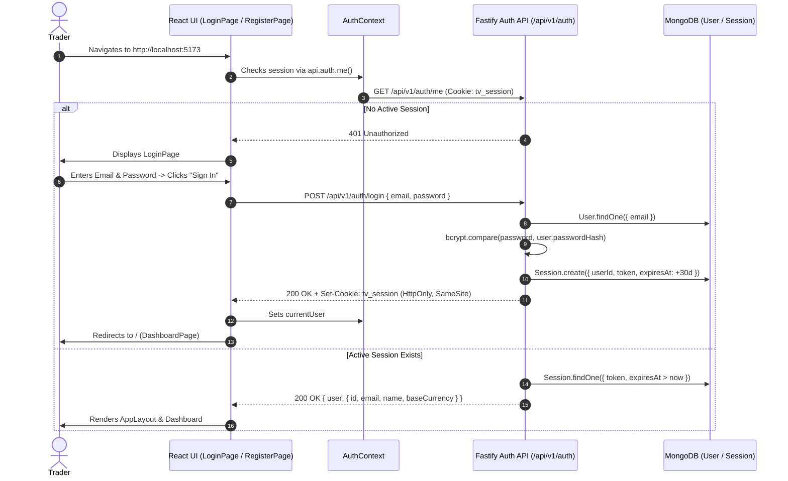
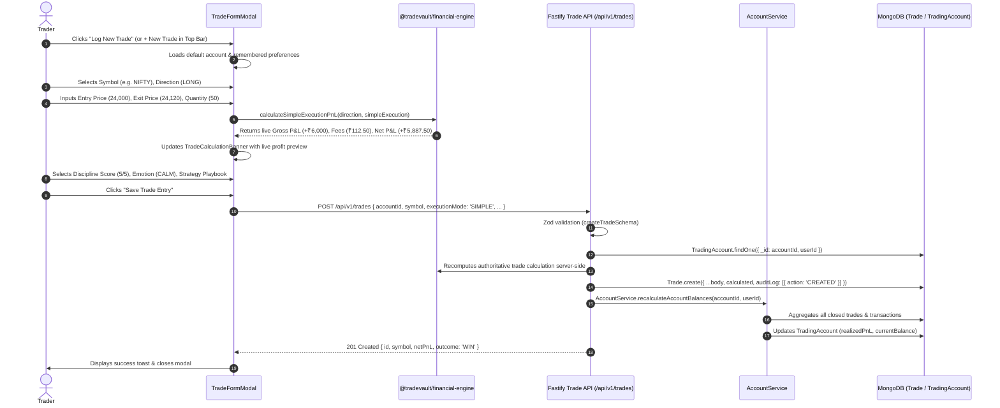
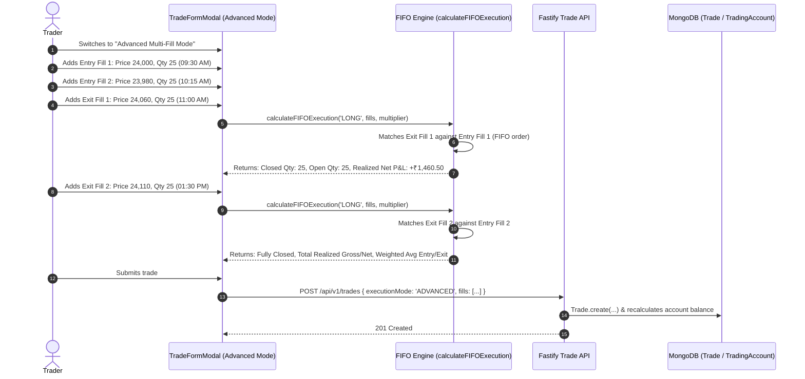
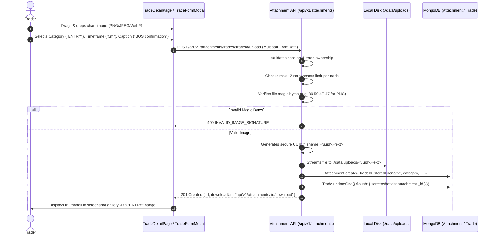
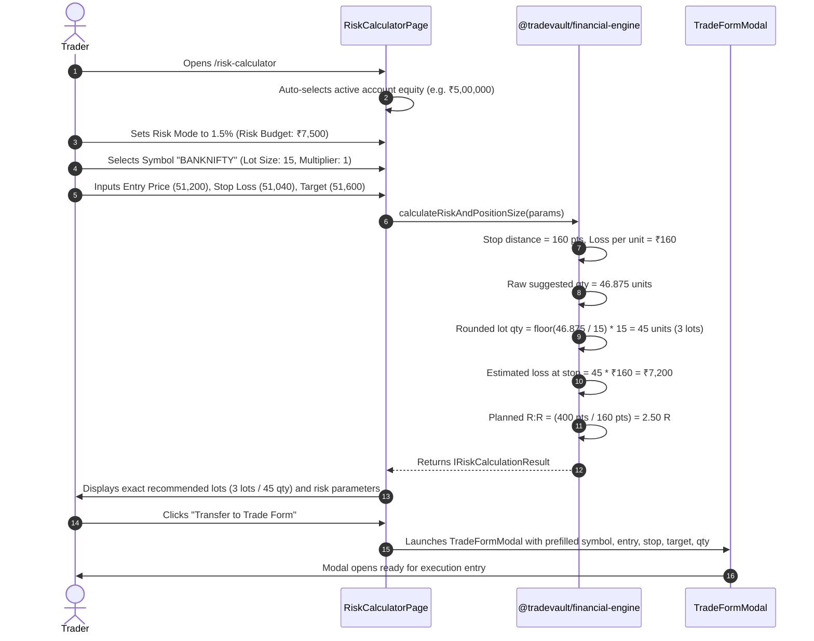
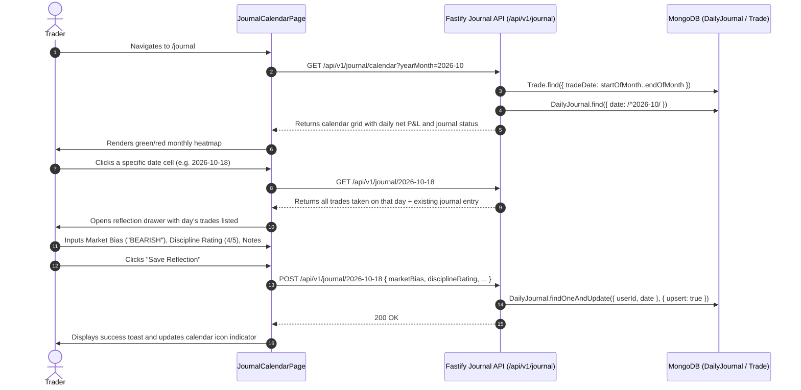
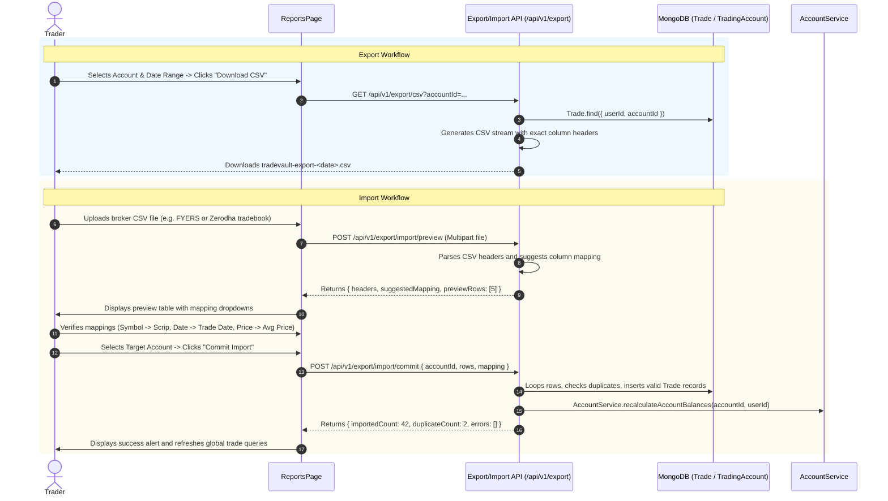

# SetupMint — User Workflows & Sequences

This document provides detailed, end-to-end traces of the primary user workflows in **SetupMint**, illustrating the exact sequence from UI interaction through frontend state, REST API calls, backend validation, business logic, and database persistence.

---

## 1. Authentication & Onboarding Workflow

---

## 2. Express Manual Trade Logging Workflow (Simple Mode)

---

## 3. Advanced Multi-Fill Trade Logging Workflow (FIFO Matching)

---

## 4. Private Chart Screenshot Upload Workflow

---

## 5. Pre-Trade Risk Calculator & Form Transfer Workflow

---

## 6. Daily Journal & Reflection Calendar Workflow

---

## 7. CSV Export & Interactive CSV Import Workflow

---

## 8. Local Backup, Restore & Reconcile Workflows

### A. Backup Flow (`npm run db:backup`)
1. User executes `npm run db:backup` in terminal.
2. Script [`scripts/backup.js`](file:///Users/komal/projects/Trading%20Vault/scripts/backup.js) establishes connection to local MongoDB.
3. Iterates across all database collections (`users`, `tradingaccounts`, `trades`, `instruments`, `strategies`, `dailyjournals`, `attachments`, `brokerintegrations`, `auditlogs`).
4. Serializes each collection to formatted JSON in `./backups/tradevault-backup-<timestamp>/`.
5. Copies all private chart screenshot files from `./data/uploads/` to `./backups/.../uploads/`.
6. Generates `manifest.json` recording timestamp, record counts, and file counts.

### B. Restore Flow (`npm run db:restore`)
1. User executes `npm run db:restore [optional-backup-path]`.
2. Script [`scripts/restore.js`](file:///Users/komal/projects/Trading%20Vault/scripts/restore.js) identifies the latest backup directory in `./backups/`.
3. Connects to MongoDB, cleans existing collections, and repopulates collections from JSON files.
4. Restores screenshot attachments into `./data/uploads/`.
5. Disconnects cleanly.

### C. Reconciliation Flow (`npm run db:reconcile`)
1. User executes `npm run db:reconcile` (or triggers via UI "Reconcile Balance" button).
2. Connects to database and iterates over every trading account.
3. Re-aggregates all closed trade net P&Ls and account transactions (deposits, withdrawals, adjustments).
4. Persists the exact calculated balance back to `TradingAccount.currentBalance` and `realizedPnL`.
