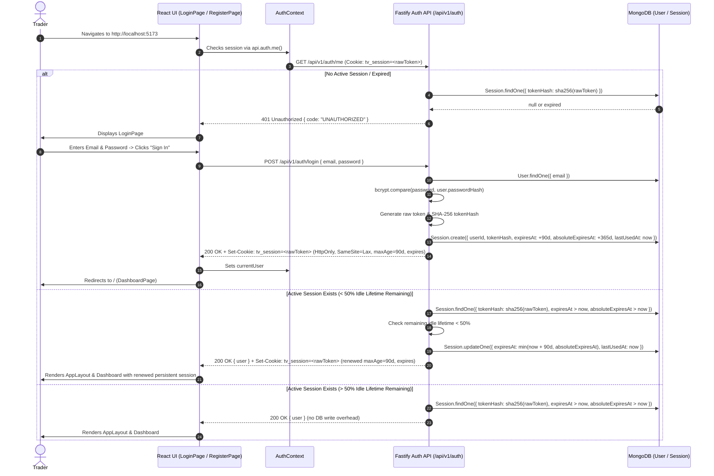
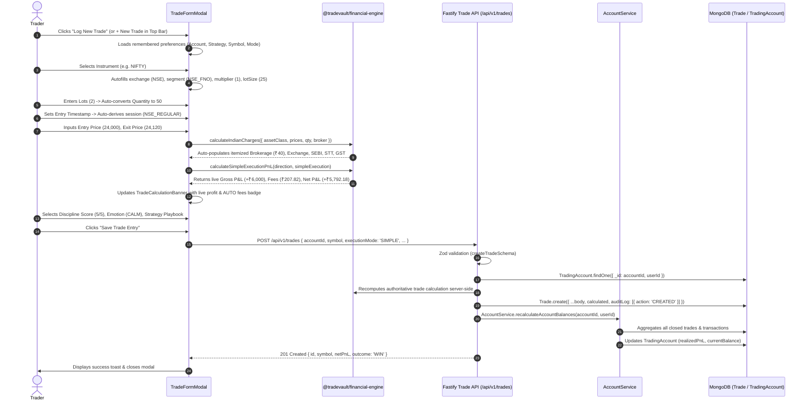
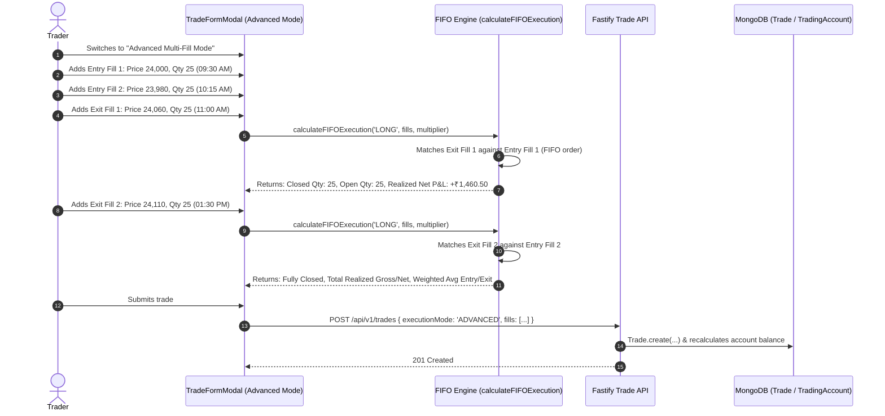
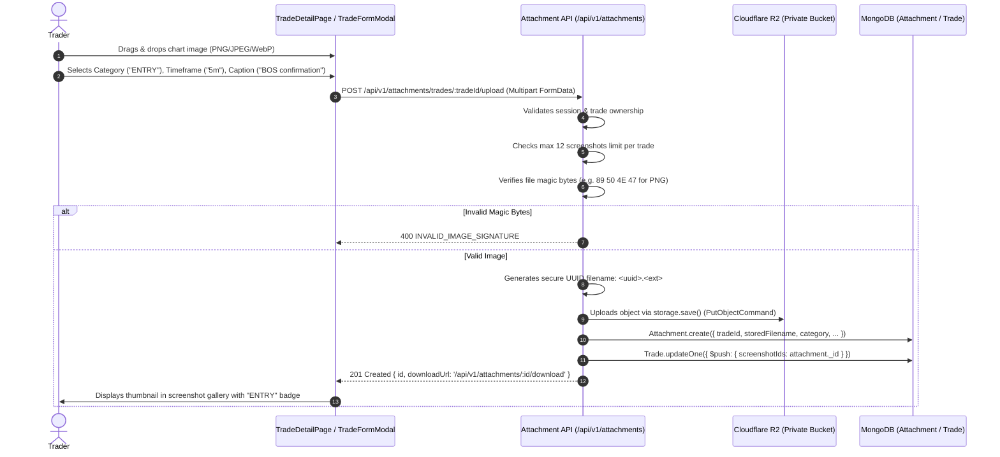
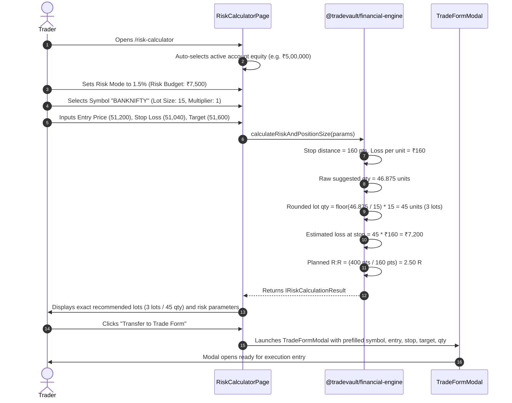
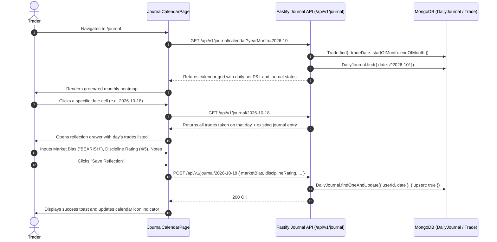
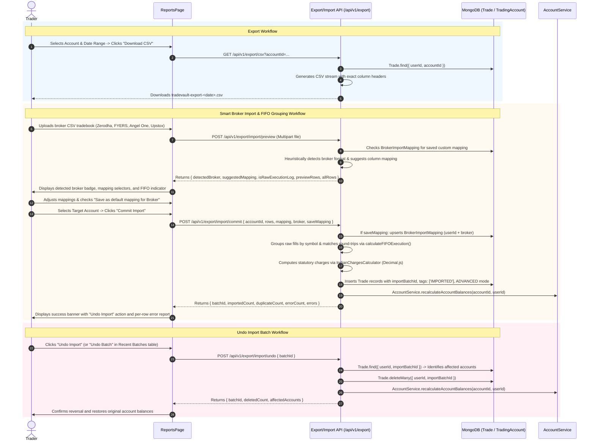
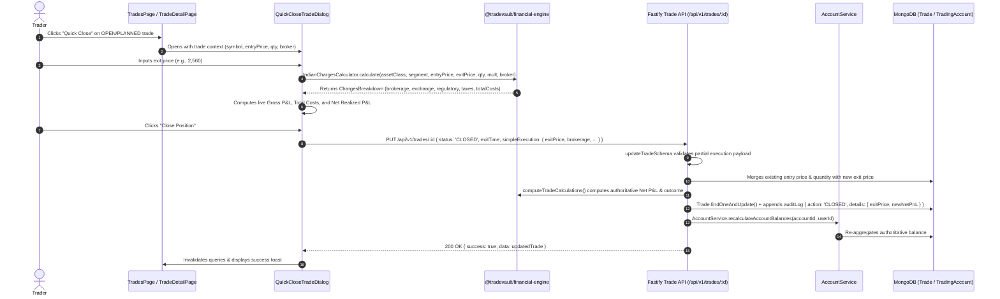
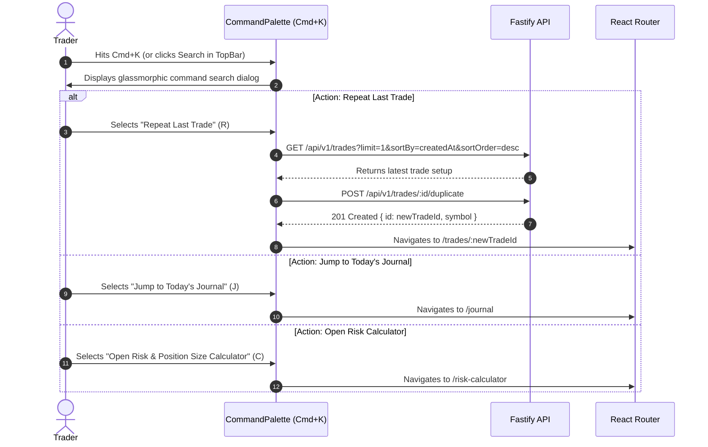
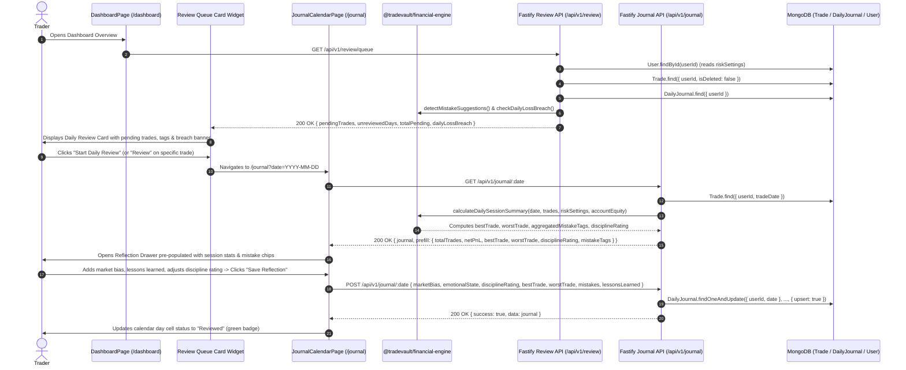

# SetupMint — User Workflows & Sequences

This document provides detailed, end-to-end traces of the primary user workflows in **SetupMint**, illustrating the exact sequence from UI interaction through frontend state, REST API calls, backend validation, business logic, and database persistence.

---

## 1. Authentication & Persistent Sliding Session Workflow

---

## 2. Express Manual Trade Logging Workflow (Simple Mode)

---

## 3. Advanced Multi-Fill Trade Logging Workflow (FIFO Matching)

---

## 4. Private Chart Screenshot Upload Workflow

---

## 5. Pre-Trade Risk Calculator & Form Transfer Workflow

---

## 6. Daily Journal & Reflection Calendar Workflow

---

## 7. CSV Export & Interactive CSV Import Workflow

---

## 8. Cloud Backup, Restore & Reconcile Workflows

### A. Nightly Scheduled Off-Site Backup (`npm run backup:scheduled`)
1. Scheduled via macOS `launchd` LaunchAgent (02:30 AM local) or Linux cron.
2. Acquires local lockfile `backups/.backup.lock` to prevent overlapping runs.
3. Connects to **MongoDB Atlas** (`MONGODB_URI`) and dumps all 19 canonical collections to BSON Extended JSON (EJSON `{ relaxed: false }`).
4. Incrementally syncs screenshots from live **Cloudflare R2** bucket to secondary off-site bucket via server-side S3 `CopyObjectCommand`.
5. Compares record counts against previous backup; flags `SUSPICIOUS` if critical records drop $>10\%$.
6. Compresses into a POSIX ustar `.tar.gz` and encrypts with AES-256-GCM using `BACKUP_ENCRYPTION_KEY`.
7. Uploads to secondary off-site bucket under `daily/` (and on 1st of month under `monthly/`).
8. Verifies upload checksums, applies retention (30 daily + 12 monthly, min 3 kept), updates `backups/status.json`, and mirrors to `status/latest.json`.

### B. Manual Backup Flow (`npm run db:backup`)
1. User executes `npm run db:backup` in terminal (supports `--dry-run`).
2. Connects to MongoDB Atlas and serializes collections to Extended JSON into `./backups/setupmint-backup-<timestamp>/`.
3. Downloads private chart screenshots from Cloudflare R2 into `./backups/.../screenshots/`.
4. Writes `manifest.json` recording collection counts, SHA-256 hashes, and screenshot metadata.

### C. Restore Flow (`npm run db:restore`)
1. User executes `npm run db:restore -- <backup-path-or-enc-file> --yes-i-am-sure`.
2. If encrypted `.enc` archive, decrypts via AES-256-GCM and unpacks into an ephemeral temporary directory.
3. Verifies target database name against `--target-prefix` safety flag (override with `--force-db`).
4. Populates MongoDB Atlas collections and restores screenshot attachments back to Cloudflare R2.
5. Authoritatively re-aggregates account balances via `AccountService.recalculateAccountBalances()`.

### D. Reconciliation Flow (`npm run db:reconcile`)
1. User executes `npm run db:reconcile` (or triggers via UI "Reconcile Balance" button in Settings).
2. Connects to database and iterates over every trading account.
3. Re-aggregates all closed trade net P&Ls and account transactions (deposits, withdrawals, adjustments).
4. Persists the exact calculated balance back to `TradingAccount.currentBalance` and `realizedPnL`.

---

## 9. Fast Entry, Quick Close & Command Palette Workflows

### A. Quick Close Workflow

### B. Command Palette & Quick Re-Entry Workflow

---

## 10. Daily Review Queue & End-of-Day Journal Reflection Workflow

